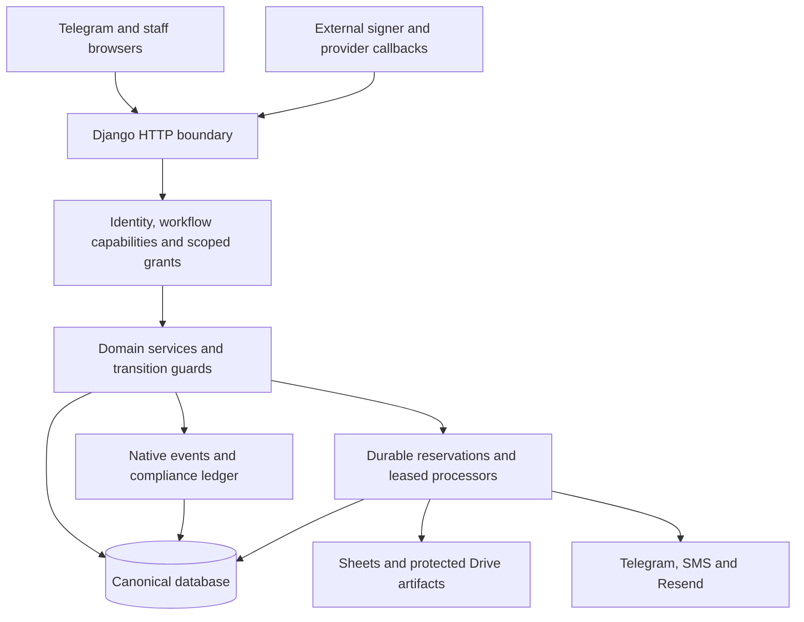
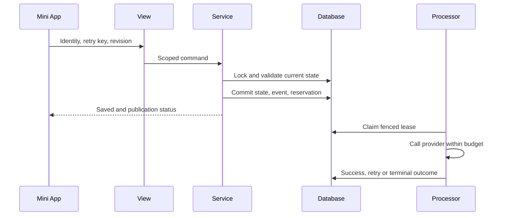
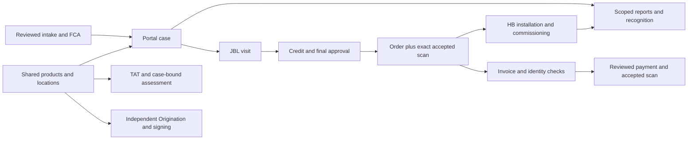
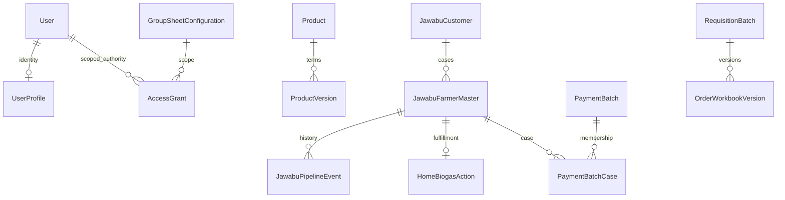
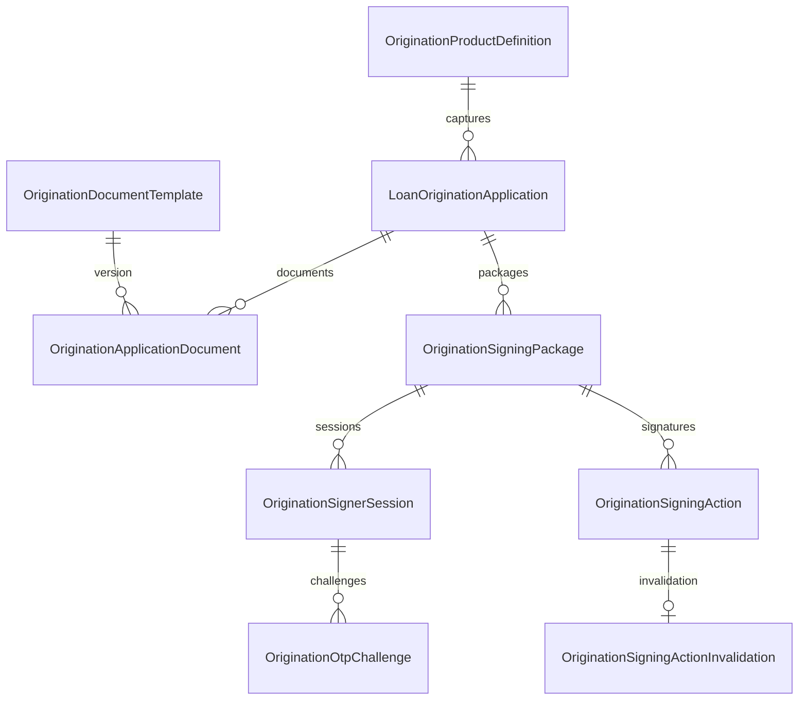
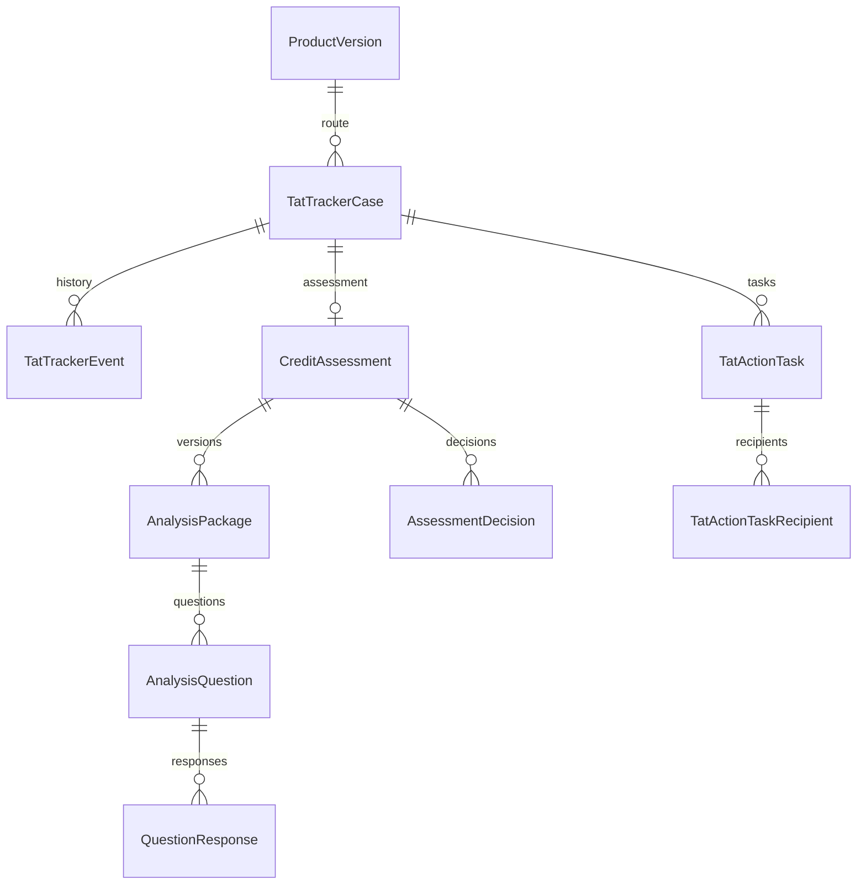

# JBL/Jawabu HomeBiogas — Codebase Knowledge

Analysis date: **19 October 2026**. Source baseline: **`f9b1e8a97cf98b1e6c79927bd0ee7ce46c2ddcc2`**. This document describes checked-in source, not an inspected production deployment.

## How to use this document

Start with the high-level overview, find the owning workflow in the feature catalogue, then follow its service, model and test references. Read **Things You Must Know Before Changing Code** before modifying behavior. The deep reference explains request contracts, schema ownership, verification and safe change procedures.

Every source path is relative to the repository root. `[[F:path#start-end#hash8]]` identifies an inspected source range; HASH8 is the first eight hexadecimal characters of SHA-256 over the exact file bytes. A changed hash requires re-reading that source. The static inventories index more files than were read in depth; a symbol's presence does not prove that its implementation is reachable.

All analysis artifacts are under `codebase-analysis-docs/`:

| Artifact | Purpose |
|---|---|
| `codebase-analysis-docs/assets/FILE_INDEX.md` | Ranked file inventory: priority, path, type, line count, exact-byte hash and static incoming-import count. First 50 entries are the continuation file map. |
| `codebase-analysis-docs/assets/SOURCE_INDEX.json` | Machine-readable source snapshot and classification metadata. |
| `codebase-analysis-docs/assets/MODULE_REFERENCE.md` | Python module discovery map, source summaries and public declarations. Historical docstrings are explicitly not runtime evidence. |
| `codebase-analysis-docs/assets/SYMBOL_INDEX.json` | 5,178 top-level class/function declarations, method locations and static imports. |
| `codebase-analysis-docs/assets/MODEL_REFERENCE.md` | Declared model fields, relations, options, constraints, indexes and nested choices. |
| `codebase-analysis-docs/assets/MODEL_INDEX.json` | Machine-readable model declarations. |
| `codebase-analysis-docs/assets/DATABASE_DOMAINS.md` | Domain, purpose, authority, lifecycle, physical table and parent map from the checked-in governed catalogue. Its freshness limitation is recorded below. |
| `codebase-analysis-docs/assets/ROUTE_REFERENCE.md` | Local route patterns, views and URL names; apply the mounts described below. |
| `codebase-analysis-docs/assets/ROUTE_INDEX.json` | Machine-readable route declarations; not OpenAPI. |
| `codebase-analysis-docs/assets/SETTING_INDEX.json` | Environment variable names, source lines and casts; intentionally excludes configured values. |
| `codebase-analysis-docs/assets/TEST_REFERENCE.md` | Python test classes and methods for finding behavioral evidence. |
| `codebase-analysis-docs/assets/ANALYSIS_STATE.md` | Phase checkpoints, unresolved questions and continuation state. |
| `codebase-analysis-docs/assets/build_source_inventory.py` | Standard-library-only static inventory builder and bounded source reader; imports no Django code and contacts no provider. |
| `codebase-analysis-docs/assets/validate_analysis.py` | Read-only validation of source hashes/ranges, explicit repository paths, inventory continuity, required master sections and compact diagrams. |

The index contains **1,455 existing tracked files**, including **264 repository migration files**, **248 test-classified files**, **16 vendor-classified files**, **215 declared model classes**, **392 route declarations** and **176 direct settings lookups**. These categories are heuristic: for example, abstract classes and compatibility declarations affect counts. Django's loaded catalogue contains **209 application-table entries**; the validated migration graph contains **271 migrations**, including framework migrations. These numbers measure different things.

**Decisions/Findings:** use this as a navigation and invariant guide, with code/tests as authority. **Open Questions:** deployed settings, applied migrations, staff grants, data volumes and provider health were not queried. **Next Steps:** refresh inventories and source anchors when the baseline changes.

## Part I — High-Level Overview

### 1. Business purpose and users

This is a Django operational workflow platform for **JBL/Jawabu Biashara Limited**, a Kenyan credit-only microfinance institution, and its HomeBiogas financing/fulfilment operations. It coordinates staff work from customer intake and field visits through credit/final review, orders, invoice identity verification, payments, installation and commissioning. Separate applications manage loan origination and signing, TAT measurement, complaints, reporting and staff access.

Telegram supplies signed Mini App identity, launch links, selected message/file ingestion and operational notifications. Django stores canonical workflow state, immutable or append-oriented evidence and authorization. Google Sheets publishes operational registers; Google Drive retains protected media and documents. Sheets is not a second workflow database.

The users include field/JBL officers and BROs, credit analysts, branch managers, Operations Administrators, Head of Rural, HomeBiogas staff, scoped IT staff, access-control checkers and technical Superusers. These are distinct roles, not aliases for Django `is_staff`. The same person may need separate grants in different workflows. See `core/services/access_policies.py`, `core/services/workflow_capabilities.py`, `core/services/telegram_identity.py::user_access` and `origination/auth.py`.

### 2. Feature map and current reachability

| Feature family | Business purpose | Current implementation boundary |
|---|---|---|
| Complaint Cases | Shared intake, customer issue resolution, evidence, response timing and management registers | Mini App intake is current. Telegram complaint intake and complaint batch imports return retirement messages; retained parsers/models support compatibility/history. |
| Jawabu/FarmUp/SysUp/FCA | Import and reconcile field/customer information with explicit staff review | Reviewed canonical commits, source retention, identity/provenance controls and separate publication/archive status. |
| Portal pipeline | Move a case through visits, analyst review and Head of Rural approval | Server-owned transitions, revision guards, independent approval evidence and scoped queues. |
| Requisitions | Prepare official orders and retain each workbook version | UUID workspace identity; group/partner number allocator; exact accepted signed scan establishes finality. |
| Invoices and identity corrections | Link supplier evidence to the correct legal applicant before payment | PDF intake, explicit matching, national-ID-led checks, household links, correction letters and signed agreements. |
| Payments | Prepare and review grouped payments without losing per-case accountability | Per-case payment modes and fact-bound Head of Rural review; workbook generation allocates the number; accepted scan completes finality. |
| HB Action | Track post-order installation and commissioning | Bounded `hb_operations` app; released only from an accepted requisition sign-off. |
| SPIN | Legacy CRB/credit request submission and analyst completion | Available unless `SPIN_HARD_CUTOVER` closes its surfaces. It is distinct from TAT credit assessment. |
| TAT | Track loan-cycle work, responsibility, timing, targets, tasks and recognition | Versioned product routes; frozen requested-amount path; separate routing, capabilities and notification state. |
| TAT credit assessment | Bind statement, appraisal, analyst questions/responses and BM decisions to one TAT case | Bounded `credit_assessments`; HTTP/mailbox behavior is gated by `CREDIT_ASSESSMENT_GMAIL_ENABLED`. |
| Loan Origination | Capture product-specific applications and exact documents, signatures and approvals | Independent `origination` app and grants, captured configuration, verified signing and immutable packet bytes. |
| Product/location catalogues | Apply consistent terms, availability, requirements and geography | Shared stable identities plus governed versions/aliases; workflow snapshots preserve history. |
| Reporting/recognition/email | Give managers scoped operational and performance evidence | Allowlisted reporting, separately scored standings, approved recipients and durable deliveries. |
| Staff/access governance | Maintain identity, grants, routing, leave/offboarding and audit evidence | Staff lifecycle, checker-reviewed access requests, activation and explicit hard-deletion controls. |
| QA tracker/Design Lab | Retain human release checks and compare synthetic UI patterns | Internal admin tools; Design Lab is disabled by default and Superuser-only. |
| Order Approval Mini App | Historical order approval and media capture | Archived: `ORDER_APPROVAL_WEBAPP_ENABLED = False` is code-fixed. Its Drive/storage utilities still serve active workflows. |

Reachability evidence: `config/settings.py` around `SPIN_HARD_CUTOVER` and `ORDER_APPROVAL_WEBAPP_ENABLED`; `core/api/views.py::_spin_cutover_response`; `core/api/views.py::_process_telegram_message`; `core/services/complaint_imports.py::reserve_complaint_import_batch`; `credit_assessments/views.py`. Do not activate retained historical code just because it remains large or well tested.

### 3. Stack and repository organization

| Layer | Source-confirmed implementation |
|---|---|
| Runtime | Python `>=3.12,<3.13`; Django `5.2.17`. `requirements.txt` is the deployment manifest; `pyproject.toml` mirrors 27 direct dependencies. |
| HTTP serving | WSGI/Gunicorn, WhiteNoise, Django templates and middleware. `start.sh` starts Gunicorn with two threads and a 120-second timeout. |
| Database | `dj-database-url`; SQLite default for local work, PostgreSQL adapter `psycopg[binary]`; explicit PostgreSQL test profile. |
| Browser | Django-rendered HTML, HTMX and small JavaScript utilities; Node is development/verification tooling, not a production frontend server. |
| UI libraries | Checked-in Chart.js, HTMX, Lucide, Leaflet and AG Grid Community assets/licenses. Preserve the vendored model. |
| Integration | `requests`, gspread, Google auth/API client, Africa's Talking, provider-specific SMS adapters and Resend HTTP adapter. |
| Files | openpyxl, Pillow, pypdf, ReportLab, WeasyPrint and pypdfium2. These perform different spreadsheet/PDF/image jobs. |
| Operations | Django Unfold Admin, django-health-check, Sentry SDK, leased database work and explicit management commands. |
| Tests | Django tests, coverage, narrow Ruff correctness rules, Node tests and Playwright Chromium contracts. |

The architecture is a **modular monolith with incremental bounded-domain extraction**. `core/models.py` is 7,426 lines; `core/api/portal_views.py` is 10,132 lines; `core/admin.py` is 9,160 lines at the baseline. These are high-coupling boundaries, not a recommendation to add more business logic there. Django REST Framework is pinned, but the inspected workflow boundaries principally use Django views and `JsonResponse`; do not assume a serializer/viewset architecture from dependency presence.

Local installed apps are `core`, `origination`, `requisitions`, `payments`, `credit_assessments`, `hb_operations`, `qa_tracker`, `tat_recognition`, `portal_recognition`, `report_delivery` and `ui_review`. `config/` owns settings/routing/WSGI; `scripts/` owns governance and diagnostic tools; `docs/adr/`, `docs/runbooks/` and `docs/database/` retain design and operational references. Existing root Markdown contains historical claims and must be checked against code.

**Decisions/Findings:** preserve the monolith's service boundaries and distinguish retired, gated and active behavior. **Open Questions:** actual deployment flags and volumes are unknown. **Next Steps:** select a workflow below before locating routes/tests or proposing extraction.

## Part II — Mid-Level Technical Notes

### 4. Architecture, entry points and data flow



Diagram source: `codebase-analysis-docs/assets/architecture.mmd`. The compact diagram is a logical map; some existing services still perform bounded synchronous provider work. Durable reservations do not by themselves imply a permanently running queue worker.

#### HTTP mounts and compatibility

- `manage.py::main` selects `config.settings` and Django commands; `config/wsgi.py` exposes the WSGI application.
- `config/urls.py` mounts `/api/` to `core.api.urls`; that module includes Origination API routing. Root browser/Mini App pages come from `core/api/browser_urls.py`.
- Root pages include `/apps/`, `/staff/activate/`, `/complaints/`, `/tat-tracker/`, `/spin/`, `/portal/`, `/origination/`, compact signer `/s/` and the explicit farmer/FCA review pages.
- `/admin/` is Django Admin; `/ops/health/` mounts django-health-check; `/health/` and `/api/health/` are application health routes. Readiness is separate from liveness.
- `/ui-lab/` mounts `ui_review.urls`; the feature gate and Superuser check still apply.
- `core/api/legacy_urls.py` retains individually declared direct aliases for old authentication/webhook/signing callers. API-to-browser GET redirects use `legacy_get_redirect`; POST compatibility must preserve payload/credentials.

#### Telegram ingestion

`core/api/views.py::telegram_webhook` checks size, JSON/payload shape and the configured webhook secret using constant-time comparison. It accepts `message` and `channel_post`, handles staff joins and dispatches to `_process_telegram_message`, then formats a reply. Unsupported update types are acknowledged as ignored. Authentication here is the webhook transport secret; Mini App `initData` is a different boundary.

`_process_telegram_message` derives group, sender, source message, timestamp and tagged content, resolves `GroupRegistry`, and dispatches commands/workflows. Different workflows require tags and commands differently. Complaint new intake is rejected with a Mini App redirect message. Historical generic parsing runs through `_process_single_message` → `storage.process_and_store_message` → parser/deduplication/persistence/publication. Do not equate that retained helper with an active complaint-intake route.

`RawMessage` → `ProcessedMessage` → `ParsedMessage` separates original input, processing/dedup status and extracted fields. Case/event/evidence records add workflow-specific history. A database transaction can roll back rejected work; inspect decorators and error handling rather than inferring persistence from the helper name.

Evidence: [[F:core/api/views.py#3008-3094#51b0b379]], [[F:core/api/views.py#3170-3300#51b0b379]], [[F:core/api/views.py#3495-3548#51b0b379]], [[F:core/services/storage.py#152-275#5cdcf66a]].

#### Mini App writes and publication



For Portal, `reserve_farmer_publication` keys an operation by farmer UUID, workflow revision and target; execution reads fresh canonical state. `attempt_publication` respects retry times and destination/FIFO constraints and supersedes stale revisions or destinations instead of publishing old values. Request-assisted pumping and `drain_portal_publications` provide execution opportunities. A successful local save with pending publication must remain a successful local save.

`external_resilience.reserve_operation` and `execute_operation` provide durable attempt counts, payload digests, retry/circuit state and attempt-token fencing. Another worker's live lease produces a safe no-op. Exhausted work requires the owning workflow's reviewed retry action. Not every historical path uses exactly this orchestration; verify its caller before copying it.

Evidence: [[F:core/services/portal_publication.py#166-215#c6bbef05]], [[F:core/services/external_resilience.py#345-424#1e02778c]].

**Decisions/Findings:** canonical state, event evidence and external publication are separate outcomes. **Open Questions:** whether production schedulers are running cannot be inferred from command availability. **Next Steps:** trace both the local transaction and its downstream execution path when debugging a missing register/file/notification.

### 5. Cross-cutting integrity and security

#### Identity and authorization

`core/services/telegram_identity.py::validate_telegram_init_data` canonicalizes signed query fields, derives the Telegram HMAC key, compares signatures in constant time, validates `auth_date`, and requires a user ID. Maximum accepted age is bounded to 1–86,400 seconds; future timestamps are rejected. `core/services/telegram_auth.py` preserves a legacy tuple-return adapter; new identity work should use the canonical module.

`resolve_or_bind_telegram_user` resolves an active user by immutable Telegram ID. Binding an enrolled username happens under a row lock, honors required single-use activation proof, rejects duplicate binding and records special Superuser-binding audit evidence. A mutable username is not perpetual identity authority. `TelegramMiniAppBackend` supports Django authentication from this signed payload.

`user_access` reads current active workflow grants and unexpired emergency grants. Django Groups and `is_staff` do not grant Mini App roles. An active Django Superuser has the explicit break-glass override; IT still needs a real grant and keeps its group/branch/product limits.

`workflow_access.matching_capability_grants` evaluates **one complete tuple**: workflow, allowed role, branch, product and group. It does not combine a role from one grant with a wider scope from another. `scope_workflow_queryset` ORs complete authorized clauses and rejects scoped grants when the queryset cannot express the required dimension. The returned convenience `roles`, `branches` and `products` lists are not sufficient authorization evidence.

Some lower-level shared helpers accept `access=None` as permissive local/test context. That is an internal contract, not safe behavior for a new production caller. Authenticate and construct the actual access object before calling them. Origination's `origination_auth_required` additionally rejects missing/unauthorized Origination access even when local auth validation is bypassed.

Evidence: [[F:core/services/telegram_identity.py#46-107#9239d523]]. The authoritative named implementations are `validate_telegram_init_data`, `resolve_or_bind_telegram_user`, `user_access`, `workflow_access_decision` and `scope_workflow_queryset`.

#### Retry identity, concurrency and state

- `miniapp_requests.resolve_miniapp_request_identity` accepts `Idempotency-Key`, then `X-Request-ID`, then `client_request_id`/`create_request_id`. Conflicting headers are rejected. Keys match a bounded 8–128-character pattern. Domain `request_id` is deliberately not a universal transport alias.
- `bind_miniapp_request_identity` places the canonical key on the request and overwrites unambiguous `client_request_id` in the payload. This is binding, **not a universal response cache or business duplicate guard**.
- Strict mode (`REQUIRE_MINIAPP_IDEMPOTENCY_KEY`) rejects missing keys with HTTP 428; malformed/conflicting keys return 400. Legacy writes receive response metadata and anonymous daily counts while compatibility remains enabled.
- Services retain unique constraints, request/payload binding and replay receipts. Several compare replay before the now-changed revision so a valid retry returns its earlier result. Changed-payload reuse must follow that workflow's existing rejection behavior.
- `workflow_transitions` validates positive expected revisions and raises typed missing/conflict errors. Lock the current record before comparing; a prior view lookup is not a concurrency guard. Complaint, payment, HB and Origination records also have their own revision fields/contracts.

#### Audit, files and privacy

Native workflow events retain operational detail. `compliance_audit.record_event` adds immutable cross-workflow evidence with deterministic payload hashing, a locked chain position, previous hash and integrity hash; checkpoints supplement verification. The ledger does not replace business event tables. Actor/authority identity and request correlation matter when delegated or technical authority is used.

Uploads require count/size/content checks before parsing, safe storage naming and protected retrieval. `jawabu_media_access` audits Portal evidence access; `secure_media_preview` and invoice/PDF helpers provide controlled previews. The presence of a Drive URL does not authorize disclosure. Never place signed initData, bearer links, OTPs, passcodes or full customer data in diagnostics, logs or examples.

`request_throttling` stores keyed identity/network digests for focused public boundaries; it deliberately excludes Telegram webhook retry throttling. `miniapp_messages` and the shared client message contract provide stable user messages and support references. `core/api/validators.py::error_response` logs technical details rather than returning them. The webhook still logs a short invalid body fragment; inspect privacy implications before reusing that logging pattern.

#### UI, cache and observability

`config/settings.py` installs security, sessions, CSRF, authentication, HTMX, WhiteNoise and `MiniAppFramePolicyMiddleware`. The framing middleware permits only allowlisted HTML views in Telegram Web and preserves API authentication. Cookie-authenticated unsafe requests still need CSRF; exemptions must have their own non-cookie verifier.

`core/static/miniapp/utils.js`, `base.css`, `components.js`/`.css` and diagnostics/runtime helpers supply shared themes, messages, close protection and interaction primitives. Portal top-level navigation remains server page loads; `portal_case_navigation.js` retains a bounded in-memory case-inspection detour. Field-only recovery drafts use `miniapp_drafts`; attachments are not drafts.

`GroupRegistry` has a process-local singleton, initial settings mappings and admin-managed overrides; exact admin configuration is refreshed on lookup. `workflow_capabilities.capability_definitions` uses a process-local `lru_cache`, including configured TAT stages. These caches are not a distributed authority store. Access-policy changes must update the policy version and invalidate/refresh relevant clients/catalogues through existing services.

Sentry initialization is optional and centralized in `core/apps.py`/`core/sentry_monitoring.py`. First-party diagnostics use bounded lifecycle signals and aggregates, not session replay/customer payload capture. Logs, readiness, integration operations and runner heartbeats answer different questions; no single green health endpoint proves a provider write succeeded.

**Decisions/Findings:** identity, capability, scope, state, retry key and evidence each solve a separate problem. **Open Questions:** production enforcement flags and retained client versions are unknown. **Next Steps:** preserve allowed, denied, stale, duplicate and partial-failure contracts at the narrowest boundary.

### 6. Feature-by-feature catalogue

#### 6.1 Complaint Cases, resolution and management register

**Purpose.** Let approved staff capture complete customer issues, allow HB resolvers to respond/resolve, and give management a consistent register and response-time view.

**Entry and ownership.** `/complaints/` renders the Mini App. `core/api/complaint_case_views.py` exposes bootstrap, scoped lists/fragments, create/detail/update, complete-details, resolve/comment/reopen, evidence access, retry and organization-wide overview/export endpoints. Business rules live in `core/services/complaint_cases.py`, `core/services/complaint_register.py`, `core/services/complaint_timing.py`, `core/services/complaint_publication.py` and recovery helpers.

**Persistence.** `ParsedMessage` is the legacy case aggregate; `ComplaintCaseControl` supplies governed reference, revision, category/location/customer links and intake metadata. `CaseUpdate`, `ComplaintCaseEvent` and `ComplaintCaseEvidence` retain history/files. `ComplaintCaseSequence` provides staff references such as `CMP-1`; legacy references remain unchanged. UUID, Telegram source ID, internal case ID and displayed reference are not interchangeable.

**Behavior.** `create_complaint_case` checks capability and request identity, validates required fields, resolves governed categories and active locations, checks branch creation scope, then creates raw/processed/parsed/control/history records atomically. Both primary Kenyan phone and digits-only National ID are required; secondary phone must be valid and distinct. Category inference is advisory and token-bound; it does not authorize a category change. Creation can report deferred publication, with `finish_created_case` handling remaining work.

`update_case` validates a request-bound replay and expected control revision before applying a transition. Evidence has its own validation/storage outcome. Case work is shared within the configured complaint group; the code deliberately avoids making a visible group case impossible to resolve/reopen merely because of a branch-scoped grant. Creation scope and list/transition scope must be traced separately.

**Roles and edge cases.** Current HB resolution requires a Complaint Cases `HB_STAFF` grant; Portal HB access grants nothing here. A resolution comment is append-only feedback on an open case, not resolution or SLA reset. `complete_review_details` repairs historical `Review Needed` records under revision/audit controls. Do not introduce incomplete new intake to emulate those historical rows. Organization-wide management exports use an allowlisted projection rather than dumping every field.

**Retirement.** Telegram message intake and WhatsApp complaint batch imports are closed at the dispatch/service boundary. `reserve_complaint_import_batch` explicitly raises; claim/runner helpers do no work. Archived batch/item evidence is retained. Test old parsers as compatibility code without documenting them as staff-supported intake.

Evidence: [[F:core/services/complaint_cases.py#481-560#7e511e81]], [[F:core/services/complaint_cases.py#663-745#7e511e81]], [[F:core/services/complaint_cases.py#850-925#7e511e81]], [[F:core/services/complaint_imports.py#89-105#ac87c31e]]. Tests: `core/tests_complaint_cases.py`, complaint-specific suites discoverable in `TEST_REFERENCE.md`.

**Decisions/Findings:** Mini App intake is current; historical import code is retained but retired. **Open Questions:** configured complaint categories/projection policy are deployment data. **Next Steps:** preserve references, revision/retry checks, HB-only closure, separate comments and evidence failures.

#### 6.2 Customer identity, FarmUp, SysUp and FCA

**Purpose.** Bring field and system information into one auditable customer/case model while requiring a reviewer to reconcile ambiguities.

**Entry and services.** Telegram command routing and Portal Imports lead to `core/services/jawabu.py`, `core/services/jawabu_master.py`, `core/services/portal_imports.py`, `core/services/system_export.py`, `core/services/sysup_review.py` and `core/services/fca.py`. Farmer/FCA review pages have explicit signed review-token contracts. Portal imports also require current workflow capability/group scope; a valid token is not blanket authority for arbitrary cases.

**Persistence.** `JawabuCustomer` is a shared legal identity; `JawabuFarmerMaster` is an operational case/unit, not a synonym for a person. `JawabuVisitRecord`, `FcaImportRecord` and `JawabuFarmerUploadBatch` preserve intake/review facts. `JawabuCustomerPhoneHistory`, `JawabuCustomerFieldProvenance`, quality issues and resolutions make identity correction traceable.

**FarmUp.** Monthly group worklists keep immutable CSV versions and cumulative reconciliation. `commit_portal_farmup` locks the batch, checks exact replay payload, merges submitted rows, validates a revision token and checks existing database matches. Ambiguous identities block; material updates require acknowledgement; unchanged committed rows become `already_committed`; unselected rows remain held. Canonical commit uses `commit_farmup_review_batch(... defer_sheet_sync=True)`; Drive source archive and Sheet publication are separate outcomes.

**SysUp.** `sysup_review.commit_review` checks actor/request replay, upload revision, source-row fingerprints and selected case revisions, locks cases in stable order, authorizes each matched case and permits only allowlisted field choices/corrections. `Keep Portal` vs `Use SysUp` is explicit. It is not uncontrolled bidirectional sheet synchronization. Empty source values preserve existing values through the importer contract.

**FCA.** `core/services/fca.py` parses/reviews field-control workbooks and commits selected normalized records into the Jawabu domain. Preserve source/group/message identifiers, duplicate handling, controlled product/location resolution and the existing review-token flow. FCA sheet formats and canonical case progression are different contracts.

**Identity rules.** Exact identifiers may establish automatic matches; names are review candidates. Never merge customers solely by name/phone similarity or equate household people. Product/location mapping issues are reviewable exceptions. Use shared normalization in `core/services/identifiers.py` and quality services.

Evidence: [[F:core/services/portal_imports.py#1081-1155#e9185968]]; `core/services/sysup_review.py::commit_review`; `core/services/jawabu_customer_quality.py`; `core/services/jawabu_data_quality.py`. Tests: `core/tests_portal_imports.py`, `core/tests_system_export.py`, `core/tests_jawabu_data_quality.py`, `core/tests_pipeline.py`.

**Decisions/Findings:** reviewed imports can commit canonical data; archival/publication success is independent. **Open Questions:** current worklist mappings and source formats are runtime configuration/input. **Next Steps:** trace source fingerprint → reviewer choice → canonical event → publication operation when debugging reconciliation.

#### 6.3 Portal visits, credit and final approval

**Purpose.** Coordinate a case through field evidence, analyst review and final lending approval before order preparation.

**Entry.** `/portal/`, `/portal/s/<screen>/` and case-history routes render scoped workspaces. `core/api/portal_views.py` authenticates and maps requests through action/capability policy. `core/services/portal_navigation.py` supplies server-owned navigation; `core/services/portal_dashboard.py` supplies action queues. Services in `core/services/jawabu_pipeline.py`, `core/services/jawabu_approvals.py`, `core/services/jawabu_case360.py` and `core/services/workflow_timeline.py` own transitions, approval evidence, history and timing.

**State.** `JawabuWorkflowState`, `current_workflow_state` and `_advance_state` govern cases. Forward progression is visit → credit → final review → order, with rejection, deferral, rework and approval rechecks. Events retain actor, request ID, from/to state and revision. A visible status string alone is not proof of effective approval.

**Visit completion.** `complete_jbl_visit` validates the whole multipart batch, collates front/back ID and LAF captures via `jbl_visit_documents`, checks location/revision and required forward evidence before Drive work, and reuses content hashes on retries. Evidence can be saved while the final transition fails; the response distinguishes `evidence_saved` from visit completion. Do not repeat an upload blindly after an uncertain mobile response.

**Credit.** `set_credit_decision` locks the case, replays completed requests, checks revision/current stage and deferral expiry, validates product evidence/custom fields and requires an IMAB-created customer with digits-only customer number for Approved progression. Negative decisions preserve existing IMAB identity. Approval/exception paths and terminal/deferral paths are deliberately different.

**Final review.** `set_final_decision` checks a logged visit, analyst completion, IMAB identity and effective credit approval, then validates repayment day/tenor and product requirements. Head of Rural is the `BUSINESS_ADMIN` role; Operations Administrator cannot inherit that approval power. Portal conditional approval submissions are rejected; historical approval-condition models remain readable.

**Shared behavior.** Append-only comments are separate from transitions. Scoped delegations, material-field invalidation, approval expiry, reappraisal and maintenance restrictions must survive changes. Drafts retain only supported fields and current owner/context, not attachments. Historical TAT/timeline projections must remain consistent with corrected events.

Evidence: [[F:core/services/jawabu_pipeline.py#855-960#cc7d79ee]], [[F:core/services/jawabu_pipeline.py#1070-1170#cc7d79ee]], [[F:core/services/jawabu_pipeline.py#1240-1320#cc7d79ee]], [[F:core/api/portal_views.py#4941-4995#3baca246]]. Tests: `core/tests_pipeline.py`, `core/tests_portal_approval_controls.py`, `core/tests_portal_engineering.py` and focused visit/media suites in the test inventory.

**Decisions/Findings:** require effective audited gates, not just status labels. **Open Questions:** production approval policies and deferral data were not inspected. **Next Steps:** test forward, negative, rework, stale, duplicate and evidence-retained failure paths together.

#### 6.4 Requisitions, number allocation and physical sign-off

**Purpose.** Convert approved cases into official orders whose identity, contents and signed authorization remain provable.

**Ownership.** Portal requisition endpoints call `core/services/requisition.py` for workbook generation and the governed order/sequence flow in Portal/domain services. `RequisitionBatch` remains in `core`; the `requisitions` app owns `OrderSequenceState`, `OrderSequenceEvent`, `OrderNumberClaim`, `OrderWorkbookVersion` and `OrderWorkspaceEvent`. `core/services/document_signoffs.py` owns physical signed-scan submission and acceptance integration.

**Numbers and versions.** The allocator is scoped by group and fulfilment partner (`HB` or `ECOCONSERVE`). The printed HB/ECO number is a display reference; the workspace UUID is identity. Preview must not consume a number. An explicitly cancelled unsigned workspace may release its claim; the allocator uses the lowest released non-retired slot before the forward counter and never rewinds the sequence. Historical/untracked evidence does not automatically create a reusable slot. Testing deletion retires numbers rather than releasing them.

`requisitions.services.resolve_order` accepts UUID identity and rejects ambiguous historical number-only references. `order_for_farmer` uses the exact stored batch link or constrained historical membership/date checks; it never picks the newest user of a reused number. An unsigned amendment must satisfy the same group/partner/request-date contract. Each workbook version is retained, and a stale upload must not publish over a newer version.

**Physical sign-off.** `submit_physical_signoff` checks attestation capability, validates file bytes, locks the source artifact and binds the request to actor, document type, UUID, source checksum and scan checksum. The source workbook and signed scan have different hashes by design: printing/signing/scanning changes bytes. Staff attestation binds the scan to the exact source version; this is not automated handwriting verification. Approved signed evidence is immutable. Failed/pending uploads are retried through `retry_physical_signoff`; rejected attempts retain evidence.

**Cross-feature handoff.** Accepted exact-version requisition sign-off locks the order and releases its cases to HB Action. Drive upload is publication/storage, not the source of numbering or approval truth. Read `docs/adr/0039-unsigned-finance-workspaces.md` before changing amendment, cancellation, number reuse or rollback.

Evidence: [[F:core/services/document_signoffs.py#341-439#246be3fb]]; `requisitions/services.py::resolve_order`, `proposed_number`, `cancel_order`; `core/models.py::RequisitionBatch`. Tests: `requisitions/tests.py`, `requisitions/tests_operations_api.py` and physical-signoff suites in `TEST_REFERENCE.md`.

**Decisions/Findings:** UUID identity, allocator ownership, workbook version and accepted scan are distinct invariants. **Open Questions:** production sequence alignment is external operational state. **Next Steps:** test no-consumption preview, cancellation/reuse, ambiguous links, amendment races and exact-version scan rejection.

#### 6.5 Invoice intake, matching, correction letters and agreements

**Purpose.** Ensure the payment evidence belongs to the intended legal applicant and preserve exceptions without rewriting customer identity.

**Entry and persistence.** Portal invoice screens and API endpoints expose upload, inspection, candidates, matching, identity review, correction letters and protected PDF previews. `InvoiceUploadBatch`, `ParsedInvoice`, `ParsedInvoiceEvent`, `InvoiceIdentityReview`, `InvoiceNameChangeBatch`/`Item`/`LetterArtifact`, `JawabuRelatedPerson` and `JawabuHouseholdRelationship` hold evidence. `PaymentReceiptBatch`/`Item` track a received invoice delivery/payment-preparation worklist separately from the PDF itself.

**Parsing.** `core/services/invoice_parser.py` extracts PDFs and manages matches. `core/services/invoice_processing_limits.py` caps a delivery at 20 PDFs/32 MiB, an individual source at 8 MiB, 200 pages and 20 seconds parsing. `scripts/invoice_pdf_worker.py` isolates parsing/native rendering with a parent-enforced timeout. Preserve input hash, accepted Drive checkpoint and attempt ownership when resuming interrupted work. Do not add another long unbounded native-parser call to a web request.

**Matching/duplicates.** `invoice_identity.invoice_identity` and `applicant_identity` normalize legal ID, phone and name separately. Missing/mismatched national IDs hold identity; name variance and phone differences are distinct signals. `core/services/invoice_duplicates.py` permits exact-content comparison; a shared name, phone, ID or invoice number alone is a suggestion, not physical-delete authority. Replacement/unmatch handling must invalidate affected payment facts and preserve invoice audit. `core/services/invoice_cleanup.py` protects shared PDFs and payment/identity evidence while scheduling eligible file cleanup.

**Name changes.** Operations can confirm a distinct spouse/household person and prepare/version/send a correction letter while preserving the applicant and original invoice. Only the governed SysUp flow changes canonical applicant identity. `payments/invoice_agreements.py::agreement_facts` binds an agreed/signed scan to the exact sent artifact, unchanged matched invoice, applicant identity and confirmed relationship. `agreement_clears_item` clears only that identity hold while facts still match. It does not approve amounts or payment review, and the corrected replacement invoice may remain outstanding.

**Deletion versus archive.** Archiving a receipt worklist preserves its invoice rows/PDFs. Ignoring, unmatching, replacing and physically deleting an invoice are different operations. Reuse `payments/receipt_batches.py`, `core/services/invoice_duplicates.py` and `core/services/invoice_cleanup.py` rather than substituting one action for another.

Evidence: [[F:core/services/invoice_identity.py#45-80#ff7ead9f]], [[F:payments/invoice_agreements.py#14-48#d0bb97c6]]; `core/services/invoice_processing_limits.py`; `docs/runbooks/portal-invoice-corrections.md`. Tests: `payments/tests_invoice_agreements.py`, `payments/tests_signed_scan_upload.py`, invoice-specific suites in the test inventory.

**Decisions/Findings:** identity exceptions never merge people or authorize financial values. **Open Questions:** real invoice formats and template/provider readiness were not exercised. **Next Steps:** test exact/ambiguous matches, changed household facts, replacement/unmatch invalidation and parser timeout recovery.

#### 6.6 Payment batches and reviewed workbook finality

**Purpose.** Give Operations an editable preparation workspace and Head of Rural an independent, case-by-case financial review.

**Entry and ownership.** Portal payment preparation/approval screens and payment-batch endpoints call `payments/services.py`. `PaymentBatch` owns lifecycle, `PaymentBatchCase` owns active membership and payment mode, `PaymentCaseReview` owns current fact-bound review, `PaymentSequenceState`/`Claim`/`Event` own numbering, and `PaymentBatchEvent` owns history. Legacy `core.PaymentDocument` stores immutable generated workbook artifacts; it no longer owns the batch workflow.

**Behavior.** Create a draft workspace, add eligible cases, choose `LOAN-JAWABU` or `CASH` per case, submit, record Head of Rural decisions/comments, generate the fully reviewed workbook, then upload/accept its exact signed scan. `review_case` binds each approval to `case_payment_digest(payment_review_facts(...))`. It deliberately does not invalidate review for every unrelated farmer workflow revision. Material invoice/identity/payment changes do invalidate the relevant reviews and supersede stale documents.

`generate_reviewed_workbook` validates all current memberships under a short lock, returns stale cases for re-review, allocates the official consecutive number when generation begins, advances revision and captures a digest, then performs document/Drive work outside the lock. Completion must recheck captured state; never hold database locks across an arbitrary provider upload. Membership/editability ends at accepted signed-scan finality. `complete_batch_for_document` handles that handoff.

Unsigned cancellation releases a tracked number without deleting the workspace/history or rewinding the allocator. Accepted signed work cannot be cancelled merely because another status field drifted. Exact batch identity matters when numbers are reused. Signed order and invoice identity/readiness gates continue to apply; a signed correction agreement does not bypass them.

Evidence: [[F:payments/services.py#551-618#e2b436f5]], [[F:payments/services.py#621-669#e2b436f5]]; `payments/services.py::cancel_batch`, `complete_batch_for_document`; `core/services/document_signoffs.py`. Tests: `payments/tests.py`, `payments/tests_signed_scan_upload.py`, `requisitions/tests.py`, `core/tests_payment_documents.py`.

**Decisions/Findings:** reviews bind to material payment facts and generated artifacts bind to a captured batch. **Open Questions:** actual banking/disbursement execution is not established by these workbook workflows. **Next Steps:** test mixed modes, review invalidation, edit/generation races, duplicate generation and immutable signed completion.

#### 6.7 HomeBiogas installation and commissioning

**Purpose.** Track real fulfilment after a signed official order, without allowing Sheets edits or historical order text to invent release authority.

`hb_operations.models.HomeBiogasAction` is one-to-one with a Portal case and protects links to the exact source requisition and accepted sign-off. It captures immutable order/version references; current fields describe installation/readiness/report status, planned/actual dates, serial number, commissioning and remarks. `HomeBiogasActionEvent` retains transitions.

`hb_operations/views.py` supplies list/detail, protected document/invoice preview, transition, correction and commissioning-note endpoints. `hb_operations/services.py::transition_action` checks revision/request replay, authorizes scope, validates progression, records events and reserves one-way publication. Commissioning cannot precede installation; installation becomes read-only after commissioning. A correction is an explicit audited action, not silent field overwrite. `cs_remarks` maps to the existing Master Data CS Remarks column.

This workflow uses Portal grants/capabilities, not Complaint Cases HB grants. Accepted requisition release contributes a Portal milestone; installation/commissioning contribute later milestones. Payment and HB progression are separate authorities and must not be coupled merely by display order.

Sources: `hb_operations/models.py`, `hb_operations/services.py::transition_action`, `core/services/document_signoffs.py`, `core/services/portal_recognition.py`. Tests: `hb_operations/tests.py`.

**Decisions/Findings:** release requires exact accepted order evidence. **Open Questions:** deployed HB coverage and current field queues are operational data. **Next Steps:** preserve release idempotency, date ordering, post-commissioning locks and publication/audit on corrections.

#### 6.8 TAT cases, immutable routes and stage transitions

**Purpose.** Measure and route responsibility through a loan cycle while preserving the rules that applied when the case began.

**Entry.** `/tat-tracker/` and `/api/tat-tracker/` bootstrap/home/search/detail/create/update/report/task/settings/remark endpoints live in `core/api/views.py`. `core/services/tat_tracker.py` holds `StageConfig`, `ProductConfig`, configuration selection, validation, serialization, stage updates and Sheet projection. `core/services/tat_configuration.py` owns exact version snapshots and explicit legacy reconciliation.

**Persistence.** `TatTrackerCase` stores product/version/terms/quote/configuration snapshots, original requested amount, optional final amount, stage values, stage-target snapshots, current stage/status, workflow revision and immutable data mode/cycle. `TatTrackerEvent` stores transition/field evidence. Configuration binding is `versioned`, `legacy_assumed` or `unresolved`; unresolved cases are read-only until audited reconciliation.

**Creation.** `create_case` validates name, digits-only national ID, normalized Kenyan phone, canonical branch, BRO identity, product scope and amount bounds. Versioned products resolve available effective terms, requirements/custom values/fees and the frozen TAT stage configuration. The original requested amount selects Standard/HOCC, optionally with valuation. A lower later final loan amount cannot switch the route. Case/BRO selection uses canonical IDs; duplicate display labels are not identity.

**Stage updates.** `update_case` locks group/case, checks active mode and scope, replays prior transition receipts, validates revision and required evidence, applies each stage-specific rule and records one submission-level revision/transition receipt. Role-specific capabilities and prerequisite order remain server-side. Versioned cases require a final loan amount when `bro_applied` becomes Met. Corrections can enqueue historical metric rebuilds; responsibility tasks and external dispatches are reserved after canonical transition logic.

**Stage contracts.** Current global defaults include M-PESA submission, BM analysis approval, Admin verification, analyst/BRO/BM responses, optional valuation/HOCC stages, sanctions, BRO system application, register submission/approval and Finance disbursement. Defaults initialize empty configurations; they do not overwrite edited/published versions or historical cases. BM analysis approval is a different stage from BM response to CA and does not activate credit assessment.

**Remarks.** `tat_comments.add_remark` adds an actor/request-bound append-only comment, including on otherwise finished cases. It checks mode/readability and unresolved configuration, but deliberately updates remarks without changing `workflow_revision` or `updated_at`. It must not advance stages, restart timing, modify scores/tasks/signatures or use a business-submission retry. Event-keyed named-cell publication runs separately.

Evidence: [[F:core/services/tat_tracker.py#1037-1145#aaa19100]], [[F:core/services/tat_tracker.py#1718-1835#aaa19100]], [[F:core/services/tat_configuration.py#108-125#a53eb354]]; `core/services/tat_comments.py::add_remark`. Tests: `core/tests_tat_tracker.py`, `core/tests_js/tat_bro_assignment.test.js`, `core/tests_js/tat_case_validation.test.js`, TAT configuration/comment suites in the test inventory.

**Decisions/Findings:** case-owned configuration and original amount govern history. **Open Questions:** active product designs and routing thresholds are database configuration. **Next Steps:** test all route variants, stale/mode conflicts, stage denials, corrections, final-amount bounds and remarks' non-effects.

#### 6.9 TAT responsibility, private tasks, timing and recognition

**Purpose.** Direct work to the right authorized staff member, show overdue work and provide defensible performance evidence.

`core/services/tat_responsibilities.py` answers who should receive work; `AccessGrant` answers whether they may act. `TatResponsibilityAssignment`/`Backup` and audit records define effective primary/backup coverage. Routing never grants permission. `tat_notifications.synchronize_case_task` creates/synchronizes durable task state; task/recipient/locator/reroute tables support private inboxes and deep links. Dispatch rechecks current authority, respects connection state, retries delivery and escalates to backups/privacy-safe group exceptions. A deep link is a locator, not an access credential.

`process_tat_notifications`, repairs and update-dispatch runners require scheduler invocation where unattended work is needed. Processor leases prevent overlap; heartbeat/readiness evidence can reveal missed schedules. `core/services/durable_jobs.py` currently reports TAT repair runner health; old complaint-runner assumptions do not describe current behavior.

`business_calendar.business_minutes_between` defines Monday–Friday, 08:00–17:00 Nairobi excluding active holidays. Wall-clock and business-hours metrics are distinct; business-hours display is optional under `core/services/tat_presentation.py`, and no change should silently replace the primary elapsed metric. Targets are captured when stages begin. `core/services/workflow_sla.py` evaluates candidates and can persist idempotent escalation records; it does not itself deliver messages. TAT reporting uses scoped paging, exports and bounded metric rebuilds.

`core/services/workflow_recognition.py` and `tat_recognition` retain final period facts and expiring per-viewer rank checkpoints. Settled periods freeze on the first authorized view more than 30 days after the period; current grants still filter visibility. Later corrections do not rewrite a final snapshot. Live movement is a temporary checkpoint, not an authoritative business score. Portal recognition uses a different scoring policy and must not inherit TAT metrics.

Sources: `core/services/tat_responsibilities.py`, `core/services/tat_notifications.py`, `core/services/tat_reporting.py`, `core/services/workflow_recognition.py`, `core/services/business_calendar.py`, `core/services/workflow_sla.py`; `tat_recognition/models.py`. Tests: TAT notification/responsibility/reporting/recognition suites in `TEST_REFERENCE.md`.

**Decisions/Findings:** routing, permission, delivery and measurement remain independently auditable. **Open Questions:** real scheduler freshness/private-chat reachability were not tested. **Next Steps:** verify no-access recipient exclusion, backup order, overdue transitions, target snapshots and final-period immutability.

#### 6.10 SPIN and TAT credit assessment

**SPIN purpose and boundary.** `SpinCreditRequest`, review items and sequence models support legacy credit/CRB requests, batch review, attachments and analyst completion through `core/services/spin_credit.py` and `/spin/` endpoints. `process_spin_form_submission` validates request-type/product/branch/amount/evidence/custom fields and captures mode/version/quote information; group/request hashing supports duplicate replay. Completion is an authorized analyst action with retained audit metadata. `SPIN_HARD_CUTOVER=True` returns a 410 retirement response at HTTP surfaces and rejects legacy service submissions; old records remain for audit.

**Credit assessment purpose.** The `credit_assessments` app owns evidence and decisions for a one-to-one `TatTrackerCase` relationship. `CreditAssessment` transitions through draft, BM authorization, analysis, BRO review, analyst validation and BM decision, with return/decline branches. `StatementMailReceipt`, `MailboxCursor`, `AssessmentDocument`/`Secret`, `AnalysisPackage`/`Question`, `QuestionResponse`/`ValidationEvent`, `AssessmentDecision` and `AssessmentEvent` retain evidence versions and accountability. `EngineJob` is a future engine boundary, not proof of deployed automatic underwriting.

**Mail and evidence.** `credit_assessments/mailbox.py` uses Gmail read-only OAuth, separate from Drive service-account credentials. Candidate statements are constrained by forwarding staff email, time range and masked-phone matching; the BRO must confirm a receipt. `services.confirm_statement` rechecks sender ownership and records the chosen period/full-year evidence. Pre-appraisal retains signed LAF reference/hash. Passcodes use Fernet encryption and explicit reveal/destruction controls. Analyst reports/questions and BM decisions bind exact evidence revisions; TAT continues to own stage timing/routing.

**Gates.** `CREDIT_ASSESSMENT_GMAIL_ENABLED` defaults false and closes the HTTP/mailbox boundaries when disabled. Enabling a BM TAT stage is not equivalent to enabling this workflow. SPIN cutover and credit-assessment enablement are separate flags; do not assume their production combination. There is no automatic SPIN-to-TAT identity join merely because both involve credit.

Evidence: `core/services/spin_credit.py::process_spin_form_submission`; [[F:core/api/views.py#2197-2210#51b0b379]]; `credit_assessments/services.py::get_or_create_assessment`, `confirm_statement`, `submit_pre_appraisal`, `submit_analysis`, `bro_review`, `validate_responses`, `manager_decide`; `credit_assessments/views.py`. Tests: `core/tests_spin_credit.py`, `credit_assessments/tests.py`.

**Decisions/Findings:** legacy SPIN and gated case-bound assessment are separate workflows. **Open Questions:** deployment cutover state and mailbox authorization are unverified. **Next Steps:** validate disabled boundaries, sender ownership, evidence-version invalidation, role denials and duplicate receipt/submission handling.

#### 6.11 Global products, quotes and locations

**Purpose.** Keep product terms, permitted channels/branches, evidence requirements and geography consistent across otherwise independent workflows.

`Product` has stable identity/code; `ProductVersion` carries governed effective-dated terms and immutable published configuration. Fees, requirements, custom attributes, availability, TAT configuration and version events are related records. `product_catalog.publish_product_version` controls publication; aliases and mapping issues handle legacy inputs. A workflow records its selected version and relevant snapshots rather than reinterpreting history under today's product.

`product_quotes.calculate_product_quote` uses `Decimal`, cent quantization and explicit rounding. It validates principal/tenor, selects mandatory/optional fees, handles financed collections, computes installment count from tenor/frequency and applies flat/reducing interest rules. Financial JSON uses decimal strings where the existing contract requires them. Preserve fee order/basis/minimum/maximum and frequency conversion; a spreadsheet formula is not a replacement for backend arithmetic.

`OperationalLocation` has immutable code/type/hierarchy; aliases preserve historical labels. `BranchServiceArea`, `LocationPolicyState`, mapping issues and events govern selection/readiness. Workflows keep canonical foreign keys and display snapshots. Renaming a display label must not silently remap historical branch/customer scope.

Catalogue testing resets, Origination family purge and permanent selected-product deletion have different ownership/protection rules. Connected products can become inactive tombstones; destructive selected-product deletion blocks if other workflows depend on the selection. Never treat “inactive” as authorization to delete operational records or Drive files.

Sources: `core/services/product_catalog.py`, `core/services/product_quotes.py`, `core/services/product_availability.py`, `core/services/location_catalog.py`, catalogue reset/deletion services; `core/models.py::Product`, `ProductVersion`, `OperationalLocation`. Tests: product/location/quote/reset suites in `TEST_REFERENCE.md`.

**Decisions/Findings:** shared catalogue identity does not merge workflow cases or authority. **Open Questions:** published products, overlaps, aliases and availability are operational configuration. **Next Steps:** preserve effective dates, frozen terms, Decimal outputs, explicit availability and protected references.

#### 6.12 Loan Origination: applications, document authoring and snapshots

**Purpose.** Capture product-neutral loan applications and turn exact reviewed data/documents into a reproducible signing package.

**Independent ownership.** `/origination/` and `origination/urls.py` use `origination/auth.py`, `origination/views.py`, models, admin, templates/static assets and services under `origination/`. `core/services/loan_origination.py`, many `core/services/origination_*` modules and `core/api/origination_views.py` replace their module entry with an import of the owning implementation. Fix behavior in the owner; preserve compatibility for callers. Portal grants do not authorize Loan Origination.

**Configuration.** `OriginationDataField` defines canonical field key/type/meaning and sensitivity/reporting policy. `OriginationProductDefinition` controls product details/terms/eligible document choices. `OriginationDocumentTemplate` plus configuration revisions/product eligibility controls PDF versions, form/signers/layout. Product publication does not publish PDFs. Document publication can succeed with warnings; “Published” is not “ready for this application/signing package.” Valid source/geometry/revision checks remain mandatory.

**Application creation.** `loan_origination.create_application` requires an officer/request key, validates configured group/product/current effective version/availability, resolves an explicit Main LAF and selected supporting documents, checks catalogue revision and captures terms, schema, mappings, signer rules, acknowledgement and document requirements. Duplicate officer/request identity replays only compatible scope/selection digest. Public API creation requires a catalogue selection; retained direct-service compatibility paths do not define the public contract.

**Values and forms.** `origination/services/origination_value_contracts.py` distinguishes shared application values, local document values, units, subjects, reporting period and allowlisted sources. `origination/services/origination_field_rules.py` and country choices govern snapshot-owned input contracts. Form projection derives placed PDF fields plus essential operational inputs; hidden/unplaced-field rules must not create impossible validation. Explicit person-role reuse is not automatic customer matching or signature authority.

**Draft document management.** `origination/services/origination_document_choices.py` exposes captured documents and compatible new supporting choices. Existing captured versions never follow catalogue upgrades. Selection changes reconcile evidence requirements, form projection and signing participants. Changing Main LAF cancels the original and starts a blank successor; answers, uploads and application signer overrides do not transfer. Submitted/signed packets follow withdrawal/correction rules rather than draft mutation.

**Submit/review.** `submit_for_review` locks/replays, verifies officer, revision and state, validates saved values/commercial policy/identity/evidence, and requires preview evidence for the exact current revision. Newly captured document-owned applications with no required signatures on any selected document become `completed`; required supporting-document signers retain the signing path. Historical applications are not converted to this policy.

`LoanOriginationApplication` retains `revision`, schema/terms/quote/template/identity snapshots, `signing_policy_snapshot`, approval roles, signing plan and selected document instances. `OriginationApplicationEvent`, correction requests/items and requirement evidence preserve review history. Commercial exceptions are exact-revision/hash-bound Superuser decisions; editing commercial inputs cannot silently preserve an old exception.

Evidence: [[F:origination/services/loan_origination.py#1220-1318#a24fad1b]], [[F:origination/services/loan_origination.py#1826-1918#a24fad1b]], [[F:origination/models.py#829-925#51088e88]], [[F:origination/services/origination_document_choices.py#1-90#ae0d885f]]. Tests: `core/tests_loan_origination.py`, Origination suites in `origination/` and `core/` indexed in `TEST_REFERENCE.md`.

**Decisions/Findings:** applications are captured contracts, not live views of today's editor. **Open Questions:** current legal templates, geometry and publication readiness were not exercised. **Next Steps:** preserve exact snapshot semantics, no-signer completion, selected-document compatibility, preview binding and blank-successor behavior.

#### 6.13 Origination signing, SMS delivery and immutable copies

**Purpose.** Prove which person consented to which exact packet, and preserve the resulting signed bytes through approval/archival failures.

`OriginationSigningPackage` freezes selected documents, preview/mapping/signer/consent values and hashes. `OriginationSignerSession` represents an opaque external link or staff task; `OriginationOtpChallenge` stores a hashed code, expiration, attempts and binding hash; `OriginationSigningAction` stores completed document/slot evidence. Invalidations are separate append-only records.

`origination_esign.create_signer_session`, `record_consent_and_signature`, OTP issuance and `verify_otp` bind packet, consent, capture and participant. Verification locks session/package/challenge, checks expiry and exact binding, decrements attempts and enforces a 30-minute lockout when exhausted; OTP TTL is ten minutes. A changed packet/capture requires a new bound challenge. Provider acceptance/delivery never establishes signature verification.

Staff signer authorization uses `origination.signing.staff` plus the required slot role in the same scoped grant. Officer, analyst, BM and management tasks have distinct mappings. Product/application signing plans may capture individual participants and all-required completion; ordered approval-signature and legacy conditional/pre-review policies also remain readable. Always select behavior from the application's captured policy, not the latest product settings.

`origination/services/origination_sms.py` supports Africa's Talking and Advanta. The provider is pinned to a signer session; changing the deployment default affects new links only. `origination_sms_delivery.submit_once` persists accepted/rejected/unknown submission evidence under an attempt token and validates account fingerprint. Receipt lookup reconciles an existing operation; it must not replay a send. Keep original-provider credentials while its links remain active. `process_origination_deliveries` provides scheduled delivery reconciliation.

`archive_signed_package` requires fully signed state/hash, uploads retained exact bytes to restricted Drive, then rechecks the hash under lock before recording archive completion. Failure leaves a retriable archive state; `signed_package_content` checks retrieved bytes against the immutable hash. Do not regenerate old documents from current configuration to “repair” them. `origination/services/application_copies.py` supplies scoped/revision-bound unsigned/final copies; download is neither review nor signing, and signed URLs recheck live authority. Typed-mark image assets are pinned and preview/PDF must agree.

Legacy governed conditional packets use `origination_final_review.final_review_signed_packet` and targeted correction/signature invalidation before finality. That is separate from retired **Portal** conditional approvals. Feature gates include `ORIGINATION_ESIGN_ENABLED`, conditional approval and non-production test-signing controls.

Evidence: [[F:origination/services/origination_esign.py#795-893#92dd2c22]], [[F:origination/services/origination_esign.py#1206-1278#92dd2c22]], [[F:origination/services/origination_sms_delivery.py#63-104#c62507eb]]; `origination/services/application_copies.py`, `origination/services/origination_signing_plans.py`, `origination/services/signature_appearance.py`, `origination/services/origination_final_review.py`. Tests: signing/OTP/SMS/copy/plan/final-review suites in `TEST_REFERENCE.md`.

**Decisions/Findings:** exact-byte signatures, provider delivery, application approval and archival are different states. **Open Questions:** live SMS sender setup/receipts and Drive accessibility were not tested. **Next Steps:** test packet changes, replay, wrong/expired codes, identity/role mismatch, lost leases, ambiguous delivery and hash-preserving archive retry.

#### 6.14 Reporting, email, dashboards and recognition

**Purpose.** Give authorized staff actionable operational views and management evidence without widening disclosure.

`core/services/portal_reporting.py` is a read-only allowlisted catalogue over canonical Portal cases, not an arbitrary ORM/SQL report builder. Definitions/charts are revision-controlled models; selected fields, filters, chart types, sorting, aggregation and XLSX output are server constrained. At baseline it caps selected fields at 18, filters at 10, charts at 6, table output at 2,000 rows and pages at 50. TAT, SPIN and complaint identities are not joined by mutable identifiers. `core/services/reporting_relationships.py` inventories relationships for governed expansion rather than activating new joins.

`core/services/portal_dashboard.py`, `core/services/jawabu_case360.py`/history projections and scoped queue services feed current work. Portal Home must project only Portal-owned integration-operation types, not a global inbox from the shared table. Workspace saved views/pins/recents remain capability-restricted and must never grant case access. Maintenance and recovery views expose owning-workflow status/repair actions; opening Settings is not a universal business-retry action.

`core/services/portal_recognition.py` attributes accepted milestones to the original JBL visit officer. Its six score milestones are accepted visit, credit approval, final approval, signed order, installation and commissioning; payment has no point. Current awaiting-visit backlog is independently case-read-authorized and is not scored or frozen into settled standings. Policy-versioned final facts and expiring live checkpoints live in `portal_recognition` models. This is separate from TAT recognition.

`report_delivery` owns approved recipients, scoped schedules, per-recipient durable `ReportDelivery` rows and signed `WebhookReceipt` records. Portal/TAT/Complaints settings use their own workflows. `queue_schedule`/one-off paths reserve work; every send rechecks current recipient facts and one complete current authorization scope. A revoked authorizer, widened recipient scope or changed schedule can block pending delivery.

`process_delivery` captures/fixes the payload, validates lease and authority, calls Resend with a stable idempotency key, and records accepted/retry/uncertain/failed states. Ambiguous submission is not permission to issue a new send identity. `report_delivery/dispatch.py::wake_deliveries` starts a bounded best-effort thread only after commit and only for explicitly requested durable IDs; it is not the recurring scheduler. Unattended recurrence uses `process_report_deliveries --apply`.

Resend receipts use raw-body Svix HMAC verification with replay bounds; out-of-order delivery state and suppression are tested. Report periods use Nairobi completed-period semantics and distinguish activity from current backlog. Customer facts remain in protected approved output; email rendering uses the existing local logo/Pillow inline chart path rather than public customer download links. Read `report_delivery/README.md` before changing disclosure/retry/retention.

Sources: `core/services/portal_reporting.py`, `core/services/portal_recognition.py`, `core/services/portal_dashboard.py`; `report_delivery/services.py::queue_schedule`, `validate_delivery`, `process_delivery`; `report_delivery/dispatch.py`, `report_delivery/resend.py`, `report_delivery/sources.py`, `report_delivery/one_off.py`, `report_delivery/management_email.py`. Tests: `core/tests_portal_reporting.py`, `report_delivery/tests*.py` discovered in the test inventory, Portal/TAT recognition suites.

**Decisions/Findings:** a saved report, a scheduled reservation, provider acceptance and recipient delivery are separate contracts. **Open Questions:** production recipient approvals, mail domain setup and schedule execution are unverified. **Next Steps:** preserve no-scope-composition, frozen payload retries, period boundaries, suppression and truthful missing-data/comparison displays.

#### 6.15 Staff lifecycle, policy governance and internal tools

**Staff/access.** `core/services/access_control.py` owns checker appointments, policy/grant requests, snapshots, emergency access, policy versioning and usage evidence. Direct legacy `apply_superuser_grant_override` is **retired** and raises `PermissionDenied`. This does not remove the separate direct-Superuser staff-lifecycle path: `staff_lifecycle.submit_lifecycle_change` defaults to `DECISION_SUPERUSER`, atomically validates/applies a plan, or explicitly queues checker review. Never collapse these different entry points into one blanket “Superuser direct-grant” rule.

Lifecycle plans coordinate activation, desired permanent grants, TAT routing/replacements, leave/return, delegations and offboarding with request fingerprint, stale snapshot and audit checks. They do not administer Superuser status. `access_grant_governance` uses a context variable to reject permanent grant mutations outside governed services. `core/signals.py` retires live Mini App access when a user is deactivated and blocks ungoverned hard deletion.

**Telegram handoff.** `core/services/staff_telegram_onboarding.py` reserves authorization-filtered private welcome/group invitation/launcher work after lifecycle changes. Staff activation is a single-use identity binding challenge; accepting a group invite controls Telegram membership, not workflow permission. BotFather's Main Mini App configuration and per-group launcher publication are separate setup steps.

**Hard deletion/reset.** `core/services/user_hard_delete.py` permits an active Superuser to delete another user while preserving immutable identity/evidence manifests and audit hashes, retiring live routing/access and protecting the final active Superuser. Workflow/product/testing deletion services have explicit gates and closure manifests; historical references, shared catalogues and external files have distinct protections. No deletion/reset command was run for this analysis.

**QA tracker.** `qa_tracker` stores `TestCase`, `TestCycle`, `TestRun` and private screenshot evidence, supports scoped IT/Admin workflows and PDF reports, and is not the automated test runner. Its current `WORKFLOWS` mapping includes Origination under the Portal QA scope; this is a tool-specific compatibility mapping, not proof that Portal grants authorize the Origination Mini App.

**Design Lab.** `ui_review` compares synthetic scenes and freezes source-bound revisions/evidence/decisions/standard releases. `ui_review_auth_required` requires the feature gate and active Superuser, checks CSRF for cookie-authenticated unsafe requests and gives private no-store responses. An approved design standard is not authorization to migrate live Mini Apps. Preserve the repository's UI review process and pinned asset licenses.

Evidence: [[F:core/services/access_control.py#687-709#911222aa]], [[F:core/services/staff_lifecycle.py#850-866#16e97603]]; `core/services/access_grant_governance.py`, `core/services/staff_telegram_onboarding.py`, `core/services/user_hard_delete.py`; `qa_tracker/services.py::allowed_cycles`; `ui_review/views.py::ui_review_auth_required`. Tests: `core/tests_staff_lifecycle.py`, `core/tests_user_hard_delete.py`, access-control/activation suites, `qa_tracker/tests.py`, `ui_review/tests.py`.

**Decisions/Findings:** lifecycle direct execution, checker requests and retired override helpers are distinct. **Open Questions:** actual staff/access policy and QA cycle scope were not queried. **Next Steps:** test grants/retirement, stale plans, identity activation, self-approval denial and unchanged audit hashes under deletion.

### 7. Cross-feature interaction and ownership map



| Shared concern | Consumers | Boundary to preserve |
|---|---|---|
| Canonical User/Telegram profile | All staff-facing workflows | One identity does not supply cross-workflow roles. |
| Products/versions/locations | Portal, TAT, SPIN, Complaints geography, Origination | Share stable identities; retain workflow-owned snapshots and availability checks. |
| JawabuCustomer | Portal, explicitly linked Complaints/Origination | Customer matching is governed; do not infer cross-workflow joins from names/phones. |
| Requisition accepted scan | Order archive, invoice/payment eligibility, HB release | Match exact workspace/version; reused number cannot redirect history. |
| Invoice identity correction | Portal and Payments | A signed agreement clears a bounded identity hold, not payment review. |
| TAT assessment | TAT timing/routing and `credit_assessments` evidence | Neither app may silently assume the other's state ownership. |
| IntegrationOperation | Portal, TAT, Drive/SMS/Telegram/report-related work | Filter by owning operation types; a common table is not a common inbox. |
| Native events/compliance | All workflows | Preserve native detail and immutable shared integrity evidence. |
| Media storage | Active Portal/Origination/Complaints plus historical order utilities | Storage helper location does not determine active UI ownership. |
| Pilot/Production visibility | SPIN and TAT only | Production is always included; only current Pilot cycle is additionally included while in Pilot. |

**Decisions/Findings:** shared infrastructure is not shared authority. **Open Questions:** any future interlinkage needs explicit owning-workflow resolution. **Next Steps:** list all downstream consumers before changing a shared model, role, identifier or publication contract.

## Part III — Deep Reference

### 8. Things You Must Know Before Changing Code

| Non-obvious rule or hazard | Why it matters / safe action | Source anchor |
|---|---|---|
| Retained code may be unreachable | Check early returns, flags, URL wrapping and dispatch before describing or reviving an old feature. Complaint import/Sheet import services contain historical implementations behind explicit disabled boundaries. | `core/services/complaint_imports.py`; `core/services/sheet_sync.py`; `config/settings.py` |
| Sheet-to-Django synchronization is retired | `sync_group_from_sheet` and `sync_sheet_to_backend` immediately return `SHEET_IMPORT_DISABLED`. Do not remove the return and accidentally activate old delete-missing code. | `core/services/sheet_sync.py` lines 1–75 |
| Legacy deduplication is not group-aware | `generate_message_hash` combines normalized sender/content/timestamp window, not group. Its globally unique processing hash may collide across groups if that legacy path is reused. This is a source-level risk, not a demonstrated production complaint issue because current complaint intake is different. | `core/services/deduplication.py::generate_message_hash`; `core/services/storage.py::process_and_store_message` |
| Dedup helpers have different failed-record behavior | `is_duplicate` excludes failed records; `check_duplicates` checks existence without that exclusion. Do not assume their retry semantics match. | `core/services/deduplication.py` |
| Scope lists cannot be multiplied together | Cross-combining branches/products/roles from separate grants can widen authority. Require a complete matching grant or scoped queryset. | `core/services/workflow_access.py` |
| Permissive local context exists in shared helpers | Passing `access=None` to a production path can skip intended scope. Build access only after canonical identity validation; do not use a missing object as a fallback. | `workflow_access_decision`, `scope_workflow_queryset`; `origination/auth.py` |
| Historical model names survive domain extraction | Origination models live in `origination` but often retain `core_*` physical tables. State/content-type migration is intentional; never create a second table just to match today's app name. | `origination/migrations/0001_domain_ownership.py`, `origination/migrations/_ownership.py`; `core/migrations/0199_origination_domain_ownership.py` |
| A retry key is not a response cache | Preserve service-level request/actor/payload bindings and database constraints. A shared boundary alone cannot prevent duplicate finance or signing work. | `core/services/miniapp_requests.py`; domain service replay checks |
| Revision checks must follow a fresh lock | A valid stale-screen request can otherwise overwrite newer work. Expected revision names differ by API. | `core/services/workflow_transitions.py`; `payments/services.py`; `origination/services/loan_origination.py` |
| Commenting can intentionally avoid workflow revision/time changes | TAT remarks use queryset update to preserve stage timestamps, scores and dispatch behavior. Adding generic save hooks could change operational measurement. | `core/services/tat_comments.py::add_remark` |
| Requested versus final loan amount are separate | TAT routing uses frozen requested amount; later BRO final amount is not permission to reselect stages. | `core/services/tat_configuration.py::resolve_tat_configuration`; `core/services/tat_tracker.py::update_case` |
| Timing has multiple bases | Wall-clock, business-hours, pause/deferral exclusions and snapshotted stage targets are not interchangeable. Preserve historical snapshots and explicit presentation settings. | `core/services/business_calendar.py`; `core/services/tat_reporting.py`; `core/services/jawabu_case360.py`; `core/services/tat_presentation.py` |
| Printed finance numbers may be reused | Follow UUID workspace links and retained versions; never resolve by latest matching number. Explicit cancellation and testing deletion have different allocator outcomes. | `requisitions/services.py`; `payments/services.py`; number-claim models |
| Source and signed-scan hashes must differ | They bind different artifacts through attestation. Equality would incorrectly reject every normally signed/scanned document. | `core/services/document_signoffs.py::submit_physical_signoff` |
| Payment approval binds facts, not unrelated case changes | Reusing all-case revision as the digest would cause unnecessary re-review; ignoring material identity/invoice changes would preserve invalid approval. | `payments/services.py::payment_review_facts`, `case_payment_digest` |
| Published document is not ready-to-sign document | Document editor warnings can be advisory; required signer geometry and application readiness are checked later. Do not move all warnings into a universal publish block. | `origination/services/document_editor.py`; `origination/services/origination_templates.py`; `origination/services/origination_signing.py` |
| Old application policies stay old | Snapshot-owned acknowledgement, ordered approvals, individual signing plans, no-signer completion and legacy review coexist. Do not backfill existing applications from current defaults. | `origination/models.py`; `origination/services/application_completion.py`; `origination/services/origination_signing_plans.py` |
| Changing Main LAF is a blank successor operation | Transferring answers/uploads into a different contract would silently reinterpret captured meanings. | `origination/services/origination_document_choices.py`; `origination/services/loan_origination.py::restart_application_with_main_laf` |
| SMS receipt is neither OTP verification nor approval | Keep original provider/account binding and reconcile uncertain sends without creating duplicates. | `origination/services/origination_sms_delivery.py`; `origination/services/origination_esign.py` |
| A durable record needs an execution mechanism | IntegrationOperation and ReportDelivery persist work; request pumping/threads are opportunistic. Recurring/unattended work still needs the documented runner. | `core/services/portal_publication.py`; `report_delivery/dispatch.py`; management commands |
| Circuit/lease state is shared operational state | A stale worker cannot finalize a new worker's attempt; keep attempt tokens and result fencing. | `core/services/external_resilience.py::execute_operation` |
| Named columns are authority; numbers are transport | Duplicate/ambiguous/reordered headers must fail or resolve explicitly. Do not restore numeric fallback writes that can hit a staff/formula column. | `core/services/sheet_columns.py::NamedColumns` |
| Group configuration has fallback and cache behavior | Legacy wildcard routing exists when no explicit mappings/admin rows exist; admin overrides refresh on lookup. Never assume missing exact group always means no configuration. | `GroupRegistry._load_groups`, `get_group` |
| Calendar loops and synchronous document generation are bounded work to review | Business-minute calculations iterate dates; PDF rendering/uploads/large reports can occupy Gunicorn threads. Profile real call counts before introducing per-row recalculation. | `core/services/business_calendar.py`; `scripts/invoice_pdf_worker.py`; report limits; `start.sh` |
| Generated ER maps do not prove actual cardinality | Some existing database catalogue diagrams render generic parent-child edges. Use actual ForeignKey/OneToOne/ManyToMany declarations and constraints for a migration. | `core/management/commands/generate_database_catalog.py`; model source |
| Root architecture and AGENTS prose can lag executable behavior | Immediate legacy grant override and complaint imports are examples where retained prose can mislead. Existing public services/guards determine current behavior. | `core/services/access_control.py::apply_superuser_grant_override`; `core/services/complaint_imports.py` |
| Local validators currently report existing issues | Do not “fix” a documentation task by weakening architecture, catalogue or test baselines. Record failures and owner paths. | Section 12 below |

These are source-backed design constraints or explicitly labelled risks. There was no benchmark, production exploit assessment or live operational-data audit. Large modules, synchronous calls and naive reuse create change risk; they are not proof of unacceptable production latency.

**Decisions/Findings:** preserve intentionally different policies and fail-closed boundaries. **Open Questions:** production impact of the identified risks requires separate bounded investigation. **Next Steps:** add focused allowed/denied/retry/race evidence before any behavior change rather than treating this table as a refactor mandate.

### 9. Schema and relationship reference

The model inventory records declared fields/types, FK/one-to-one relations, deletion behavior, reverse names, decimal precision and explicit constraints/indexes. Implicit Django fields, abstract inheritance, runtime registration and migration state need checking in code. The governed catalogue adds purpose, source-of-truth status, retention/lifecycle and usage/writer discovery.

#### Principal Portal/access/finance relationships



Sources: `core/models.py`, `payments/models.py`, `hb_operations/models.py`, `requisitions/models.py`; full diagram source `codebase-analysis-docs/assets/core-relationships.mmd`. Optional FK presence and historical compatibility need the field inventory even where the compact diagram omits them.

#### Origination snapshots and signing



Source: `origination/models.py`; diagram source `codebase-analysis-docs/assets/origination-relationships.mmd`. A signing package is a frozen evidence aggregate, not merely a current-form export.

#### TAT and assessment



Sources: `core/models.py`, `credit_assessments/models.py`; diagram source `codebase-analysis-docs/assets/tat-relationships.mmd`.

#### Migration and retention rules

- New persistent entities belong to their bounded domain, with purpose/lifecycle/retention/source-of-truth metadata, table/column comments, deliberate reverse names and justified explicit indexes. Do not grow legacy `core` with a new domain model simply because older features did so.
- Match the owning domain's predictable table-name convention. Existing physical names are compatibility contracts; Origination's state-only ownership migration preserves tables and adjusts content types/permission references.
- Status/schema changes need checked-in migrations and explicit historical/backfill/rollback semantics. Never edit an applied migration or silently reinterpret an old Sheet field/status.
- `PROTECT`, historical snapshots and append-only events intentionally block naive deletes. Use reviewed deletion services/manifests and preserve immutable audit evidence rather than disabling protection.
- Test schema/locking behavior with PostgreSQL where production semantics matter; SQLite passing does not prove `select_for_update` behavior or all constraints/index operations.

**Decisions/Findings:** current code/model constraints and checked-in migrations are schema authority. **Open Questions:** actual applied production migration history/retention execution were not inspected. **Next Steps:** inspect the specific model, latest migrations, generated catalogue and affected callers before a migration; record exact forward/reverse commands in implementation evidence.

### 10. Internal and external API reference

#### Internal route families

The table lists verified principal patterns. `ROUTE_REFERENCE.md` supplies all statically discovered declarations. `<...>` is a route parameter; local route patterns under `core/api/urls.py` and `origination/urls.py` get the `/api/` mount.

| Method/pattern | Boundary and contract |
|---|---|
| `POST /api/webhook/telegram/` | Webhook secret plus Telegram payload validation; dispatch/acknowledge update, not signed Mini App identity. |
| `/api/auth/telegram/` | Canonical signed Telegram-to-Django session boundary; consult `core/api/auth_views.py` for exact method/response. |
| `GET /api/health/`, `/api/readiness/` | Liveness versus readiness; never use either as proof all workflow providers are healthy. |
| `/api/complaints/bootstrap/`, `/cases/`, `/global/...` | Complaint group context, identity and capability; global register/export has separately governed disclosure. |
| `POST /api/complaints/cases/create/` | Form/JSON fields plus repeated multipart `evidence` where files are supplied; 201 new/200 replay with `ok`, `case`, `message`, `publication_deferred`. |
| `POST /api/complaints/cases/<case_id>/resolve/`, `/comments/`, `/reopen/` | Distinct revision/request-bound transitions; HB comment does not resolve. |
| `POST /api/tat-tracker/create/` | Group, signed identity/form context, product/branch/BRO/identity/amount, retry/mode data; returns `ok`, case detail and dispatch metadata. |
| `POST /api/tat-tracker/update/` | `case_id`, `updates`, positive workflow revision, mode version and request identity; stage authorization enforced in services. |
| `/api/tat-tracker/comments/`, `/tasks/`, `/reports/...` | Separate comments, routed work and reporting authority. Do not copy update semantics into comments. |
| `/api/tat-tracker/credit-assessment/detail/`, `/action/`, `/document/` | Gated case-bound evidence API; requires current TAT scope and action-specific assessment role/state. |
| `POST /api/portal/imports/<batch_id>/commit/`, `/farmup/<batch_id>/commit/` | Source/reviewer/revision-bound canonical commits; publication/archive tracked separately. |
| `POST /api/portal/credit-queue/<farmer_id>/`, `/final-review-queue/<farmer_id>/` | Current Portal approval authority, expected case revision, explicit decision inputs and request key. |
| `POST /api/portal/requisition-queue/finalize/` | Official order workspace finalization/allocation; preview/finalize are different operations. |
| `/api/portal/invoice-pool/...`, `/invoice-receipts/...` | Invoice objects versus preparation delivery worklists; matching, identity and cleanup protections apply. |
| `/api/portal/payments/batches/` and batch actions | Current scoped batch membership/revision; case review, generate, cancel and signed-scan paths are distinct. |
| `POST /api/portal/payments/batches/<batch_id>/cases/<farmer_id>/review/` | Head of Rural payment authority; `decision`, nonempty `comment`, `revision` and request key. |
| `/api/portal/hb-actions/<farmer_id>/...` | Exact released HB action; transition/correction/note operations have own revision/capability checks. |
| `/api/origination/api/products/`, `/applications/` | Independent Origination access. The repeated `/api/origination/api/` pattern is intentional; do not invent a cleaner route. |
| `POST /api/origination/api/applications/<application_id>/submit/` | Saved revision, officer authority and captured policy choose review/signing/completed behavior. |
| `/api/origination/sign/api/session/`, `/packet/`, `/consent/`, `/otp/`, `/verify/` | External signer token/session boundary, with throttling and exact binding; no blanket staff access. |
| `POST /api/report-delivery/resend/webhook/` | Raw body and Svix signature/replay verification; delivery receipts are not workflow approvals. |

#### Example: revision-bound TAT update

Illustrative shape only: obtain real authorized group/case/mode/revision from bootstrap/detail. Placeholder identities are deliberately non-operational. `request_id` is included here for the existing TAT domain contract; the shared transport helper does not infer it as a universal key.

```http
POST /api/tat-tracker/update/
Content-Type: application/json
X-Telegram-Init-Data: <fresh-signed-initData>
Idempotency-Key: analysis-example-0001
X-Request-ID: analysis-example-0001
```

```json
{
  "group_id": "<authorized-group-id>",
  "init_data": "<fresh-signed-initData>",
  "case_id": "<existing-case-reference>",
  "workflow_revision": 3,
  "workflow_mode_version": 1,
  "client_request_id": "analysis-example-0001",
  "request_id": "analysis-example-0001",
  "updates": [{"field": "remarks", "value": "Synthetic workflow update"}]
}
```

At this boundary `_workflow_mode_version` reads `workflow_mode_version`. A response includes `ok`, `data`, `dispatch_ids`, `dispatch_status`, `dispatches` and `sheet_projection` with `enabled`, `requested`, `status`. `pending` means the local save and external side effects are separate. A comment-only user action should use the dedicated comments API instead of this workflow mutation. Sources: `core/api/views.py::tat_tracker_update`, `_tat_json_body`, `_workflow_mode_version`; `core/services/tat_tracker.py::update_case`.

#### Example: payment review and Origination submit

Payment review JSON at the verified batch-case review route:

```json
{
  "decision": "approved",
  "comment": "Synthetic reviewed payment facts.",
  "revision": 4,
  "client_request_id": "analysis-payment-review-0001"
}
```

Use current signed Telegram identity and the same retry header/body key. Success returns `{"ok": true, "batch": <serialized batch>}` conceptually; denial/not-found/stale handling follows the owning Portal boundary. The authenticated actor is supplied server-side, never by the JSON.

Origination submit JSON at `/api/origination/api/applications/<application_id>/submit/`:

```json
{"revision": 7, "client_request_id": "analysis-origination-submit-0001"}
```

Success returns `ok` and `application`; conflict uses HTTP 409 with `conflict: true`. The view can call `confirm_and_start_conditional_signing` for captured approval/signing-plan policies instead of the simpler `submit_for_review`. Do not implement an assumed uniform submit sequence from the endpoint name alone. Sources: `core/api/portal_views.py::portal_payment_batch_case_review`; `origination/views.py::portal_origination_submit`.

#### External integrations and failure evidence

| Integration | Client/owner | Contract and failure handling |
|---|---|---|
| Telegram Bot API | Webhook boundary, command/launcher/onboarding/notification services | Webhook header secret; outgoing token held server-side; respect bounded requests/retry-after and durable recipient/operation evidence. Do not register webhooks or send real messages during local diagnosis. |
| Google Sheets | `core/services/sheets.py`, named-column helpers and workflow publication services | gspread/auth client; named owned columns, immutable case/reference matching, safe append/update and truthful sync outcomes. Old Sheet-import entry points are disabled. |
| Google Drive | `GoogleDriveMediaStorage` in `core/services/order_approval.py`, template/document/evidence services | Restricted file storage, content hashes, protected previews/downloads and IntegrationOperation outcomes. Active consumers remain even though Order Approval UI is archived. |
| Gmail | `credit_assessments/mailbox.py` | Read-only authorized-user OAuth to dedicated mailbox; cursor/receipt idempotency; separate from Drive service-account identity. |
| TAT e-signature service | `core/services/tat_signature.py` | `POST /api/v1/integrations/signing-sessions/` then a session Telegram-approve endpoint, bearer API key and certificate-stable idempotency keys; callback secret and certificate state. Distinct from Origination's local signing/OTP implementation. |
| Africa's Talking / Advanta | `origination/services/origination_sms.py`, `origination/services/origination_sms_delivery.py` | Session-pinned provider and account fingerprint; one attempted submission, accepted/unknown/rejected evidence, bounded delivery lookup; never turn reconciliation into resend. |
| Resend | `report_delivery/resend.py` | Fixed `POST https://api.resend.com/emails`, bearer credential and stable `Idempotency-Key`; bounded timeout/no redirects; transient versus permanent/ambiguous failure; signed Svix receipts. |
| Groq transcription | `core/services/portal_voice.py` | Disabled-by-default, allowlisted fields, audio quotas/retention and actor-bound acceptance; no automatic workflow decision. |
| Complaint-category AI | `core/services/complaint_category_inference.py` | `off`/`shadow`/`suggest`, redacted description and active allowlisted catalogue; bounded request, validated suggestion and signed evidence token. Provider output never commits/authorizes workflow state. |
| Sentry | `core/apps.py`, `core/sentry_monitoring.py`, browser diagnostics | Optional configured monitoring with privacy filters; missing package/config affects readiness, not proof business logic is correct. |

**Decisions/Findings:** exact routes and response envelopes are workflow-specific; do not invent a universal REST schema. **Open Questions:** no live API/provider conformance tests were executed. **Next Steps:** use current route/view/test contracts, synthetic credentials/fixtures and mocked adapters when extending an endpoint.

### 11. Development, operations and safe change recipes

#### Environment and release boundaries

`requirements.txt`, `pyproject.toml`, `.python-version`, `runtime.txt`, `package.json`, `package-lock.json` and `.github/workflows/ci.yml` are the executable environment references. Python 3.12 and Node 22 are the CI defaults; `package.json` permits Node 20–24. The local system interpreter has no Django, while `.venv/Scripts/python.exe` loads Django but currently lacks the pinned `cryptography` dependency. Use the intended complete environment rather than diagnosing a missing package as an application defect.

Configure only synthetic/local settings for checks. Do not point commands at the repository's existing SQLite files: some are tracked or may contain operational data. This analysis used in-memory SQLite for Django metadata/graph checks and did not inspect customer rows. Google credentials, SMS/email credentials, Sentry and bot configuration were not needed to validate documentation.

Environment groups, with names discoverable in `SETTING_INDEX.json`:

| Group | Examples / ownership |
|---|---|
| Django runtime | `DJANGO_SECRET_KEY`, `DEBUG`, `ALLOWED_HOSTS`, `DATABASE_URL`, security/session/CSRF settings |
| Telegram | Bot token, webhook secret, Mini App short names, launch/auth age and staff activation settings |
| Google | Service-account or application credential source, Sheet/Drive targets; dedicated Gmail authorized-user OAuth for statement intake |
| Feature gates | Origination signing/conditional/test modes, SPIN cutover, credit assessment, report email, voice/category inference and testing resets |
| Reliability | Strict Mini App idempotency, request quotas, runner leases/freshness, provider retry/spacing budgets |
| Release | Immutable `APP_RELEASE`, backup reference/explicit no-backup override and actor/environment attribution |
| Monitoring/retention | Sentry, diagnostics, workspace cleanup, operation/runner/readiness thresholds |

Examples are configuration names, never actual configured values. `.env.example`/`.env.optional.example` describe placeholders, not production readiness. Some behavior such as archived Order Approval is fixed in code and is not a toggle.

`build.sh` installs pinned packages, checks signature asset/PDF rendering, validates configuration/migration drift and collects static assets. `release.sh` runs `release_production`, which requires reviewed migration/readiness/backup attribution. `start.sh` only serves the already-reviewed application. Do not run build/release/start scripts as part of a read-only investigation: dependency installation, static generation, deployment/database actions and server execution have different effects.

Root Google Apps Script files are deployed separately from Django. `master_data_script.gs`, `tat_tracker_apps_script.gs`, `complaint_management_apps_script.gs`, `order_approval_apps_script.gs` and `current orders/script.gs` have their own register/column contracts. Editing them requires separately reviewed staff-side deployment/version steps and copied-sheet validation; a Django deploy does not update Apps Script.

`core/services/production_release.py`, `origination/services/origination_production.py`, `core/services/tat_production.py`, `core/services/fresh_database_baseline.py` and bootstrap services expose readiness and controlled release work. Do not infer deployed code, a successful backup or a restoration target from a passing source-level test. No production deployment/migration/seed/bootstrap/provider action was performed here.

#### Jobs and side effects

| Command/workflow | Work and caution |
|---|---|
| `process_tat_notifications`, `process_tat_repairs` | Private routing/delivery and repair work; inspect scope/lease/apply flags and provider targets first. |
| `drain_portal_publications` | Executes queued Portal register publication; not a read-only audit. |
| `process_credit_statement_mailbox` | Gmail intake; requires explicit mailbox enablement and authorized environment. |
| `process_origination_deliveries` | Reconciles pinned-provider SMS receipt evidence; not permission to resend. |
| `process_report_deliveries --apply` | Approved recurring report-email runner; disclose only to current approved recipients under valid scope. |
| `purge_report_deliveries`, diagnostics/workspace prune commands | Retention work; review deletion scope rather than treating a cleanup name as harmless. |
| Complaint import runners | Public service behavior is retired/no-op; retained old implementation is not an active scheduler requirement. |
| Sheet/Drive/access audit commands | Inspect implementation/options for read-only guarantees; explicit `--apply` or publication/repair changes the action class. |
| `release_production`, baseline/bootstrap/seed/reset commands | Mutate schema/configuration/data or providers; not routine analysis checks. |

A command's existence is not authorization to execute it. This table is an ownership guide; inspect the current `add_arguments` and service call before an actual invocation. `MODULE_REFERENCE.md` includes command modules for complete discovery.

#### Recipe: implement a new feature

1. Identify the bounded owner and existing route/service/model/test pattern. Check whether the behavior is active, gated or retired.
2. Define source-of-truth fields, state transition, actor/authority, revision, request/payload replay and native/compliance evidence. Use Decimal for money.
3. Add or extend a server-owned capability and scope only within the authorized task; do not reuse another Mini App's role. Keep policy migrations, runtime version/cache refresh and denial evidence together.
4. Put business logic in domain services. Keep HTTP adapters focused on identity, permission, parsing and response mapping; do not add direct ORM mutations to views.
5. Reserve external work durably where required, define partial failure/retry/fencing and expose truthful local-versus-publication status. Do not add a process-only thread as sole ownership of critical work.
6. For a model change, add bounded-domain catalogue metadata and a checked-in migration with historical/backfill and exact rollback commands. Regenerate the canonical database catalogue only as part of that authorized implementation.
7. Extend existing local UI primitives and comply with the repository UI review process before appearance/interaction changes. Keep local vendor assets and licenses paired.
8. Validate focused happy/denial/stale/duplicate/partial-failure cases, then relevant governance/frontend/PostgreSQL checks. Document facts and remaining verification gaps.

#### Recipe: diagnose a reported defect

Trace one synthetic request through route wrapper → canonical identity → workflow/scoped capability → service state/revision → native event/replay receipt → integration reservation/attempt → response/client handling. Determine whether the user-visible issue is failed local commit, pending publication, blocked configuration, stale screen or denied authority. Inspect safe correlation/record IDs and sanitized errors; never replay a business submission to repair an external operation without confirming the owning retry contract.

When a status display disagrees with the database event history, find the projection (`farmer_to_card`, workflow timeline, task inbox, report catalogue, Sheet named binding) before altering canonical state. When a signed artifact disagrees with current data, preserve immutable bytes and investigate its captured revision/hash; current configuration is not a reconstruction source for historical signatures.

#### Recipe: refactor safely

Extract a bounded service/interface incrementally. Preserve public routes, exact table identity, captured JSON/version contracts and compatibility aliases; move tests with behavior. Measure import/call dependencies, including lazy imports and `sys.modules` aliases that a simple import graph misses. Keep financial/state/policy behavior changes separate from architecture moves. Use state-only migrations only with a documented table/content-type/permission migration strategy, as the Origination extraction demonstrates.

**Decisions/Findings:** analysis does not authorize production writes or structural redesign. **Open Questions:** operator-owned deployment/restore/scheduler evidence remains external. **Next Steps:** select a bounded implementation task and its narrowest meaningful validation rather than running broad operational commands.

### 12. Tests, verification performed and existing findings

#### Where behavior is tested

| Change surface | First test boundary |
|---|---|
| Complaint intake/resolve/evidence | `core/tests_complaint_cases.py` and complaint-specific cases in `TEST_REFERENCE.md` |
| Portal state/visits/approvals | `core/tests_pipeline.py`, `core/tests_portal_approval_controls.py`, `core/tests_portal_engineering.py` |
| FarmUp/SysUp/customer matching | `core/tests_portal_imports.py`, `core/tests_system_export.py`, `core/tests_jawabu_data_quality.py` |
| Orders/number reuse | `requisitions/tests.py`, `requisitions/tests_operations_api.py` |
| Payment review/scans/agreements | `payments/tests.py`, `payments/tests_signed_scan_upload.py`, `payments/tests_invoice_agreements.py` |
| HB fulfilment | `hb_operations/tests.py` |
| TAT transitions/configuration/reliability | `core/tests_tat_tracker.py`, `core/tests_reliability.py`, focused TAT modules in the test map |
| SPIN / assessment | `core/tests_spin_credit.py`, `credit_assessments/tests.py` |
| Origination | `core/tests_loan_origination.py`, other `core/tests_origination*` suites and tests owned by `origination` |
| Access and lifecycle | `core/tests_telegram_authentication.py`, `core/tests_staff_lifecycle.py`, `core/tests_user_hard_delete.py`, access-control suites |
| Reporting/delivery | `core/tests_portal_reporting.py`, `report_delivery/tests.py` and its focused report suites |
| QA / Design Lab | `qa_tracker/tests.py`, `ui_review/tests.py` |
| Frontend | `core/tests_js/`, `core/tests_browser/miniapp_flows.spec.js`, browser fixture/interception helpers and dedicated specs |
| Engineering governance | `scripts/tests/`; architecture, database, artifact, migration, settings/dependency parity and UI checks in CI |

Browser tests intercept APIs and use synthetic fixture data; passing them does not prove a live Telegram/Google/SMS integration. Node tests cover request identity, theme/error/runtime behavior, TAT BRO/amount contracts, named Sheets and Origination field rules. CI separately runs PostgreSQL 16 tests with `config.settings_test_postgres`, which refuses remote hosts and database names without `test`.

#### Actual validation results from this analysis

| Check | Result and limits |
|---|---|
| Static Python AST inventory | Passed: no parse errors in indexed Python sources. This proves parsability, not import/runtime correctness. |
| `python scripts/check_dependency_parity.py` | Passed: 27 direct dependency declarations agree. Installed-environment completeness is a separate issue. |
| `npm run test:node` | Passed the configured suite, including idempotency/named-column/client contracts. |
| `npm run check:js` | Passed: 143 first-party JavaScript files, vendor bundles excluded. Initial sandbox subprocess EPERM was environmental; rerun succeeded after execution permissions changed. |
| Virtualenv `scripts/check_migration_graph.py`, isolated in-memory SQLite | Passed: 271 migrations, 16 graph leaves. No schema applied and no customer database used. |
| Virtualenv unit tests `scripts.tests.test_audit_tracked_artifacts` and `scripts.tests.test_database_governance` | Passed: 11 tests. The initial system-interpreter attempt lacked Django and was rerun in the venv. |
| `python scripts/check_architecture_boundaries.py` | Existing failure: direct `OrderWorkspaceEvent.objects.create` inside `core/api/portal_views.py::portal_requisition_finalize`. No baseline was changed. |
| Normal `generate_database_catalog --check` | Blocked by missing local `cryptography` during URL import (`credit_assessments.services`), despite the package being pinned. No dependency was installed for this documentation task. |
| `generate_database_catalog --check --skip-checks`, isolated venv | Existing failure: `docs/database/catalog.json` and `catalog.md` usage/writer metadata is stale. Model-only check can run without importing the broken URL boundary. |
| Direct in-memory catalogue comparison | 209 entries loaded; changed keys are `used_by` and/or `direct_orm_writers` for seven entries, detailed below. This did not demonstrate schema drift. |
| Analysis-bundle validation | Source byte hashes and 249 source anchors/ranges verified; explicit repository paths checked. Final counts are retained in the Phase 6 state block. |
| Django workflow, Playwright browser and PostgreSQL suites | Not run. Normal Django URL import is blocked locally; broad business suites/provider verification were outside the needed documentation validation. |
| Production integrations/deployment/backups/performance | Not exercised or asserted. |

Catalogue metadata drift was observed for `core.ComplianceAuditChainState` and Origination's `LoanOriginationApplication`, `OriginationApplicationDocument`, `OriginationDocumentTemplate`, `OriginationSignerSession`, `OriginationTemplateConfigurationRevision`, `OriginationSigningParticipant`. The generated analysis `DATABASE_DOMAINS.md` intentionally identifies its source as the checked-in catalogue; use current model source for decisions until canonical catalogue maintenance is performed in a separate authorized change.

The architecture failure is evidence that the intended “no direct view writes” boundary is not perfectly enforced by current source, not permission to add more exceptions. Documentation files were the only intended changed scope; no application code, migrations, canonical catalogue or policy baseline was edited.

#### Verification commands for a future implementation

Use a complete local virtualenv, synthetic credentials and an isolated database. Commands below are examples; replace the focused test label with the actual owner. No external credentials or live database URL should be inherited.

```powershell
$env:DEBUG='True'
$env:DJANGO_SECRET_KEY='synthetic-local-check-key-00000000000000000000000000000000'
$env:DATABASE_URL='sqlite:///:memory:'
$env:GOOGLE_SERVICE_ACCOUNT_JSON=''
$env:GOOGLE_APPLICATION_CREDENTIALS=''
$env:SENTRY_DSN=''
$env:TELEGRAM_BOT_TOKEN=''
.\.venv\Scripts\python.exe manage.py test core.tests_reliability
```

Other established checks: `makemigrations --check --dry-run`, `generate_database_catalog --check`, `scripts/check_migration_graph.py`, `scripts/check_architecture_boundaries.py`, `scripts/check_miniapp_write_inventory.py`, `scripts/check_settings_env_parity.py`, `scripts/check_dependency_parity.py`, Ruff correctness checks, `npm run check:js`, `npm run test:node` and the relevant browser suite. PostgreSQL-specific changes require the guarded local PostgreSQL profile. Do not lower coverage/UI/security baselines to conceal existing failures.

**Decisions/Findings:** validated source structure/client contracts, with explicit existing failures and unexecuted boundaries. **Open Questions:** application behavior in a fully provisioned local and production environment remains unverified. **Next Steps:** repair environment/catalogue/boundary findings only under a separate implementation request; rerun the relevant suites after such changes.

### 13. Glossary

This is a compact operational vocabulary for this document. `docs/glossary.md`, capability catalogues and owning service definitions remain canonical; source-confirmed retirements above qualify older terminology.

| Term | Meaning and owner |
|---|---|
| JBL / Jawabu | Jawabu Biashara Limited, the institution and associated customer/pipeline domain. |
| HomeBiogas / HB | Financing/fulfilment product line; scoped HB roles differ by workflow. |
| BRO / JBL officer | Field/relationship staff roles; canonical role codes differ between TAT and Origination/Portal. |
| FCA | Field-control visit/review/import workflow; `core/services/fca.py`. |
| FarmUp | Reviewed farmer/customer intake; monthly versioned worklists in `core/services/portal_imports.py`. |
| SysUp | Reviewed system-export reconciliation with explicit case/field choices; `core/services/sysup_review.py`. |
| Portal case | `JawabuFarmerMaster`, an operational case/unit associated with customer identity, not the customer itself. |
| Jawabu Case ID | Immutable case UUID used before mutable identifiers in Master Data publication. |
| Global customer | `JawabuCustomer`, shared legal identity under governed exact matching. |
| Applicant / borrower / party | Applicant applies; borrower is the contractual role; party collectively describes document participants. |
| Main LAF | Officer-selected principal Loan Application Form/document contract in Origination. |
| Supporting document | Optional/required captured additional packet document with its own fields/signers/evidence. |
| Canonical data field | Immutable key/type and governed meaning reused across product/document schemas. |
| Value contract | Snapshot-owned subject/source/units/period and shared/local value rules. |
| Form projection | Captured PDF placements plus essential inputs projected into the operational form. |
| Signing plan | Captured individual-participant obligations configured through Admin; not officer permission to invent signer roles. |
| Acknowledgement | Exact agreement/consent text bound to an application/packet; historical packages retain theirs. |
| Signing package | Frozen data/document/mapping/signer/consent bytes and hashes for signing. |
| OTP | Short-lived hashed verification challenge bound to exact signer/session/capture/packet state. |
| TAT | Turnaround Time and the staged loan-cycle tracker; `core/services/tat_tracker.py`. |
| TAT configuration binding | `versioned`, `legacy_assumed` or `unresolved`; determines the governing stage interpretation. |
| HOCC path | Optional governed committee stages selected from product terms/original requested amount. |
| BM analysis approval | Early TAT BM stage distinct from later BM response and gated credit assessment. |
| TAT responsibility | Who receives work first; routing does not grant capability. |
| SPIN | Legacy credit/CRB request workflow, separately gated from case-bound assessment. |
| Credit assessment | One TAT case's governed statement/appraisal/questions/responses/decisions evidence domain. |
| Pilot cycle | Versioned SPIN/TAT test-data scope; closed cycles become read-only and can be eligible for controlled purge. |
| Production mode | Immutable record classification; Production records stay operational even while current mode is Pilot. |
| Product / ProductVersion | Stable product identity versus immutable effective-dated commercial/configuration version. |
| Operational location | Stable branch/county/sub-county identity with aliases/hierarchy and service areas. |
| Mini App / initData | Telegram-launched web UI / signed Telegram identity payload; identity alone is not authority. |
| AccessGrant | Current user/workflow/role/group/branch/product scope tuple. |
| Capability | Code-owned action key assigned through approved role policy, e.g. `portal.credit.write`. |
| Complete grant tuple | One grant must satisfy all required role and resource scope dimensions. |
| IT | Workflow-scoped technical role; not inferred from Django admin flags. |
| Head of Rural | Portal display role for `BUSINESS_ADMIN`, final/payment approval authority. |
| Operations Administrator | `OPERATIONS_ADMIN`, preparation/processing role, not final/payment approver. |
| Superuser | Active Django technical break-glass authority; actor evidence remains required. |
| Checker | Appointed independent access-policy reviewer; not a general Mini App role. |
| Workflow revision | Server-controlled concurrency token for a state mutation; names vary by domain/API. |
| Retry key | Stable client action identity; a different action needs a different key, a retry reuses the same key/payload. |
| Native event / compliance event | Detailed owning-workflow history / immutable hash-chained cross-workflow evidence. |
| Integration operation | Durable provider-operation evidence and retry/lease state, not an autonomous scheduler. |
| Fenced lease | A claimed attempt token prevents stale workers from finalizing another attempt. |
| Requisition workspace | UUID-identified order with retained workbook versions and allocator/display reference. |
| Released number claim | Number reusable only after explicit unsigned cancellation; testing deletion can permanently retire it. |
| Physical sign-off | Authorized attestation/upload of the exact version's signed/stamped scan; not e-signature verification. |
| Payment review digest | Hash of material payment facts/mode; excludes unrelated pipeline changes. |
| Invoice-name agreement | Signed copy of the exact sent correction letter clearing a bounded identity hold, not financial approval. |
| HB Action | Post-signed-order installation/commissioning state and history. |
| Settled recognition snapshot | Immutable period facts with policy version; live viewer movement is a separate expiring checkpoint. |
| Publication | Django-to-Sheets/file projection; failure must not erase a valid local workflow commit. |
| Named column | Validated unique Sheet header binding; numeric coordinates are derived only. |

**Decisions/Findings:** use workflow-qualified terms when role/state names overlap. **Open Questions:** new domain concepts require an explicit owning definition. **Next Steps:** update canonical glossary and applicable knowledge sections together when terminology changes.

### 14. Assumptions, confidence and continuation

| Assumption / boundary | Confidence | Evidence / consequence |
|---|---|---|
| Git baseline represents the analyzed application source | High | Commit captured in inventory; application tracked files were clean at start. It is not proof of deployment. |
| Current implementation/tests outrank old status/architecture prose | High | Explicit repository instructions plus observed retired/gated service behavior. |
| Financial values are KES unless an explicit product/workflow declares otherwise | High for the established workflows | Decimal services, product currency and repository business rules; do not hardcode a cross-product override. |
| Domain data/configuration is intended to persist in Django | High | Canonical models, revision/transition services, one-way publication/disabled Sheet import. |
| PostgreSQL is the production-shaped database target | High for configured design, unverified for a live environment | Adapter, test profile, CI service, comments/index governance. |
| Provider/scheduler/backups are correctly configured in production | Unknown; not assumed | No external state inspected. Follow the production runbook and readiness evidence. |
| Every discovered model/route/symbol is active | False | Static inventories include abstract/archived/compatibility/gated code. Reachability is documented per feature. |
| Static import counts approximate coupling | Medium | Useful prioritization; dynamic/lazy imports and compatibility module replacement are not a complete call graph. |
| Checked-in database catalogue is fully fresh | False at analysis time | Read-only check found usage/writer drift; current model declarations remain authoritative. |
| Existing tests prove every deployment integration works | False | Many suites mock/intercept providers; no live integration checks were performed. |

#### Resume or refresh the analysis

Run the static builder from the repository root:

```text
python codebase-analysis-docs/assets/build_source_inventory.py
```

It writes only analysis inventories under `codebase-analysis-docs/assets/`, not the master narrative/checkpoint ledger or canonical catalogue. It includes tracked source metadata, parses Python without importing application code and records exact file hashes. Generated summaries may contain obsolete source docstrings, so refresh interpretation separately.

Read a bounded source chunk without writing:

```text
python codebase-analysis-docs/assets/build_source_inventory.py --chunk core/services/tat_tracker.py:1718:1835
```

The output begins `CHUNK_ID = path#start-end#hash8`. Prefer 600–1,200-token logical chunks on function/class boundaries; split unusually large functions at coherent internal boundaries. Preserve old source anchors when comparing revisions and explicitly add new anchors for changed bytes. Mechanical inventories are discovery evidence, not a claim that all source was semantically reviewed.

`codebase-analysis-docs/assets/ANALYSIS_STATE.md` contains a STATE BLOCK for each completed phase with `INDEX_VERSION`, `FILE_MAP_SUMMARY`, `OPEN_QUESTIONS`, `KNOWN_RISKS`, `GLOSSARY_DELTA` and next-read queue. The file map's first 50 ranked entries supply the requested top-file continuation index. If continuing under a new context, re-ingest this state and the relevant feature section, verify Git/hash continuity, then read only unresolved owning paths.

For a context-limited continuation, emit `CONTINUE_REQUEST`, the latest STATE BLOCK and ordered `NEXT_READ_QUEUE` of exact chunk IDs; save the checkpoint in the analysis folder first. No continuation request is needed for this assembled edition.

### Post-snapshot implementation delta: 19 October 2026

Loan Origination now includes a disabled-by-default optional Applicant phone
registration check. Its IT-only complete-grant authority, saved primary/alternate
phone binding, shared thirty-day exact-pair reuse, fifty-per-Nairobi-day dispatch
cap and immutable independent evidence are documented in
`codebase-analysis-docs/assets/PHONE_ID_CHECKS.md`. The owning services are
`origination/services/phone_identity.py` and
`origination/services/daraja_phone_identity.py`; the dedicated GET/POST is
`/api/origination/api/applications/<application_id>/phone-id-checks/`.

This is advisory and never changes application revision, status, requirements,
identity or signing bytes. Check events explicitly do not adopt form-projection
policy. It makes no provider calls on reads, typing, autosave or expiry and never
automatically retries a paid call. Each application receives its own confirmed
receipt without learning which application obtained shared evidence.

Read `docs/adr/0058-origination-phone-identity-checks.md` before changing this
boundary. Core migration 0207 and Origination 0010/0011 introduce the provider
choice, three evidence/allowance tables and the built-in IT capability. The
canonical catalogue now contains 212 application tables. The original source
anchors/inventories above remain the earlier snapshot; do not reinterpret their
hashes as post-change bytes. Current feature evidence, outstanding PostgreSQL and
human/native review gates, and continuation state are in
`codebase-analysis-docs/assets/PHONE_ID_CHECK_VERIFICATION.md`. Flow/schema assets
are `codebase-analysis-docs/assets/PHONE_ID_CHECK_FLOW.mmd` and
`codebase-analysis-docs/assets/PHONE_ID_CHECK_SCHEMA.mmd`.

**Decisions/Findings:** the document and inventories are self-contained architecture/workflow guidance with bounded evidence and explicit verification limits. **Open Questions:** live deployment facts remain operator-owned; no unresolved source question prevents using this handoff. **Next Steps:** use the owner/test map for the next bounded feature, bug fix or refactor and update changed evidence rather than blindly re-running the entire analysis.

## Post-analysis change: Portal hardening (19 October 2026)

This section supersedes the original snapshot only for the following bounded
Portal contracts. Earlier file hashes remain historical, not current-source
fingerprints. No schema, access policy, financial values or allocator rules
changed.

### Lead completion response boundary

`core/api/portal_views.py::portal_create_and_complete_jbl_lead` now returns JSON
after `core/services/jawabu_pipeline.py::complete_jbl_visit` succeeds or returns
an expected validation failure. Its success/failure handling previously sat
below an unconditional return in the unrelated `portal_tat_target_settings`
function. The endpoint therefore returned `None` after processing an otherwise
valid intake.

A newly created invalid intake can be removed only through
`core/services/jawabu_pipeline.py::discard_uncompleted_portal_visit_lead`.
It locks the exact request-bound case and requires revision one, the initial
JBL Visit state, no recorded visit date, no media and no pipeline events.
An existing/retried or progressed case is retained. Its paired customer is
removed only if no application still references it. This cleanup never calls
Google, releases a case reference or erases recorded workflow/evidence history.
Evidence-retained failures return HTTP 409; ordinary validation failures return
HTTP 400 with field feedback. Same-key retries reuse the actor-bound intake.

### New document row order

`core/services/requisition.py::ordered_document_farmers` is the shared pure
ordering helper. It returns a new sorted list without changing the selection:

1. For payments only, rank Eco-conserve before HB using the existing
   `core/services/requisition_partners.py::fulfillment_partner_for_farmer`
   county/salesperson rule. No grouping authority comes from the client.
2. Within the applicable group, use typed HBG visit date, then a parseable
   legacy sign date, then the case creation date in Africa/Nairobi.
3. Break equal intake-date ties with creation time, immutable case reference,
   then UUID. Completely undated rows are last within their group.

`core/api/portal_views.py::_validate_requisition_farmers` uses this order for
new order-preview cards. `core/services/requisition.py::generate_requisition_excel`
uses it independently at the workbook boundary, including additions to an
unsigned order. UUID lock ordering remains unchanged; lock acquisition order
is not presentation order.

`core/services/payment_documents.py::payment_readiness` applies the same helper
with `eco_first=True`. Draft payment previews and generated workbook rows consume
that result. Saved document `preview_rows` and retained workbook bytes are
never resorted or regenerated merely to adopt this rule. The invariant is
covered by `core/tests_portal_hardening.py::RetainedDocumentTests`.

### Persistence and regression governance

Order finalization calls `requisitions/services.py::record_workspace_event`
inside the existing allocator transaction instead of directly creating
`OrderWorkspaceEvent` in the view. Event contents, request-key uniqueness,
number allocation and exact signed-version finality remain unchanged.

`core/miniapp_write_inventory.py` now describes 34 previously missing existing
contracts. These entries are documentation checked by CI, not role grants or
new request handlers. Launcher discovery is explicitly recorded as a read-only
Telegram authentication/current-grant projection rather than a business-write
route; the checker still rejects unreviewed unsafe routes. The complete
inventory has 201 business-route entries plus its explicit exceptions.

The Portal browser regression corrections retain actual production HTML/CSS/JS:
load the shared confirmation module, return the real download-link response
shape, run the existing download helper, verify the recovery-workspace handoff,
and assert the current immediate preparation/search-control placement. No
operational UI source, screenshot baseline, candidate tokens or Phase 6
authorization changed. Backend fixtures now retain explicit historical case
scope, canonical saved product labels, and distinct timestamps where a test
requires an older original or batch. Authorization was not relaxed to satisfy
fixtures.

Primary regression sources are `core/tests_portal_hardening.py`,
`core/tests_requisition.py`, `core/tests_payment_documents.py`, `payments/tests.py`,
`requisitions/tests_operations_api.py` and `core/tests_browser/portal_*.spec.js`.
Final isolated verification ran 297 backend checks (294 passed; two
PostgreSQL-specific skips and one absent optional template) and all 261 Portal
browser checks passed. Architecture boundaries, the 201-entry route inventory,
Django checks, migration graph/drift, database governance, JavaScript
syntax/client checks and the UI source ratchet passed. Current limitations are
recorded in `KNOWN_GAPS.md`. Operational guidance is
`docs/runbooks/portal-action-confirmations.md`.

**Decisions/Findings:** new finance document chronology and lead responses are
server-owned; retained evidence, permissions and financial authority are
unchanged. **Open Questions:** deployed health, PostgreSQL concurrency and real
Telegram-device acceptance remain operator-owned release gates. **Next Steps:**
review and deploy the bounded code change through the normal release process;
do not backfill or regenerate historical signed documents.
