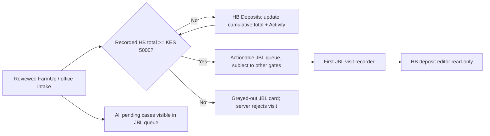

# HB Deposits and first JBL visit eligibility

## Operational contract

HB Actions now has three independent workstreams: Deposits, Installation and
Commissioning. Deposits operate before JBL's first visit. Existing
`HomeBiogasAction` records still require an accepted signed order; no early
installation records are manufactured. Architecture: `docs/adr/0059-hb-deposit-gate.md`.

The minimum recorded HB deposit is **KES 5,000.00**, including exactly that
amount. Blank/unknown, zero and lesser totals create a financial hold. A staff
record is evidence of a reported total, not proof of a bank/M-PESA transaction.
There is no payment initiation, provider/API fee, receipt ledger or ID-check
integration in this feature. JBL's LGF deposit is a different field and never
contributes to this threshold.

1. Reviewed FarmUp intake accepts an otherwise valid blank/zero/underpaid
   deposit. Original uploaded CSV versions and other validation rules survive.
2. HB staff open **HB Actions → Deposits**, defaulting to Awaiting Deposit.
   Cleared and All filters, search, oldest-HBG-intake-first ordering and
   30-case paging support follow-up. Office cases without an HBG date sort
   after dated cases, using creation time/UUID ties.
3. Enter the **cumulative total**, not the latest instalment. For example,
   changing KES 2,000 to KES 5,000 records KES 5,000 paid, not KES 7,000.
   A reduction requires an explanation. Unchanged totals create no audit event.
4. The JBL queue continues to list held cases, greyed out with no phone/card
   activation and an explicit shortfall. Reaching the threshold unlocks the
   next refreshed queue only if other case/stage/authorization rules pass.
5. A reduction below the threshold immediately reinstates the hold while
   unvisited. After the current cycle's first recorded JBL visit, the new editor
   is read-only. Existing downstream invoice/payment workflows keep their
   authority. A governed reappraisal restart uses its reset current-cycle visit
   state; historical visits and audit events are never rewritten.

Inactive records are excluded. Downstream, ordered, invoiced and unrelated
deferred-stage records cannot be edited through this pre-visit editor even if
their legacy visit date is missing. All retains read-only history for previously
visited active cases. Other intake review blockers are not cleared by payment.



**Findings:** one derived financial gate, not a new workflow state or approval.
**Open questions:** real deployment readiness and handset acceptance require
operator verification. **Next steps:** follow the release checklist below.

## Data, audit and authorization

`hb_operations/deposits.py` owns the shared policy and mutation boundary.

- Canonical value: `JawabuFarmerMaster.deposit_paid_hbg`, a two-decimal DB
  `Decimal`. Unknown remains null until staff save an explicit total.
- Operational aliases `actual_receipts` and `actual_receipts_currency` update
  atomically with the numeric amount. They are not immutable uploaded evidence.
  This prevents `canonicalize_farmer()` from restoring an obsolete CSV total.
- A case-row lock, `workflow_revision`, mandatory request key and original
  normalized amount/reason payload protect saves. Different payloads cannot
  reuse a key. Successful retries survive subsequent edits or a recorded visit
  without repeating writes. No-op totals are rejected without fake history.
- `JawabuCustomerFieldProvenance` with source `hb_deposit` establishes manual
  ownership. `JawabuPipelineEvent` action `hb_deposit_updated` retains actor,
  prior/new totals, reason, request payload and eligibility snapshots; the
  existing compliance projection retains independent audit evidence.
- Later `upsert_farmer()` imports lock the same case. Before HB ownership,
  accepted nonblank FarmUp totals can update the case. Afterwards the numeric
  amount and aliases remain protected; `hb_deposit_import_observed` retains a
  differing incoming total, batch/row identity and retained amount. Repeated
  identical observations do not duplicate Activity.
- FarmUp import/update, office hold, HB changes and legacy reconciliation events
  appear in Activity with Nairobi time. Corrections append; they do not replace
  earlier entries. Do not repurpose `HomeBiogasActionEvent`, whose parent
  requires post-order evidence.
- Updates reserve `reserve_farmer_publication()` work; the existing paced
  publication mechanism reads current Django facts. Saving a total never
  synchronously contacts Google or Telegram. No new Sheet column or runner.

Approved capabilities are `portal.hb_deposit.view` and
`portal.hb_deposit.write` in `jawabu_portal`. View depends on the existing HB
Actions shell capability. Portal HB staff view/edit; Operations Administrators
view only; scoped IT and active Django Superusers retain existing overrides.
Queries and saves enforce one complete group/branch/product grant tuple using
the intake case group, not a requisition group that does not yet exist. Product
scoping prefers canonical product identity. Django `is_staff` and grants in
Complaints, TAT, Origination or SPIN do not supply authority.

General Case History corrections no longer offer pre-visit deposit edits: use
HB Deposits. Other correction fields and downstream invoice/payment authority
are unchanged. Reads do not reconcile, publish or mutate cases.

**Findings:** Django owns totals and history; external source differences are
observations, never implicit correction authority. **Open questions:** none for
the approved v1 policy. **Next steps:** keep allowed/denied and retry tests when
changing any alternate writer or serializer.

## Interfaces and failure handling

The authenticated API lives in `hb_operations/deposit_views.py`:

| Method / relative path | Contract |
|---|---|
| `GET /api/portal/hb-deposits/` | `state=awaiting\|cleared\|all`, `search`, `page`; items, counts and pagination. Search supports customer identifiers and `JBL-<number>`. |
| `GET /api/portal/hb-deposits/<farmer UUID>/` | Current total, requirement, shortfall, revision, edit permission and Activity. Out-of-scope cases return not-found. |
| `POST /api/portal/hb-deposits/<farmer UUID>/update/` | Explicit cumulative amount, expected revision, reason and canonical request key; returns current detail after commit. |
| `GET /portal/s/hb-actions/?queue=deposits` | Existing HB shell, financial follow-up list. |
| `GET /portal/s/hb-actions/<farmer UUID>/?workstream=deposits` | Dedicated deposit detail inside the same shell. |

Example POST, using synthetic values and the existing verified Telegram
`initData` header. Keep `Idempotency-Key` unchanged when retrying the same save:

```json
{
  "amount": "5000.00",
  "reason": "Updated cumulative recorded total",
  "expected_revision": 3,
  "client_request_id": "synthetic-hb-deposit-request-1"
}
```

Reject negative/non-finite/malformed/exponent values, more than two decimal
places and values beyond the existing `DecimalField(12,2)` capacity. The request
must carry a real key; missing keys return 428. A stale revision, locked case or
changed-payload key returns a conflict. Mini App response normalization remains
the transport authority; the UI also displays safe server error text.

`farmer_to_card()` adds a `deposit` object containing decimal-string
`recorded_amount` (nullable), `required_amount`, `shortfall`, `deposit_hold`,
`deposit_sufficient`, `visit_recorded` and `reason`. This is additive for older
clients. A cached UI cannot bypass the server-side gate.

`complete_jbl_visit()` checks eligibility before document preparation/Drive
upload. `preflight_jbl_visit_completion()` and `log_jbl_visit()` check under the
case lock. A concurrent reduction cannot produce a newly visited underpaid
case. Evidence already retained during a race follows existing partial-failure
retry handling; it is not deleted. Only a `jbl_visit_completed` request event
counts as a completed-visit replay, not an HB deposit or another pipeline action.

Office intake below the minimum uses the existing create-and-complete route but
saves **intake only**, without requiring visit date/outcome/GPS/evidence. The
response explicitly contains `intake_saved: true`, `visit_logged: false` and a
hold message, with HTTP 201 on creation and 200 on replay. No visit attachment,
visit event or recognition point is created. Changed lead details cannot reuse
the held-intake key. Funded office intake keeps normal visit validation.

**Findings:** disabled UI is supplementary; locked services enforce policy.
**Open questions:** none for the wire contract. **Next steps:** retain direct
submission, stale form, cross-action key and source-import regression tests.

## Release, historical reconciliation and rollback

1. Inspect the migration plan and obtain the normal production release approval.
   Migration `core.0208_hb_deposit_capabilities` adds only approved missing policy
   defaults, preserves explicit denials and increments the policy version.
   Existing access bootstrap/version polling refreshes active Mini Apps. There
   are no new model tables, environment values or external dependencies.
2. Deploy API, templates and cache-versioned assets together. Test with synthetic
   scoped HB, Operations, IT and denied accounts. Check both light/dark and an
   actual Telegram handset before declaring operational acceptance.
3. Preview only committed historical records in one explicitly selected group:

   ```text
   python manage.py reconcile_hb_deposit_holds --configuration <configuration-pk>
   ```

   This command defaults to dry-run and makes no external calls. It considers
   only unvisited, un-ordered/un-invoiced FarmUp cases whose exact sole cleaning
   note is `Missing Deposit Paid to HB`. It revalidates other required inputs
   and current catalogue labels; case-only legacy location differences are not
   rewritten. Explicit source review status and unrelated blockers survive.
4. After reviewing the dry-run and obtaining separate authorization for the
   production data change, apply with `--apply --actor <active-superuser-pk>`.
   Each changed case receives a revisioned `hb_deposit_review_reconciled` event
   and publication reservation. No unselected/staged CSV row is committed. The
   command prints case/event UUIDs, not customer names or phone/ID data. Repeating
   apply finds no already-reconciled candidates.
5. To reverse one unchanged reconciliation, use the same configuration and actor
   with `--apply --undo-event <event-UUID>`. Later case revisions or visits block
   automatic reversal. Reversal appends its own audit event and queues current
   publication; it never erases history.

For code rollback, first stop affected writes and hide/disable the new entry.
Keep numeric totals, aliases, provenance, pipeline/compliance events and original
source evidence. Do not restore import overwrites or drop audit tables. The
exact capability-only migration reversal, after checking for later migrations,
is `python manage.py migrate core 0207_alter_integrationoperation_integration`.
It removes the seeded allow defaults (not explicit denials), records the policy
change and advances the access-policy version. Coordinate rollback code so it
does not continue exposing a capability whose deployment defaults were removed.
No signed order, invoice or payment evidence is regenerated or reversed.

**Findings:** deployment and historical data repair are separate operator
actions. **Open questions:** production impact counts are intentionally unknown;
no operational database was inspected. **Next steps:** obtain release approval,
review the scoped dry-run, then perform authorized deployment checks.

## UI candidate and evidence

The implementation reuses the current HB list/detail/Activity classes, Portal
form controls, feedback/loading primitives and MiniAppUtils close protection.
No candidate Design Lab foundations, token migration, screenshot baseline
approval or Phase 6 authorization is introduced. Source-ratchet entries point to
this candidate evidence, not to a claim of human design approval.

`core/tests_browser/portal_deposits.spec.js` mounts the real shell and deposit
partial, uses production scripts and exercises the real JBL card renderer with
synthetic I/O. It covers the three HB workstreams, status filters/paging,
light/dark mobile forms, Activity, read-only access, reduction explanation,
interrupted-save key reuse, stale-revision preservation/reload and held-to-ready
card activation. `portal_camera.spec.js` checks the office hold/capture boundary.
Backend template rendering separately verifies the held server fragment.

Screenshots are ephemeral synthetic test evidence under
`test-results/playwright/portal_deposits-*`: light/dark retry and cleared states,
plus `jbl-deposit-held.png`. Inspection caught and corrected a header-cascade
clipping defect; an explicit in-viewport heading assertion now guards it.
The fixture uses the actual Telegram theme variables, not a cosmetic class.
Remote fonts and provider/network traffic are blocked. Font fallback is not
proof of production typography, and automated Chromium is not a real Telegram
handset review. Do not copy these images into approved visual baselines.

Backend regression sources: `hb_operations/tests_deposits.py`,
`core/tests_portal_hardening.py`, existing HB/import/capability/JBL/approval tests.
PostgreSQL-only edit/edit and edit/visit race tests explicitly skip on SQLite.
Verification results and remaining broad-suite failures are recorded in
`KNOWN_GAPS.md`; never interpret a passing focused suite as production health.

Final local result: **233 backend tests passed, two PostgreSQL race tests
skipped; all 268 Portal browser checks passed**. The backend run used fresh
in-memory SQLite with socket connections blocked and the normal Django test
database lifecycle. System/migration/architecture/database-governance checks,
202 reviewed write routes, 147-file JavaScript syntax, Node/client checks and
the UI source ratchet passed. Ruff and a local PostgreSQL installation were
unavailable. The wider legacy API/policy diagnostic is not fully green; see
`KNOWN_GAPS.md` for its boundaries rather than treating it as final coverage.
A follow-up three-test no-database run passed for the final ASCII-only amount
validation and compiled SQL cast guard; it overlaps the focused amount checks.

**Findings:** source-faithful synthetic evidence covers v1 interactions, not
deployment/device approval. **Open questions:** PostgreSQL and handset gates
remain external verification tasks. **Next steps:** review the retained test
artifacts and run the documented release checks with an authorized operator.
