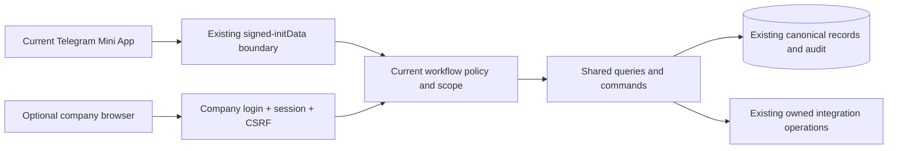
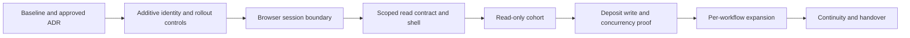

# Platform independence: phased implementation and Telegram-safe rollout

Plan date: **19 October 2026**. Source baseline inspected: `7217791e9836986a493559254f465555ed670568`.

Status: **proposed implementation programme; no implementation or production change is authorized by this document**. This change writes Markdown only. The architectural evidence and primary-source research are in `codebase-analysis-docs/assets/PLATFORM_INDEPENDENCE_RESEARCH.md`. That document explains the current system; this document adds sequencing, staffing assumptions, delivery gates, release controls and rollback.

All repository paths are relative to the repository root. Proposed route names, controls and work packages are not existing deployed features. Production configuration, current incidents, applied migrations, staffing and identity-provider contracts were not inspected.

## 1. Recommendation and delivery expectations

Build a **second, optional access channel to the existing business system**, while continuing to support Telegram. Keep one canonical staff identity, one workflow database, one authorization policy per workflow and one implementation of each business command.

Do not start by moving everyone, changing the Telegram bot, changing employee primary keys or rebuilding the frontend. Introduce company login and a browser entry point alongside the existing Mini Apps. Expand one workflow at a time after measured acceptance.

### Target milestones

| Target window | Milestone | What staff gain | What happens to Telegram |
|---|---|---|---|
| End of week 2 | M0: baseline and decisions approved | An agreed, testable delivery scope | Nothing changes |
| End of week 4 | M1: company authentication foundation accepted | Staff login works in staging; production browser channel remains closed | Existing authentication and launchers remain unchanged |
| End of week 6 | M2: restricted browser read pilot | Selected staff can search authorized Portal cases and view limited history | Remains available to all currently authorized users |
| End of week 10 | M3: first dual-channel write accepted | Selected HB staff can record deposits from a browser | The same deposit workflow remains usable in Telegram |
| End of week 16 | M4: selected Portal workflow coverage | Reviewed intake, visit, credit, order/payment and HB-operation surfaces have browser coverage | Both channels use the same business rules; no forced switch |
| End of week 22 | M5: Complaints and Origination waves accepted | Each approved workflow has independently secured browser access | Its Telegram experience and captured signing requirements remain supported |
| End of week 28 | M6: TAT and other active approved workflows accepted | Browser access to the agreed TAT/SPIN/FCA/legacy scope | No unrelated cutover, stage or notification policy is activated |
| End of week 32 | M7: continuity exercise and handover accepted | Evidence that the agreed operational scope can function without Telegram | Telegram may remain a fully supported channel indefinitely |

These are **planning estimates, not deadlines or a readiness claim**. Week 1 starts at an approved kickoff. Production opening at any milestone requires a separate release decision. Gates take precedence over dates.

Planning allowance: **about 6 weeks to useful read-only access, 10 weeks to an accepted first write pilot, and 7–8 months for the broad programme**. Reserve another **6–8 weeks** for provider onboarding, existing defects, security review and workflow-specific surprises: a budget envelope of roughly **9–10 months** for the entire scope. The first ten-week tranche is a useful standalone investment; JBL can stop there with Telegram still operational.

The estimate assumes two dedicated experienced engineers, approximately one QA/test engineer, part-time IT/operations support, named business owners and timely security decisions. It includes build, testing and controlled observation—not just coding. One engineer, intermittent availability, missing staging, a new IdP procurement or a broader offline/native-mobile requirement requires re-estimation. Early milestone confidence is moderate; later workflow dates are lower confidence until the route inventory is complete. Do not halve the calendar merely by doubling developers: acceptance and operational observation still take time.

**Decisions/Findings:** fund a small first tranche and expand on evidence. **Open Questions:** actual staffing, IdP and initial business audience. **Next Steps:** confirm the assumptions in P0 before promising calendar dates.

## 2. Non-disruption contract

The objective is **no planned interruption to current Telegram usage**. This is not a promise that a shared-backend release is risk-free. Feature isolation, compatibility, observation and rollback are the controls.

During the programme:

1. Existing Telegram URLs, bot identity, webhook configuration, launchers, group membership and notification defaults remain unchanged unless a separately approved task requires a change.
2. Existing `*_WEBAPP_REQUIRE_TELEGRAM_AUTH` settings stay enabled. They are not repurposed as browser-access switches. `core/production.py::MINIAPP_AUTH_SETTINGS` and `core/services/telegram_auth.py` remain the reference for the actual set of protected surfaces.
3. Existing employees keep the same Django user and `UserProfile`. No mass account recreation, password reset, forced reactivation or Telegram rebinding is needed for ordinary users.
4. Mini App roles remain independent. Browser enrollment adds **no business permission**. A permitted browser cohort is an extra restriction on existing authority, never a substitute for `AccessGrant`.
5. Cases, deposits, evidence, TAT state, product snapshots, signatures, finance numbers and audit history stay in their existing owning domains. No browser-specific case database, business dual-write or production data copy is introduced.
6. Telegram and browser may edit the same case. Existing revision, lock and retry semantics—not the interface—decide whether an action is valid.
7. Current Telegram screens do not acquire a new company-login dependency. Company IdP/DNS failure must not prevent existing Telegram authentication.
8. Existing private evidence links, expired-link behavior, audit requirements and signing finality remain enforced. Login never changes who signed or which document bytes were accepted.
9. Existing cached Mini App clients remain compatible throughout each rollout. Do not remove accepted request fields or retire endpoints as a side effect of adding browser access.
10. Shared failures are visible. Do not present focused passing tests as a green full suite, and do not change UI baselines or broaden grants just to clear a release gate.
11. Browser rollback closes the new channel without deleting its valid business transactions. Staff can continue from the canonical state in Telegram after checking uncertain submissions.
12. Do not switch Portal into global maintenance merely to disable a browser pilot. The existing maintenance control affects Portal writes; use browser-specific rollout controls for browser-only faults.

Relevant sources: `core/api/portal_views.py::portal_auth_required`, `core/services/workflow_access.py`, `core/services/miniapp_requests.py`, `core/services/portal_maintenance.py`, `core/models.py::UserProfile`, `AccessGrant`, `JawabuPipelineEvent`, and `docs/adr/0039-unsigned-finance-workspaces.md`.

If an operation cannot meet this contract—for example, an unavoidable database lock or a worker upgrade requiring a drain—postpone it or propose a separately approved maintenance window. Do not hide the interruption inside a “zero-downtime” label.

**Decisions/Findings:** Telegram remains the compatibility baseline, not a temporary migration casualty. **Open Questions:** deployed worker topology and migration constraints. **Next Steps:** turn this contract into release checks in P0/P1.

## 3. Proposed technical approach

### 3.1 Two explicit credential boundaries, shared business services

Recommended pilot boundaries:

| Surface | Existing/proposed | Authentication and purpose |
|---|---|---|
| Existing Mini App roots and `/api/portal/...` routes | Existing | Keep verified Telegram identity and current scope checks |
| `/staff/` | Proposed | Company browser shell and authorized application discovery |
| `/staff/auth/...` | Proposed | Company login/callback/logout; no operational authority on its own |
| `/api/staff/portal/...` | Proposed | Browser-only session endpoints; unsafe methods require CSRF; call the same Portal services |
| Other `/api/staff/<workflow>/...` surfaces | Proposed, later waves | Admit only the individually reviewed workflow surface |
| Current signer/download capabilities | Existing | Retain their separate purpose-specific credentials and current authorization checks |

Paths are a recommended namespace, not a commitment to mount every current API twice. First approve a small endpoint manifest: method, credential, capability, resource scope, input contract, side effects, retry rule, expected revision and response projection. Business commands must be reused; do not call decorated Telegram HTTP views from browser wrappers.

Keep the existing Django/template/htmx/JavaScript stack. Do not introduce an SPA, API gateway, event broker, microservices or a native app for the pilot. Extract a small query/service from `core/api/portal_views.py` only when needed; preserve old import/function compatibility and behavior.

### 3.2 Browser origin and cookie isolation

Preferred deployment proposal: a company-owned browser hostname serving its own same-origin UI and API through the existing application, while retaining the current Telegram hostname and URLs. Use host-only session/CSRF cookies and a fixed allowlisted callback/browser origin. This can reduce accidental cookie sharing between channels without duplicating workflow data or starting another bot/worker fleet. Render supports custom domains; actual service/domain setup and entitlement remain to be confirmed. [R6]

P0 must approve the topology after checking proxy/host validation, session cookie names/domain/path, existing `APP_BASE_URL` link generation, callback URLs, CSRF origins, Admin exposure and Telegram Web framing. If a separate hostname is unavailable, use the same namespace design on the existing origin only after explicit cookie/session-confusion testing. Do not silently change `SESSION_COOKIE_DOMAIN`, Django secrets, bot tokens or the existing public base URL.

Browser endpoints should require a session established through the approved company login—not merely any authenticated session issued by the existing Telegram bridge. Record and verify browser-login assurance without storing raw provider tokens in the frontend. Preserve a valid company session's actor; reject an explicitly conflicting Telegram credential rather than falling back to whichever identity is more privileged.

Existing `core/api/auth_views.py::telegram_session_login` creates sessions, and Portal/Origination decorators also call `login()` after signed validation. That is **not** an independently authenticated browser product. Keep those paths unchanged initially; establish a company session at the actual login boundary, not on every business request. Django documents CSRF-secret rotation on login. [R1]

### 3.3 Internal identity and security policy

- Reuse the existing Django user. A provider link maps a verified company identity to that account; it does not create an employee/workflow duplicate.
- Prefer the organization's existing managed OIDC provider if suitable. Select a maintained integration and justify any new dependency through the repository's explicit approval gate.
- Use issuer plus subject for the provider binding, not email, name, phone or Telegram username. Do not assume Telegram OIDC subject equals its Mini App user ID. [R3]
- Use reviewed authorization code/PKCE, callback validation and safe redirect handling; keep secrets and any required provider tokens server-side. [R2]
- Enforce cookie-session CSRF protections at the browser boundary. Never add a session fallback to an unchanged CSRF-exempt Telegram write. [R1]
- Re-evaluate current active-user and complete workflow grants on every operational request; `access=None` must never be a production browser fallback. Default-deny is the target. [R4]
- Require an explicit assurance decision before enabling approval/signing/payment actions. Adding a browser channel does not itself authorize stronger or weaker approval rules.

New identity persistence, if required, belongs in a reviewed bounded-domain app or approved provider-library model—not a new legacy `core` model. P0 chooses the exact model/app/library. New models require catalogue metadata, table/column comments, constraints, intentional reverse names and justified indexes. An identity-link migration must not alter existing case/user primary keys.

**Decisions/Findings:** isolate transport first and share business behavior underneath. **Open Questions:** IdP, integration library and approved hostname/session topology. **Next Steps:** resolve them in the architecture/security ADR before code or dependency changes.

## 4. Owners, dependencies and decisions required

### 4.1 Minimum delivery roles

| Role | Responsibility | Planned involvement |
|---|---|---|
| Business sponsor/release authority | Scope, priorities, explicit production approvals and go/no-go | Weekly review plus each release |
| Technical lead/backend engineer | Identity, contracts, service boundaries, migration compatibility, security fixes | Dedicated |
| Full-stack engineer | Shared runtime/browser adapters, accessible shells, backend integration | Dedicated |
| QA/test engineer | Cross-channel regression, PostgreSQL concurrency, actual-device tests and release evidence | Approximately one dedicated person during pilots |
| IT/IdP/operations owner | Tenant/domain setup, staff enrollment, monitoring, release/rollback and support | Part-time; available during every release |
| Workflow owner/champion | Real operational acceptance with their existing approved role | HB/Operations, Complaints, Origination and TAT owners during their waves |
| Security/privacy reviewer | Threat model, identity recovery, assurance, evidence/download and data-flow review | P0/P1 and higher-risk gates |

Name actual people at kickoff. A workflow IT role used for technical tests is not a replacement for acceptance by ordinary HB, officer, BM, CA or approver users. Engineering parallel work is a staffing estimate, not authorization to run unsupervised agent delegation or simultaneous production changes.

### 4.2 Decision register

| ID | Decision | Due | Default recommendation if acceptable | Blocking consequence |
|---|---|---|---|---|
| D1 | Company IdP, tenant, staff coverage and MFA ownership | P0 | Existing company-managed OIDC provider | No production company login until selected; do not improvise passwords |
| D2 | Browser origin, session assurance and cookie policy | P0 | Dedicated company hostname; same-origin API; host-only cookies | No browser release without isolation/CSRF tests |
| D3 | First cohort and exact read scope | P0 | 3–5 existing Portal staff, one reviewed business scope | No broad self-enrollment or all-branch pilot |
| D4 | Account linking, recovery, offboarding and session expiry | P0/P1 | Explicit approved link to existing user; defined revocation | No user enrollment without verified binding/recovery |
| D5 | First write and browser-admission controls | P0 | HB Deposits only; existing HB grants unchanged | Higher-risk transactions stay Telegram-only |
| D6 | Alert alternatives and disclosure rules | Before relevant workflow wave | Authorized in-app task surface first; email/SMS only when approved | No automatic new messaging audience |
| D7 | Production change window, baseline, backup and rollback authority | Before every release | Existing release/runbook process | No deployment merely because CI passed |
| D8 | Full workflow coverage versus selected office workflows | P0, recheck M3 | Tranche approval rather than all-or-nothing commitment | Later dates must be re-estimated on scope expansion |
| D9 | High-risk browser approval assurance and signed-document acceptance | Before P4/P5 approval features | No change to captured obligations; explicit assurance policy | No browser financial/signing activation before acceptance |

The sponsor should answer D1–D5 before the implementation brief is finalized. This plan is executable as discovery now; identity/library decisions are deliberately not fabricated.

**Decisions/Findings:** decisions have owners and due gates. **Open Questions:** named people and company-provider details. **Next Steps:** hold a short kickoff and record decisions in the approved private project tracker; never put staff identity lists or credentials in Git.

## 5. Phases, timeline and acceptance milestones

The phase identifiers P0–P7 below refer only to this delivery programme. They do **not** approve the separate Design Lab “Phase 6” UI migration.

### P0 — Baseline, discovery and release design: weeks 1–2

**Goal:** know what must remain working and settle the choices that could invalidate the rollout.

Work:

1. Obtain an authorized read-only operational baseline: current deployed commit, migration state, enabled workflows, worker/scheduler topology, current incidents and provider readiness. No production repairs or provider calls are bundled into this audit.
2. Identify the Telegram critical journeys actually in use: launch, authentication, queue/search, FarmUp review/commit, deposits, visit, credit, approvals, documents, TAT work, Origination signing and authorized evidence access. Mark archived/gated routes explicitly.
3. Create the pilot endpoint/credential manifest and a workflow coverage register. Identify GET-side effects, hidden tokens, actor-label helpers, cached clients and client-assisted integration processing.
4. Record baseline tests, open failures and owners. Preserve complete test results; focused green runs do not erase broader defects.
5. Measure existing request/error/latency and publication/runner health with privacy-safe aggregates. Do not assume Sentry currently collects performance metrics; its existing data-minimization policy must be respected.
6. Resolve D1–D5; write the architecture/security ADR, migration compatibility approach and release/rollback brief. Obtain approval before adding a dependency or changing effective access logic.
7. Prepare isolated staging with synthetic cases, test identities, test bot/resources and blocked live provider access. Confirm PostgreSQL acceptance can run on the supported release matrix.
8. Read `docs/ui-standard/README.md` and `docs/ui-standard/component-index.md`; plan approved reuse or source-bound review candidates. This is not permission to load candidate themes into staff apps.

Primary source owners: `core/services/telegram_identity.py`, `core/services/workflow_access.py`, `core/api/urls.py`, `core/api/browser_urls.py`, `origination/auth.py`, `core/api/complaint_case_views.py`, `core/api/views.py::_tat_context`, `core/services/production_release.py`, `.github/workflows/ci.yml`.

**M0 exit:** signed scope/decision record, named owners, reproducible Telegram regression baseline, staging, initial monitoring baseline and reviewed rollback strategy. Unknown deployment details are resolved or expressly block the affected release.

**Telegram impact:** none. **Rollback:** no runtime change to reverse. **Owner:** technical lead, IT and business sponsor. **If delayed:** continue safe documentation/test discovery; do not substitute a weaker login approach to meet the date.

### P1 — Additive identity/session foundation, closed by default: weeks 3–4

**Goal:** prove company login without changing current Mini App authority or use.

Work:

1. Add the reviewed provider integration, controlled binding and browser session assurance. Use existing internal users; no auto-link by email or automatic workflow grants.
2. Add browser admission controls and an empty/limited authorized discovery shell. Staff access stays disabled in production by default.
3. Add schema only if required. Deploy additive schema independently from activation, with no destructive auth/profile edits or mandatory mass backfill.
4. Enforce CSRF on browser login-related writes, logout and business writes; validate callback state/issuer/audience/expiry and allowed return destinations. Test session fixation, identity confusion, logout and revocation.
5. Keep expensive/remote IdP work outside database locks. If the company provider is down or its keys cannot be verified safely, fail the company login closed while Telegram continues.
6. Extend relevant deployment/readiness checks so enabling browser access requires safe browser configuration. Off-mode must not query absent new tables or block the old application during schema expansion.
7. Test offboarding against already open browser sessions and queued tasks. Define a documented idle/absolute lifetime and reauthentication policy; a disabled IdP account alone does not prove local session invalidation.

Existing sources to preserve: `core/models.py::UserProfile`, `AccessGrant`; `core/auth_backends.py`; `core/api/auth_views.py`; `core/services/staff_lifecycle.py`; `core/services/staff_telegram_onboarding.py`; `config/settings.py`; `core/production.py`; `core/checks.py`.

**M1 exit:** an ordinary approved employee signs in to staging without Telegram and resolves to the same internal actor. Unbound/wrong-tenant/inactive users and contradictory credentials fail. Telegram regression remains unchanged. Old app/new schema compatibility and browser kill controls are demonstrated.

**Telegram impact:** no forced login/account change. **Rollback:** keep browser admission disabled, invalidate only affected company sessions when needed, leave additive identity evidence intact. **Owner:** backend lead and IT/security reviewer. **If delayed:** browser access stays closed; Telegram is not converted to company SSO.

### P2 — Scoped read-only Portal pilot: weeks 5–6

**Goal:** deliver useful browser access with a minimal mutation surface.

Week 5: implement scoped All Cases search and selected history facts, browser transport, navigation/theme fallbacks and ordinary-role denial tests. Week 6: stage acceptance, then—only after production approval—run at least five working days with the small read-only cohort.

Work:

- Reuse scoped query/projection rules behind `core/api/portal_views.py::portal_all_cases`, `portal_farmer_detail` and `core/services/jawabu_pipeline.py::all_cases`/`farmer_to_card`.
- Exclude financial approvals, editing, bulk export, paid checks and unreviewed sensitive media from this first surface.
- Classify audit and workspace side effects explicitly. `portal_farmer_detail` can record a recent open if its workspace-open header is supplied; do not copy it as an allegedly side-effect-free endpoint.
- Adapt `core/static/miniapp/portal_api.js`, `core/static/miniapp/utils.js`, `core/static/miniapp/miniapp-nav.js` and the shared shell without changing existing Telegram credential attachment.
- Ensure the browser channel works with Telegram script/API hosts unavailable. Browser dirty-form/in-flight protection must not depend on `initTelegram()` running.
- Test current grants on every query and download. A menu hiding a case is not an authorization boundary.
- Compare read results using isolated snapshots or safe query functions, not by replaying side-effectful HTTP handlers in production.

**M2 exit:** actual company login → actual Django backend → correct scoped query, with no Telegram credential or mock API. All cross-scope denials pass; read-cohort observation passes section 8 gates. Staff can return to Telegram immediately without data conversion.

**Telegram impact:** none intended; shared asset changes require both-channel regression. **Rollback:** disable browser read admission; no case rollback. **Owner:** full-stack engineer, QA and Portal owner. **If delayed:** postpone cohort expansion; do not add writes to compensate for a slow read pilot.

### P3 — HB Deposits write pilot and coexistence proof: weeks 7–10

**Goal:** prove one real shared business command from both channels.

Weeks 7–8: implement the browser boundary, focused tests, PostgreSQL concurrency tests, staging acceptance and release rehearsal. Weeks 9–10: allow the first approved live write cohort for at least ten working days. Prefer 2–3 existing scoped HB users plus an Operations read-only reviewer; adapt the count to actual staffing, never by adding new roles.

Work:

- Call `hb_operations/deposits.py::update_deposit` from a CSRF-protected browser endpoint. Keep `hb_operations/deposit_views.py` Telegram behavior intact.
- Preserve cumulative `Decimal` totals, KES 5,000 eligibility, reason-for-reduction, pre-first-visit edit lock, source ownership, exact grant scope, provenance, native/compliance audit and publication reservation.
- Distinguish existing business source from authentication channel. Do not replace a governed `SOURCE` value with “browser”; add approved channel/assurance metadata only for new events without rewriting hashes/history.
- Reuse the same retry/revision rules. Test Telegram/browser edits racing, retries after ambiguous network loss and a browser close during submission.
- Keep held cases greyed/unavailable for JBL visit on both clients; stale clients must still encounter the server gate. Browser admission must not become a route around the deposit policy.
- Verify that browser commits reserve the same owned publication work once. If publication processing still needs a visible authenticated Portal client, provide an equivalently authorized browser processing path before claiming independence; do not create a new cron or replay everything.
- Use normal approved operational actions for live observation. Never ask staff to enter fabricated deposits into production just to satisfy a pilot test.

**M3 exit:** equivalent commands produce equivalent canonical results and audit, with no duplicate publication or hidden authority. Ten-working-day observation is complete and any low-volume coverage is supplemented by staging tests. Concurrent stale edits conflict; browser disable is rehearsed without losing a committed deposit.

**Telegram impact:** remains a valid client of the same command. **Rollback:** close browser writes, let admitted transactions finish safely, check Activity/current revision before staff switch channels. Never undo valid deposits automatically. **Owner:** backend lead, HB owner, Operations reviewer and QA.

### P4 — Portal expansion in bounded waves: weeks 11–16

**Goal:** extend beyond the pilot without mixing business-policy changes into the channel conversion.

| Window | Wave | Scope and safety gate |
|---|---|---|
| Weeks 11–12 | P4a: intake and case processing | FarmUp upload/review/commit, authorized visit/recovery/media paths and credit review; no change to who can submit/decide |
| Weeks 13–14 | P4b: governed order/invoice work | Current official order workspaces, exact-version evidence, invoice identity/correction and preparation; preserve UUIDs and signed finality |
| Weeks 15–16 | P4c: higher-risk review and HB operations | Approved payment-preparation/review surfaces and installation/commissioning; activate only individually accepted capabilities |

For each wave: read capability first, then its reviewed write; reuse existing owner services; release behind a separate surface control; run the corresponding ordinary-role and denial journeys. Feature completion may occur in this window while production observation continues afterward. M4 is not passed until every surface claimed under it has completed its observation gate; otherwise retain partial coverage and move the milestone.

Specific invariants:

- FarmUp immutable uploads, row selection and canonical commit ownership remain unchanged. A file upload is not an instruction to auto-commit held cases.
- Preserve deposit gating, complete visit evidence, protected previews/downloads and field-only recovery rules.
- Credit/final decisions remain server-validated; do not activate retired conditional-approval paths or new policy stages.
- Official order/payment membership, revisions, signed scans, numbering/reuse and cancellation rules remain owned by their existing domains. No new document may replace retained signed bytes.
- New order documents remain oldest-intake-first. New payment documents remain Eco-conserve-first then HB, oldest first within each partner. Retained workbooks are never reordered.
- Head of Rural approvals remain distinct from Operations preparation. HB installation/commissioning remains post-signed-order and commissioning cannot predate installation.
- Browser financial/document approval has its own explicit D9 security/business acceptance; it is not bundled into “the login works.”

Owning sources: `core/services/jawabu_pipeline.py`, `core/services/jawabu_media_access.py`, `core/services/invoice_identity.py`, `core/services/portal_publication.py`, `requisitions/`, `payments/`, `hb_operations/`, and `core/api/portal_views.py`.

**M4 exit:** exact reviewed coverage is listed, signed/financial invariants pass, ordinary staff UAT and both-channel regressions pass for each exposed capability. Unfinished surfaces remain Telegram-only and are visibly excluded from the milestone.

**Telegram impact:** existing records and behavior remain supported. **Rollback:** disable only the affected browser surface; preserve accepted orders, scans, receipts, decisions and finance claims. **Owner:** Portal technical lead plus the individual operational/approval owners.

### P5 — Complaints and Origination, separate waves: weeks 17–22

**Goal:** prove the adapter is reusable without making roles, signers or customer evidence global.

Weeks 17–19 — Complaints:

- Introduce the browser actor/context boundary around `core/api/complaint_case_views.py::_context` and the shared `core/services/complaint_cases.py` services.
- Add scoped list/detail, permitted intake and updates, evidence and comment/resolution/reopen actions in reviewed subwaves.
- Preserve Complaint HB resolver authority, mandatory intake identifiers, append-only comments, resolution timing, import attribution, references and revision conflicts.
- Do not revive a retired ingestion route because an old Markdown file describes it.
- Run at least the ordinary officer, manager, HB and unauthorized/cross-workflow cases relevant to the approved surface.

Weeks 20–22 — Origination:

- Introduce browser staff identity without changing `origination/auth.py` Telegram enforcement or granting Portal users Origination roles.
- Prove applications/forms/preview first, then governed preparation, evidence, review, signing dispatch and approved signer actions where selected.
- Preserve captured product/document versions, completion policy, signer identities, acknowledgement/consent, typed-mark assets, application revision and exact signed bundle bytes.
- Keep public signer tokens/OTP sessions distinct from staff sessions. Company login is not evidence of an applicant's consent or completed signature.
- Preserve provider-pinned SMS dispatch/retry and authorized copy/download behavior.
- Keep optional Daraja calls explicitly confirmed and scoped; login, mounting a screen or status polling must not create a billable attempt.

Sources: `core/services/complaint_cases.py`, `core/services/complaint_imports.py`, `origination/`, `origination/services/origination_sms.py`, `origination/services/origination_sms_delivery.py`, and the relevant ADRs under `docs/adr/` including `0054`, `0056`, `0057` and `0058`.

**M5 exit:** both named workflows meet their own credential/scope, mutation, evidence and observation gates. Historical signing packages remain valid and unchanged. Unreviewed actions stay disabled in the browser.

**Telegram impact:** no shared role cutover or signer backfill. **Rollback:** close the affected browser adapters; retain valid complaints, applications, signatures and queued delivery evidence. Never resend signing links or SMS automatically during rollback. **Owner:** each workflow owner and its engineering/QA lead.

### P6 — TAT, SPIN/FCA and active legacy coverage: weeks 23–28

**Goal:** address the most operationally coupled routing surfaces after simpler boundaries have proven stable.

Recommended order: TAT read/inbox → TAT permitted actions → scoped ancillary workflows. Inventory determines exact scope; archived forms are not automatically included.

Work:

- Separate TAT credential normalization from `_tat_context`, retaining independent grant, group, responsibility and capability checks.
- Preserve immutable configuration binding, loan-cycle paths, stage revisions, Pilot/Production classification, responsibility assignments, stage timing, recognition snapshots and remark semantics.
- Keep the durable task/inbox authoritative. Analyze `core/services/tat_notifications.py::synchronize_case_task`, `_routing_recipients`, backup/escalation and task access before introducing alternate channel behavior.
- Add browser task destinations and authorized discovery without requiring Telegram private-chat connection. Any change to escalation/delivery semantics is a separately approved policy task, not a hidden part of auth refactoring.
- Keep existing Telegram notification mode and destinations as the default while the browser channel is introduced. Do not duplicate alerts to every employee email.
- Apply browser adapters to currently active SPIN/FCA/review surfaces only after their source/token/role inventory. A gated SPIN cutover or draft `credit_assessments` workflow is not activated by this programme.
- Review Gmail/statement-acquisition and command-only triggers. Record any remaining Telegram-only dependency explicitly rather than claiming blanket independence.

Sources: `core/api/views.py`, `core/services/tat_tracker.py`, `core/services/tat_notifications.py`, `core/services/spin_credit.py`, `core/services/fca.py`, `credit_assessments/`, and existing workflow-specific readiness checks.

**M6 exit:** each selected active workflow is listed with tested entry, auth, scope, reads, writes, evidence and routing. TAT timing/tasks/escalation and Telegram notifications have no unintended change. Disabled/draft/retired paths remain so.

**Telegram impact:** no mandatory notification migration. **Rollback:** disable the browser workflow or new alternate delivery only; preserve tasks/stages and prevent duplicate dispatch. **Owner:** TAT/credit/FCA workflow owners with IT and QA. **If coupling is larger than estimated:** narrow M6 and reschedule; do not combine stage redesign with browser support.

### P7 — Operational independence drill, hardening and handover: weeks 29–32

**Goal:** establish continuity evidence, not just a second URL.

Work:

1. Complete scoped alternative staff enrollment/recovery and company-session offboarding. A new approved employee must be able to start without a Telegram account.
2. Provide approved task/alert alternatives where required; maintain recipient consent/disclosure boundaries and avoid unnecessary customer facts in messages.
3. In staging, block Telegram API, SDK and launcher hosts while completing the accepted scenario: fresh login, new intake, work discovery, allowed update, evidence retrieval, audit, publication recovery and helpdesk recovery.
4. Include the background processors/client-assisted publication actually used by the accepted workflows. Browser-only access with no integration progress is incomplete operational coverage.
5. Drill IdP outage separately while confirming Telegram still works. Do not make either channel's outage test disable the other globally in production.
6. Complete controlled load/capacity tests, penetration/security review, restore-to-staging exercise, staff training and current runbooks. Record measured RPO/RTO evidence; do not assume targets are met.
7. Observe at least two further normal business weeks of the mature agreed scope, including relevant document/payment/report cycles. If an important monthly cycle has not occurred, keep its gate open or use isolated staged evidence and schedule the real-cycle follow-up explicitly.
8. Publish a truthful support/coverage register: operational in both, Telegram-only pending, deliberately excluded, and retired. Hand over monitoring, enrollment, recovery and release ownership.

**M7 exit:** sponsor/security/workflow owners accept the exact continuity scope and evidence. There is a supported browser alternative and a tested rollback/support path. Telegram retirement is **not** part of M7; it requires a separate business decision, communication and decommissioning plan.

**Telegram impact:** remains supported. **Rollback:** revert affected browser/delivery switches; follow incident procedures for shared faults. **Owner:** operations lead, security reviewer and business sponsor.

**Decisions/Findings:** every phase produces a useful increment and an explicit stopping point. **Open Questions:** late-stage route/cycle complexity remains estimate-sensitive. **Next Steps:** baseline P0 and reforecast at M0, M3, M4 and M6.

## 6. Implementation work packages and pull-request order

Do not deliver this as one architecture PR. The suggested dependency chain is:

| Package | Phase | Bounded change | Required evidence |
|---|---|---|---|
| WP01 | P0 | Baseline, endpoint manifest, dependency and decision records | Current source/tests, deployment audit approval and known gaps |
| WP02 | P1 | Optional additive identity-link schema/catalogue | Reviewed migration plan, forward/reverse path and old-code compatibility |
| WP03 | P1 | Maintained company login and controlled account binding | Provider/callback/recovery negative tests; dependency approval |
| WP04 | P1 | Browser admission, session assurance, kill controls and readiness | Defaults closed; current grants still required; off-mode safe |
| WP05 | P2 | Small shared read/query contracts | Telegram projection parity, field allowlist and cross-scope denial |
| WP06 | P2 | Browser shell/transport/navigation capability adapter | Actual shell in browser and Telegram; SDK blocked; UI review evidence |
| WP07 | P3 | Browser deposit boundary, without business-rule changes | CSRF, actor, revision, idempotency, audit/publication and PostgreSQL races |
| WP08 | P3 | Pilot release/monitoring and staff handoff | Explicit release record, observation results and rollback rehearsal |
| WP09+ | P4–P6 | One workflow/surface adapter per bounded change | Its own policy, evidence, legacy-client and release acceptance |
| WP10 | P7 | Approved notification/continuity gaps, individually scoped | No unintended dispatch; current-scope disclosure and delivery reconciliation |
| WP11 | P7 | Recovery/drill/runbook/handover | Measured evidence and signed coverage register |

Some packages need several PRs. WP numbers do not authorize future schema/role/provider changes. Tests may be prepared in parallel with design, but production activation follows the gates. Preserve shared helper compatibility instead of reorganizing every service before the first feature works.

**Decisions/Findings:** small reviewed PRs isolate regressions and make rollback understandable. **Open Questions:** exact identity persistence and extraction boundaries. **Next Steps:** create tickets for WP01–WP08 only after kickoff decisions; do not open a broad rewrite branch.

## 7. Rollout controls and live cohort protocol

### 7.1 Proposed server-side controls

These are required responsibilities, **not existing environment-variable names**. Choose one audited implementation in WP04; do not create competing flag stores.

| Control | Default | Scope and enforcement |
|---|---|---|
| Browser channel enabled | Off | New browser routes only; does not alter Telegram auth settings |
| Browser cohort enrollment | Empty | Existing internal user plus reviewed workflow/scope; restrictive intersection with current grants |
| Browser surface enabled | Off per surface | Reads, deposits, evidence, approvals etc. enabled separately |
| Browser writes admitted | Off | Checked server-side before admitting new writes; supports read-only browser rollback |
| Alternate delivery enabled | Off per workflow/channel | Does not replace existing Telegram notification policy |

All switches must be enforced on the server, not merely menus. Changes require appropriate governance/audit; they cannot broaden `AccessGrant`. Cache invalidation/maximum propagation delay must be specified and tested. Disabling a surface affects bookmarked URLs, prepared downloads where applicable, jobs and direct API calls as defined by their contracts—not just navigation.

Target a **browser-only containment action within five minutes**, subject to an agreed on-call and configuration mechanism. This is an operational target, not an existing guarantee. If an environment change requires a redeploy, measure its actual delay or implement an approved more immediate control before live writes. Do not claim an instantaneous switch based on a settings variable.

Already admitted transactions may finish. A kill switch must not cut a database transaction in half, erase its audit or make the UI silently resubmit it. For queued external work, distinguish valid committed work from suspected/invalid disclosure: pause only the affected owned operations for reconciliation when necessary.

### 7.2 Cohort rings

| Ring | Admission | Minimum observation before promotion |
|---|---|---|
| R0 | Isolated staging; synthetic identities/cases and test providers | Complete automated/negative tests plus actual browser/Telegram UAT |
| R1 | 3–5 existing approved staff in one reviewed scope, reads only | Five working days and all required read/denial journeys |
| R2 | 2–3 existing scoped HB writers and an Operations read-only reviewer | Ten working days of controlled deposit use plus staged race/retry evidence |
| R3 | A second reviewed branch/group and representative roles | Ten working days per material write expansion; sufficient scenario coverage |
| R4 | All approved users for that explicitly accepted workflow surface | Each workflow gate complete; support/rollback coverage confirmed |

Counts are indicative; do not create unnecessary accounts or synthetic financial activity to reach them. In a small team use all available approved representatives and retain the observation/scenario gates. Enrollment is opt-in for convenience; employee authority still follows the existing controlled workflow grants.

Training before each ring: login/recovery, current scope selection, unsaved forms, changed-case conflicts, uncertain submissions, secure downloads and returning to Telegram. Supply a protected helpdesk route and non-sensitive error/request reference instructions. Do not send customer records or credential-bearing links to a general support chat.

### 7.3 Promotion and stop criteria

P0 records a seven-business-day baseline where available, segmented by workflow and channel. The following are **proposed release guardrails**, not measured production statistics:

| Signal | Promote only when | Stop/contain when |
|---|---|---|
| Authorization and privacy | All required allowed/denied journeys pass | Any confirmed cross-scope read/write, unauthorized approval or evidence leak |
| Canonical/audit integrity | Required actor, audit and transaction facts reconcile | Any missing required audit, duplicate financial/business effect or unexpected state transition |
| Telegram compatibility | Critical Telegram smoke journeys pass before/after release | A previously permitted critical journey breaks or Telegram is forced into company login |
| Error rate | No unexplained regression in comparable valid traffic | Shared Telegram 5xx rises by >1 percentage point above baseline for 15 minutes with adequate traffic; use three comparable unexpected failures/manual reproduction as low-volume trigger |
| Latency/capacity | Reviewed common-read p95 remains within 20% of the comparable baseline under expected load | Sustained larger degradation, connection exhaustion or blocking/queue growth attributable to the rollout |
| Browser functionality | At least 95% of valid controlled acceptance attempts succeed with no unexplained failures | Systemic login/CSRF loops, inability to save or lost/duplicated submission evidence |
| Integration processing | Existing publication/task/runner behavior stays within its agreed baseline | Duplicate dispatch, stuck leases, unexpected publication growth or broken task escalation |

Expected validation denials and intentionally blocked credentials are not application failures. Compare like-for-like endpoints/time windows; no statistical claim from tiny samples. Zero-tolerance integrity/security incidents override all percentage thresholds. Near-threshold low-volume results need human review, not automatic green. A gate cannot be passed just because there was no traffic.

Every mandatory scripted acceptance journey must pass. The 95% figure is a proposed aggregate pilot usability/completion signal, not permission for 5% of required correctness, authorization or financial tests to fail. Refine it against actual network/user conditions in P0.

Use existing sanitized logs/release evidence and add only reviewed low-cardinality telemetry: release, channel, workflow, surface, safe error category, durations and opaque request/operation references. Do not log raw `initData`, cookies, ID/access tokens, customer search terms, uploaded evidence or staff/customer identity lists. Do not add monitoring PII merely to compare channels.

**Decisions/Findings:** admission and permission are different controls; staged exposure is measurable. **Open Questions:** actual baseline, alert collection and containment latency. **Next Steps:** confirm numerical guardrails with operations during P0 and prove them before R2.

## 8. Shared data, concurrency and migration safety

### 8.1 Concurrent channel behavior

Both channels operate on the same row and existing workflow state. A browser save that advances a revision must make an older Telegram form conflict safely, not overwrite it; the reverse must also hold.

- Preserve the owning command's locking and expected-revision check. Do not serialize users through a browser-only lock while Telegram bypasses it.
- Preserve operation/resource/key/payload retry semantics across adapters. Do not add “telegram” versus “browser” to a business deduplication key merely because requests arrive through different channels.
- Retrying the same accepted request returns its permitted result without repeating a business effect; the same key with changed values conflicts. Always recheck current authority before exposing a replay result.
- A manual re-entry in another channel usually has a new key. Idempotency does not identify every human duplicate automatically. Staff must check current state/Activity after an uncertain save; domain revision/no-change/uniqueness rules remain essential.
- Keep financial evidence semantics unchanged. A recorded HB deposit is not a settlement or an automatic payment instruction.
- Do not replay writes for shadow testing. Compare queries in isolated fixtures; test commands with reset synthetic state, never by issuing the same real approval twice.

Primary references: `core/services/miniapp_requests.py`, `hb_operations/deposits.py::update_deposit`, `core/services/workflow_transitions.py`, `core/services/portal_publication.py`, and owning finance/signing services.

### 8.2 Expand first; activation later; no destructive contraction during coexistence

| Release step | Required compatibility |
|---|---|
| A: additive schema only, browser closed | Current production code continues working with the expanded database |
| B: dormant browser code | Browser off-mode cannot depend on uninitialized bindings or an available IdP |
| C: selected user binding/read activation | Existing user IDs, grants, Telegram sessions and record references are preserved |
| D: reviewed write activation | Same business transactions, retry/revision and audit constraints apply |
| E: optional later cleanup | Separate approval after every consumer/retention obligation is known; not required to keep both channels working |

No renaming/dropping existing identity fields, changing user primary keys, mandatory conversion of historical cases, or removal of Telegram provenance during this programme. New constraints/indexes and any backfill must have a reviewed lock/runtime budget tested on PostgreSQL. Large reconciliations require bounded batches, explicit authority and resumability; they are not request-time login work.

The old and new application versions may overlap during deployment. Test old code against new schema, new code with browser disabled, old/new serialized payload compatibility, background lease fencing, long uploads and cached client assets. Retain required static assets for the supported rollback/old-client window; adding query-string versions alone does not guarantee that every cached WebView reloads safely.

For every actual migration, the implementation PR and release record must state the **exact** migration names, graph/plan digest, compatibility, forward repair and reversal command. No such new migration exists yet, so this plan deliberately supplies no invented `migrate <app> <number>` command. Once new links/audit exist, routine rollback should disable the channel and leave the additive schema/evidence in place rather than delete those records.

**Decisions/Findings:** channel coexistence is a shared transaction/compatibility problem, not data synchronization. **Open Questions:** actual schema and worker compatibility for each change. **Next Steps:** require a PostgreSQL rehearsal and recorded application/schema rollback matrix for every schema release.

## 9. Deployment protocol and rollback playbook

### 9.1 Before each production release

1. Record exact scope, affected workflows, current deployed state, prior known-good application, expected migrations and open issues. Obtain explicit deployment/migration/dependency/access-policy/financial-operation approvals where applicable.
2. Run focused tests, full backend tests, browser/Node tests, the disposable PostgreSQL lane, architecture/database/write-inventory/settings/dependency checks, migration graph/drift and the UI source ratchet. Keep unrelated failures visible with an owner and release-authority decision; a passing subset is not a waiver.
3. Test normal Telegram and browser journeys in staging, including a cached Telegram client, ordinary business roles, bad credentials, CSRF, revocation, lock conflicts and provider/network failure.
4. Review the proposed schema expansion for old-worker compatibility. Confirm backups and restore evidence; record immutable references privately, not signed URLs or customer snapshots in Git.
5. Keep browser admission/write/surface controls off for deployment. Do not alter webhook URLs, bot tokens, launcher defaults or SPIN/TAT data modes.
6. Use `docs/production-release-record.md` and `PRODUCTION_RUNBOOK.md`. The existing `release.sh` calls `release_production`, which does readiness checks and migration-plan/backup validation before migrating. Extend its readiness contract for new browser enablement rather than bypassing it.
7. Confirm release operator and rollback observer availability during staff operating hours; avoid starting a complex release at a deadline or when support is unavailable. Do not overlap unrelated schema/policy releases.

Render documents staged deployment and graceful shutdown, with exceptions such as attached persistent disks. Application compatibility, database locks and in-flight requests still require their own checks; platform deployment behavior is not a financial-integrity guarantee. Do not assume the actual service qualifies without inspection. [R5]

### 9.2 Release and activation sequence

1. Authorized operator deploys the reviewed commit through the existing audited release path. Deployment remains distinct from cohort activation.
2. Verify basic and protected readiness plus critical **Telegram first** smoke journeys while the browser is still closed. If they fail, do not open the pilot.
3. Verify current workers/runners and publication leases; confirm old-worker shutdown/fencing where required. Do not start a second scheduler or integration consumer just because a new hostname exists.
4. Open browser reads for the named cohort/surface. Observe at least the first hour with support present, then the next business morning and the full ring observation window.
5. Activate a write surface separately after its gate and approval. Do not enable all browser mutations by enabling login.
6. Inspect permitted results, audit/request references and pending integration state. Real production checks are normal approved activity, not fabricated customer updates or unrequested messages/payments.
7. Record go/hold/contain/rollback and evidence in the private release record. Update user-facing canonical docs and `CHANGELOG.md`/`KNOWN_GAPS.md` for the actual behavior-changing release.

### 9.3 Rollback by failure class

| Failure | First action | What must not happen |
|---|---|---|
| Browser layout/navigation/ordinary functionality | Disable affected browser surface or write admission; keep Telegram live | Global Portal maintenance for a browser-only problem |
| Company IdP/login unavailable | Close/hold company login; retain existing permitted Telegram access | Disable Telegram auth or silently accept unverified credentials |
| Suspected browser credential compromise | Close admission, revoke affected browser sessions/links and follow incident handling | Broad staff deactivation or deleting legitimate history without review |
| Browser-specific authorization/disclosure fault | Close affected surface, stop related disclosure/delivery as needed, preserve audit and investigate | Assume stopping new requests cancels already committed external work |
| Shared-code Telegram regression | Disable new channel, then roll back to known-good app only if migrated schema is compatible | Claim a browser switch fixes shared broken code |
| Shared schema/data-integrity fault | Contain relevant writers under incident authority; prefer reviewed forward correction | Automatic reverse migration or deletion of accepted financial/signature facts |
| Disaster requiring restore | Follow existing incident/backup runbook, exact backup and accepted loss window | Restore the whole database as routine feature rollback, losing valid Telegram writes |

For a timed-out submission, preserve the request reference, query current authorized state/Activity and determine whether it committed. Staff must not blindly repeat it in Telegram with a new key. Accepted business changes survive browser rollback. Pending valid publications/deliveries remain owned work unless incident review explicitly holds them.

No rollback changes production grant matrices, reverses decisions or resends SMS/paid API calls automatically. Database restore is disaster recovery, not undo for an inconvenient browser release. These distinctions already exist in `PRODUCTION_RUNBOOK.md` and the release record template.

**Decisions/Findings:** deploy dormant code, prove Telegram health, then admit browser users. **Open Questions:** exact release-specific migrations and containment commands. **Next Steps:** rehearse the written rollback in staging before every higher-risk ring.

## 10. Test and acceptance programme

| Test layer | Required coverage | Existing sources/tools to extend |
|---|---|---|
| Identity/session unit/integration | Issuer/audience/expiry/callback, binding collision, inactive user, company-session assurance, logout/revocation | `core/tests_telegram_authentication.py`, `core/tests_user_identity.py`, new bounded-auth tests |
| Credential/CSRF boundary | Session alone cannot authenticate unchanged Telegram writes; browser writes require valid CSRF; explicit invalid/conflicting credentials fail | Existing authenticators, new browser adapter tests, Django CSRF-enforcing clients |
| Authorization | Ordinary roles and explicit denials, complete grant tuples, cross-workflow isolation, current deactivation/grant changes | `core/tests_workflow_capabilities.py`, owning workflow scope tests |
| Shared service parity | Same allowed input/actor/resource gives the same canonical result irrespective of channel | Owning service tests, beginning with `hb_operations/tests_deposits.py` |
| PostgreSQL behavior | Competing revisions, row locks, retry conflicts, lease fencing and migration compatibility | `.github/workflows/ci.yml` PostgreSQL job and isolated staging |
| Frontend/component | Existing Telegram capability hooks, absent SDK, browser forms/navigation, dirty/in-flight protection and errors | `core/tests_browser/`, Node tests and actual shared shell |
| True end-to-end | Real login + actual Django + isolated database, not just `force_login` or API mocks | New browser-auth journey and staging company IdP tenant |
| Legacy Telegram | Existing launch/auth, cached clients, upload/download, back/close/theme and primary business journeys | Existing browser tests plus actual supported Telegram devices |
| Sensitive evidence/signing | Live scope and revision rechecks, no public Drive exposure, exact retained bytes and recipient purpose | Media/download/Origination/finance tests |
| Outage/recovery | Telegram blocked while browser completes accepted workflow; IdP blocked while Telegram remains usable | P7 isolated staging drill, current recovery/runbooks |

The repository's `.github/workflows/ci.yml` already includes a main SQLite lane and a separate disposable PostgreSQL 16 lane. Extend them deliberately when new app ownership or tests require it; do not silently omit a new app from coverage/lint/governance. No test counts in an earlier analysis establish today's release readiness.

Real-device minimum proposal: current supported Android Telegram, iOS Telegram if used, Telegram Web if used, managed desktop Chrome/Edge and the browser/device actually selected for field use. Confirm versions and availability in P0. Cover narrow viewports, keyboard/200% text, light/dark, slow network, expired login, secure download and double-submit. Generated screenshots are evidence for review, not permission to migrate Design Lab tokens or update baselines.

External transports remain mocked/blocked by default. Separately approved staging/production checks may use test providers and synthetic information only under the established data policy. No real paid Daraja requests, production SMS or Google writes are inferred from “test the browser.”

**Decisions/Findings:** prove both correctness and coexistence, not just a rendered page. **Open Questions:** supported real devices and staging IdP availability. **Next Steps:** make the M2/M3 test matrix executable before expanding scope.

## 11. Dependencies that must not be overlooked

| Dependency | Required treatment | Milestone gate |
|---|---|---|
| Account recovery/offboarding | Company link recovery and session revocation independent of Telegram onboarding; preserve current lifecycle evidence | M1 and M7 |
| Group/business scope | Browser selects existing authorized group configurations; no renumbering or removal of group provenance | All milestones |
| Client-assisted publication | Browser must advance equivalent permitted publication work or have an approved independent mechanism; no false background-completion promise | M3, M4, M7 |
| Task delivery/escalation | TAT inbox and backup behavior reviewed before alternate channel activation | M6, M7 |
| Email/SMS disclosure | Existing report/signing contracts do not authorize generic staff notifications | Any delivery change |
| Evidence/download capabilities | Existing expiring actor/resource/revision binding and live access checks retained | P4/P5 and M7 |
| Application link generation | Browser return destinations and generated task/document links work without changing Telegram links | Each workflow wave |
| Product/configuration snapshots | No captured policy upgrade or new signing requirement just because a record opens in browser | Each workflow wave |
| Ops/monitoring ownership | Company-controlled domain, provider accounts, secrets/recovery and tested backups | M0, M7 |
| Existing defects/release blockers | Document and resolve through owned work; do not hide them in this architecture programme | Every release |

The programme does not require replacing Render, Drive, Sheets or every provider. Company ownership means controlled identities, authority, records, recovery and exit options—not eliminating all dependencies at once.

**Decisions/Findings:** continuity has integration and staff-support prerequisites beyond APIs. **Open Questions:** actual provider/account and processing topology. **Next Steps:** assign each dependency an operational owner in P0.

## 12. Scope exclusions and optional follow-on work

Excluded from the baseline timeline unless explicitly added and re-estimated:

- A React/SPA rewrite, microservices or a second workflow database.
- Native Android/iOS applications, app-store distribution or offline approval/synchronization.
- A wholesale Google storage/Sheets or Render migration.
- Replacing internal user IDs, automatically merging identities/customers or backfilling historical actor/signature evidence.
- Converting group configurations into a new organization/tenant schema. Browser access can initially reuse current authorized configurations.
- Changing lending/deposit/approval/signing rules, TAT stages, escalation policy, SPIN cutover or activating a draft credit-assessment workflow.
- A universal role or browser-admin grant across Mini Apps.
- Design Lab candidate-theme/token migration; its separate approval hold remains.
- Mandatory retirement of Telegram.

If management later chooses Telegram retirement, produce a separate cutover/decommission plan: complete coverage, no Telegram-only employee recovery/intake/task dependency, canonical browser links, communication/training, retention/legal review, provider revocation sequence and a defined fallback period. Do not remove the bot or webhook merely because M7 passed.

**Decisions/Findings:** a supported dual-channel system is a valid final outcome. **Open Questions:** whether eventual Telegram retirement is actually desired. **Next Steps:** make that a separate business decision after operational evidence exists.

## 13. First ten working days: concrete startup checklist

| Day | Work | Tangible output |
|---|---|---|
| 1 | Sponsor/IT/workflow kickoff; confirm staffing and explicit discovery authority | Named owners, scope, decision deadlines and no-disruption contract |
| 2 | Authorized deployed-state/incident/configuration inventory | Private baseline and unresolved risks; no repairs |
| 3 | Telegram primary journeys and supported device inventory | Regression matrix and real-device acceptance owners |
| 4 | Endpoint/credential/side-effect map for the read and deposit pilots | Small route manifest with capability, scope, CSRF, revision and retry rules |
| 5 | IdP/domain/linking/session workshop | D1–D5 decisions or documented blockers; reject unsupported assumptions |
| 6 | Reproduce baseline tests and classify failures | Focused/full-suite/PG evidence, owners and staging gaps |
| 7 | Threat model and architecture/library/schema options | Draft ADR with alternatives, assurance and migration compatibility |
| 8 | Cohort/monitoring/rollback rehearsal design | Admission protocol, thresholds and operator playbook |
| 9 | UI reuse/security review and staging readiness | Reviewed pattern/source plan, synthetic fixture and test-provider readiness |
| 10 | M0 go/no-go and reforecast | Approved first tranche, tickets WP01–WP08 and known exclusions |

These are working-day allocations for planning, not automatic production commands. Reorder independent discovery tasks to fit stakeholder availability. If IdP or release decisions remain unresolved, approve continued discovery only, not a production authentication change.

**Decisions/Findings:** the programme can start with bounded discovery and no staff disruption. **Open Questions:** meeting/provider availability. **Next Steps:** use day 10 as the first investment/reforecast decision.

## 14. Milestone evidence, status and definition of done

### Evidence packet for each milestone

- Scope, route/surface coverage and exact release commit.
- Current-versus-proposed behavior, affected workflows and reviewed authority.
- Relevant CI/full-suite/PG/real-device results; failures, exclusions and owners.
- Migration/schema compatibility, immutable backup/restore reference and exact rollback/correction procedure where applicable.
- Ordinary-role and denial UAT, incident/latency/integration observation and cohort dates.
- Staff training/support notes, privacy-safe monitoring and known gaps.
- Business/security/release acceptance, including the next review date.

Repository Markdown retains synthetic technical specifications and decisions. Actual staff cohorts, access matrices containing personal details, production records, credentials, signed URLs and private operational screenshots belong in approved restricted storage. `docs/production-release-record.md` already requires completed production release records outside Git.

### Current status

| Milestone | Status as of this plan | Completion evidence |
|---|---|---|
| M0–M7 | Planned; not started or accepted by this document | None claimed |
| Research | Source-backed architectural research completed | `codebase-analysis-docs/assets/PLATFORM_INDEPENDENCE_RESEARCH.md` |
| This plan | Documentation produced; implementation/deployment untouched | Markdown references and change scope validated separately |

Programme acceptance means the **named scope**, not every historical route, is supported in both channels with the same business authority, preserved audit, tested current access/revocation and operational continuity. Telegram continues working. Unsupported/deferred capabilities remain visible in the coverage register.

### STATE BLOCK — planning complete

- INDEX_VERSION: `platform-independence-plan-1`; source baseline `7217791e9836986a493559254f465555ed670568`.
- FILE_MAP_SUMMARY: existing identity/grants and workflow authenticators; Portal read/deposit commands; shared runtime/transport/shell; release orchestration/readiness and private release record; UI standard/component index; CI SQLite/PostgreSQL lanes; owned publication, TAT task and evidence/signing integration boundaries. Source hashes for the foundational investigation are retained in the research document, not duplicated as a new whole-repository index.
- OPEN_QUESTIONS: IdP/tenant/library, company domain/session topology, staffing, current production state, actual cohort/scopes, assurance/revocation policy, monitoring baseline and late-stage workflow coverage.
- KNOWN_RISKS: cookie authentication on CSRF-exempt paths, session/identity confusion, accidental grant broadening, old/new worker/schema compatibility, cached clients, duplicate business/external effects, low-volume false confidence and incomplete intake/task/recovery independence.
- GLOSSARY_DELTA: programme phase P0–P7 is not UI Design Lab Phase 6; cohort admission restricts existing workflow authority; milestone acceptance is evidence for named capabilities, not a global readiness label.
- NEXT_READ_QUEUE: at implementation kickoff, re-read changed source and actual deployed baseline; finalize D1–D5; approved ADR and WP01–WP08; no production mutation based solely on this plan.
- CHANGE_SCOPE: Markdown documentation only; no application test run, schema migration, provider setup, staff enrollment, grant change or deployment performed for this task.

**Decisions/Findings:** the plan is ready for review and a bounded first-tranche decision. **Open Questions:** the identified identity/staffing choices still determine executable details and dates. **Next Steps:** approve P0, then finalize the implementation brief after M0 rather than treating the entire programme as blanket authority.

## 15. Source and standards references

Repository authority: current code/tests/settings and the active `AGENTS.md`, not historical readiness claims. Primary research was checked on **19 October 2026**. Schedule, staffing, cohort sizes and numerical guardrails are this plan's recommendations, not vendor guarantees.

| ID | Primary source | Use in this plan |
|---|---|---|
| R1 | [Django 5.2 CSRF](https://docs.djangoproject.com/en/5.2/ref/csrf/) and [sessions](https://docs.djangoproject.com/en/5.2/topics/http/sessions/) | Cookie-write protection, session handling and login CSRF-secret rotation |
| R2 | [RFC 9700: OAuth 2.0 Security Best Current Practice](https://www.rfc-editor.org/rfc/rfc9700.html) | Code/PKCE, redirect/callback and issuer protections |
| R3 | [OpenID Connect Core: stable claim identity](https://openid.net/specs/openid-connect-core-1_0.html#ClaimStability) | Issuer plus subject for verified provider identity |
| R4 | [OWASP Authorization Cheat Sheet](https://cheatsheetseries.owasp.org/cheatsheets/Authorization_Cheat_Sheet.html) | Default deny and authorization on each operational request |
| R5 | [Render deployment and graceful shutdown](https://render.com/docs/deploys#zero-downtime-deploys) | Platform deployment sequence and exceptions; not a guarantee of application/database compatibility |
| R6 | [Render custom domains](https://render.com/docs/custom-domains) | Feasibility of a company browser hostname; deployed setup must be inspected |

Specific repository release references: `release.sh`, `core/management/commands/release_production.py`, `core/services/production_release.py`, `core/management/commands/check_production_readiness.py`, `core/tests_release_sequencing.py`, `PRODUCTION_RUNBOOK.md`, `docs/production-release-record.md`, `.github/workflows/ci.yml`, `docs/ui-standard/README.md` and `docs/ui-standard/component-index.md`.

**Decisions/Findings:** the controls align with existing repository governance and primary security guidance. **Open Questions:** production evidence remains operator-owned. **Next Steps:** recheck relevant source/provider guidance when implementation starts or supported versions change.
