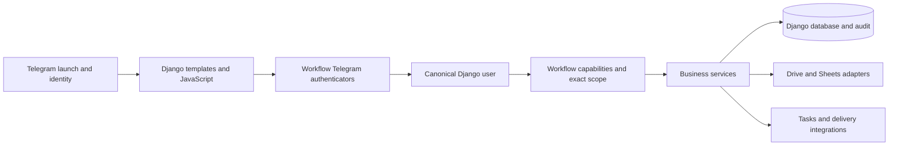
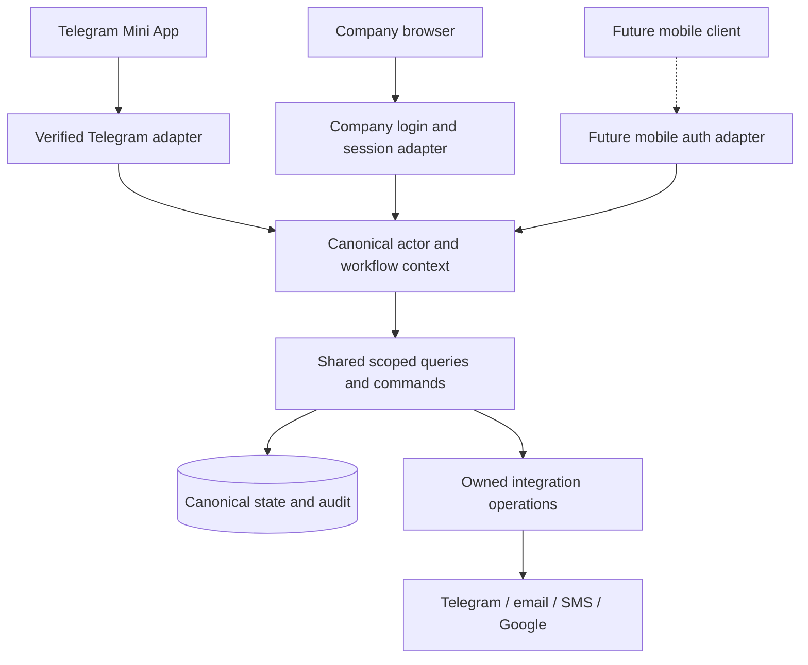
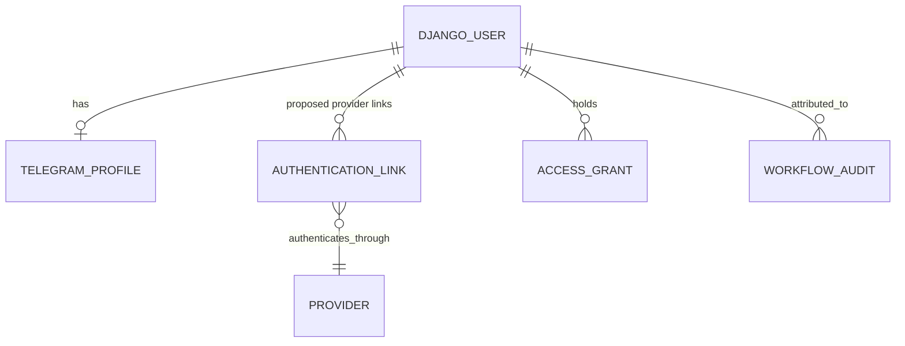

# Platform-independent JBL business system: research and recommendations

Research date: **19 October 2026**. Inspected source baseline: `7217791e9836986a493559254f465555ed670568`.

Status: **discussion and proposed roadmap, not an approved implementation specification or ADR**. Only Markdown documentation changes accompany this research. No application code, access policy, deployment settings, database, provider configuration or customer data was changed. Production was not inspected. Existing architecture and security instructions continue to apply.

Detailed delivery sequencing is in `codebase-analysis-docs/assets/PLATFORM_INDEPENDENCE_IMPLEMENTATION_PLAN.md`: proposed timelines, milestones, Telegram compatibility controls, opt-in cohorts and rollback. Its P0–P7 phases expand the conceptual roadmap below; neither document authorizes implementation or deployment.

All repository paths below are relative to the repository root. Source observations, recommendations and unresolved decisions are distinguished explicitly. External references were checked against primary documentation on the research date; links are collected in section 13.

## 1. Executive assessment

The proposal has the right central principle: **JBL should own the business system; Telegram should be an access and integration channel.** I recommend pursuing that direction incrementally, within the existing Django modular monolith.

The important correction is that this repository is **not starting from a Telegram-only user table and bot-owned business rules**. It already has canonical Django staff accounts, linked Telegram identities, workflow-specific grants, server-owned transitions, audit history, database-backed tasks, protected documents and several non-Telegram integrations. The accurate starting description is:

> A Django-owned operational platform with a Telegram-centric staff authentication and delivery experience, plus some deeper Telegram-shaped scope, attribution and operational dependencies.

Evidence: `core/models.py::UserProfile`, `AccessGrant`, `JawabuPipelineEvent`; `core/services/telegram_identity.py::user_access`; `core/services/workflow_access.py::workflow_access_decision`; `hb_operations/deposits.py::update_deposit`; `core/services/tat_notifications.py::inbox_payload`; `origination/services/origination_sms.py`; `report_delivery/services.py`.

### What I would recommend now

1. Retain Django, its database, the current domain services, server-rendered templates, htmx and existing JavaScript. Do not commission a React rewrite or split into microservices to achieve channel independence.
2. Keep the existing Django user as the internal staff identity. Add a governed company authentication link later; do not introduce a parallel employee account system or replace existing primary keys.
3. First prove an independently authenticated, scoped **All Cases search and limited case-history view** in a normal browser. An ordinary staff user, not a Superuser or Admin session, must pass the proof.
4. Then prove a bounded write through **HB Deposits**, retaining the same amount validation, KES 5,000 first-visit gate, permissions, concurrency checks, idempotency and audit history.
5. Treat notification delivery, staff onboarding, business scope, document access and intake continuity as separate exit-readiness work. A successful Chrome login does not establish Telegram independence.

This is an incremental extension, not a replacement product. Existing staff workflows must remain available during the transition.

**Findings:** the proposal is directionally sound, but several proposed foundational changes already exist. **Open questions:** company identity provider, first browser audience and required Telegram-outage scope. **Next steps:** approve a bounded discovery/pilot scope before implementing authentication or changing deployment policy.

## 2. Assessment of the supplied proposal

| Proposal | Assessment for this repository | Recommended refinement |
|---|---|---|
| The backend should own workflow rules | Correct; already substantially implemented | Preserve and reuse existing services; extract only the rules needed by the selected pilot from large views |
| Establish an internal employee identity | Already present through Django user plus `UserProfile` | Link additional providers to that same user; a human-readable HR number is optional, not an authentication prerequisite |
| Centralize permissions | Shared policy machinery already exists | Centralize policy evaluation, not roles across Mini Apps; preserve exact workflow/group/branch/product tuples |
| Use the same API from different interfaces | Correct as a business-contract goal | Thin channel-specific authentication adapters may initially have different URLs while calling the same command/query services |
| Reuse the Mini App frontend | Practical for this codebase | It is Django HTML/htmx/JavaScript, not React; isolate channel hooks rather than rewriting forms |
| A Telegram SDK may fail in Chrome | SDK-specific, not a universal browser limitation | This repository loads the official `telegram-web-app.js`; the decisive issue is absent trusted launch credentials, not whether a JavaScript object exists |
| Exchange Telegram identity for an application session | A session bridge already exists | Existing workflow decorators still require Telegram credentials; review session lifecycle and CSRF before broadening access |
| Add independent notifications | Useful, but not starting from zero | TAT has a durable private inbox; reports use email; Origination has SMS. Each has a distinct audience and disclosure contract |
| Keep a modular monolith | Strongly appropriate | Logical layers do not require separate deployables or internal HTTP calls |
| Removing Telegram later will not require a rebuild | Achievable objective, not yet proven | Require a Telegram-disabled end-to-end operational exercise before making that claim |
| This addresses Telegram's reputation | It improves control and exit options | Branding, perceived trust, actual information security and regulatory compliance are separate questions |

`pyproject.toml` declares Django `5.2.17`, django-htmx and Django REST Framework. Most inspected workflow endpoints use ordinary Django views and `JsonResponse`. DRF's presence neither proves a stable platform-neutral API nor requires converting every endpoint. The dependency declaration is not evidence of the deployed package version.

The official Telegram documentation now also describes **browser Telegram Login using OpenID Connect and Authorization Code Flow with PKCE**. This is a potential browser-access option, but it still depends on a Telegram identity provider. It is not the company-controlled alternative described in the proposal. Its ID-token verification is a different protocol from Mini App `initData` validation. [S2]

**Findings:** retain the architectural direction, correct the starting assumptions and distinguish browser access from provider independence. **Open questions:** whether an interim Telegram browser login has any business value. **Next steps:** avoid adding an intermediate login path unless it serves an explicitly chosen rollout goal.

## 3. Current architecture and concrete evidence

### 3.1 Current flow



The diagram is a logical map, not proof that every legacy view follows this separation perfectly. `core/api/portal_views.py` remains a large HTTP/business orchestration module. Some services import identity-neutral authorization through the Telegram-named module. Those are extraction opportunities, not reasons to replace the working backend.

### 3.2 Existing strengths

| Concern | Observed implementation | Meaning for the proposal |
|---|---|---|
| Internal staff account | `core/models.py::UserProfile.user` is a one-to-one link to `AUTH_USER_MODEL` | Telegram is already a linked identity, not the staff record's primary key |
| Unique linked Telegram identity | `UserProfile` has conditional uniqueness for nonblank Telegram IDs and enrolled usernames | Preserve binding constraints and account history |
| Authentication validation | `core/services/telegram_identity.py::validate_telegram_init_data` checks HMAC, freshness and user structure | Reuse this verifier; do not copy it into a browser adapter |
| Session bridge | `core/api/auth_views.py::telegram_session_login`; `core/auth_backends.py::TelegramMiniAppBackend` | A normal Django session can already be issued from verified Telegram identity |
| Workflow independence | `AccessGrant.workflow`; `user_access`; `core/services/workflow_access.py` | One login can serve multiple applications without sharing their role authority |
| Exact scope | `matching_capability_grants`, `scope_workflow_queryset` | Permissions must come from a complete matching grant, not mixed branch/product/role fragments |
| Controlled staff changes | `core/services/staff_lifecycle.py`; `core/services/staff_telegram_onboarding.py` | Reuse governance; separate future company-login activation from Telegram delivery |
| Server-owned financial rule | `hb_operations/deposits.py::update_deposit`, `deposit_state` | A useful existing command boundary for proving identical behavior across channels |
| Attribution and retained history | `core/models.py::JawabuPipelineEvent` has `actor_user`, `authority_user`, actor labels and Telegram attribution | New channel evidence can extend attribution without rewriting historical events |
| Retry identity | `core/services/miniapp_requests.py` plus workflow-level duplicate checks | Retry keys are already a cross-channel concept, despite the Mini App naming |
| Durable publication | `core/services/portal_publication.py::reserve_farmer_publication` and publication operation processing | A saved business result need not be replaced by a synchronous Sheet write |
| Sensitive evidence audit | `core/services/jawabu_media_access.py::record_jawabu_media_access` | Keep protected retrieval and fail-closed auditing in a browser channel |
| Governed downloads | `origination/views.py::portal_origination_download` | Some native-download links already bind an actor and recheck current authorization |
| In-application tasks | `core/services/tat_notifications.py::inbox_payload` | There is a durable work surface beyond a Telegram notification message |
| Other delivery channels | `report_delivery/services.py`; `origination/services/origination_sms.py` | Email and SMS are already integrations, but not a generic staff-alert service |

Migration `core/migrations/0054_unified_staff_identity.py` is historical evidence of the internal identity direction. The current `core/models.py` and subsequent migrations, not that migration alone, define today's constraints.

### 3.3 Actual dependency/gap map

| Dependency | Source evidence | Required outcome |
|---|---|---|
| Protected Portal requests require signed Telegram data | `core/api/portal_views.py::portal_auth_required` validates before accepting the actor | Add a separately secured browser path, not an unsigned fallback |
| Origination has its own Telegram adapter | `origination/auth.py::origination_auth_required` validates `initData`, then sets `origination_user` and `origination_access` | Normalize identity separately while retaining Origination authorization |
| Complaints and TAT use other request/context shapes | `core/api/complaint_case_views.py::_context`; `core/api/views.py::_tat_context` | Inventory each adapter; do not assume changing Portal unlocks all applications |
| Session creation does not replace the signed request requirement | Portal and Origination decorators call `login()` after Telegram validation | A session existing in the browser is not proof those APIs accept session authentication |
| CSRF exemptions assume non-cookie credentials | `hb_operations/deposit_views.py::hb_deposit_update`; Complaints routes; Origination routes | Browser session mutations must have enforced CSRF protection |
| Frontend API authentication is channel-specific | `core/static/miniapp/portal_api.js::initDataHeader`, `apiFetch`; `core/static/miniapp/miniapp-nav.js` htmx headers | Browser transport must attach its own valid credentials and CSRF header, not fake `initData` |
| Telegram script is in the shared Portal shell | `core/templates/base_shell.html` loads `https://telegram.org/js/telegram-web-app.js` | Standalone shell must remain usable when this external resource is blocked/unavailable |
| Some safety behavior is initialized with Telegram | `core/static/miniapp/utils.js::initTelegram` invokes `installWriteProtection` after finding the Telegram object | Make browser write/dirty-form protection a platform feature; do not accidentally omit it |
| Human-readable actor labels can derive from launch payload | `core/api/portal_views.py::_portal_sender_from_request` and its callers | Derive new browser labels from the canonical actor; preserve historic snapshots |
| Group identity mixes transport and business scope | `core/models.py::GroupSheetConfiguration.group_id`, `AccessGrant.group_configuration` | Keep existing scope intact; separate transport destinations from business workspace identity gradually |
| Discovery and activation are Telegram-shaped | `core/api/miniapp_launcher_views.py::miniapp_available`; `core/services/staff_telegram_onboarding.py` | Standalone discovery/onboarding must not require a Telegram launch or group join |
| TAT task links/delivery are channel-shaped | `core/services/tat_notifications.py::build_task_url`, `_send_recipient`, `connect_private_alerts` | Preserve tasks and routing; add approved alternate navigation/delivery where needed |
| Current browser tests do not prove independent backend login | `core/tests_browser/fixtures/portal_shell.js` blocks remote traffic; deposit browser tests inject API doubles | Add full browser-to-Django tests without Telegram credentials; do not relabel UI fixtures as independence proof |

These workflow entry points have different context and actor shapes; maintainers should follow their current signatures before implementing an adapter. A transport audit must also identify legacy bearer/form tokens, native download capabilities and external signer tokens, which have different purposes from staff login.

**Findings:** domain independence is substantial; access-channel and operational independence are incomplete. **Open questions:** deployed enablement, actual staff account bindings, legacy enrollment usage and workflow-specific continuity requirements. **Next steps:** build a bounded endpoint/credential inventory for the selected pilot, using current routes and executable tests rather than historical status reports.

## 4. Proposed architecture: one platform, multiple adapters

### 4.1 Five logical layers

| Layer | Recommended responsibility | Existing source to build on |
|---|---|---|
| Presentation | Shared workflow forms and business content; channel-specific navigation, theme, camera and download behavior | `core/templates/base_shell.html`, `core/static/miniapp/utils.js`, `core/static/miniapp/miniapp-nav.js`, owning-app templates/assets |
| Authentication and actor context | Verify one chosen credential, resolve the canonical active user, retain authentication method and session assurance | `core/services/telegram_identity.py`, `core/auth_backends.py`, `core/api/auth_views.py`, workflow authenticators |
| Business services and authorization | Validate capabilities/scope and workflow transitions; execute commands transactionally | `core/services/workflow_access.py`, `core/services/workflow_capabilities.py`, `hb_operations/deposits.py`, `core/services/jawabu_pipeline.py`, owning-domain services |
| Persistence and integration adapters | Django models/audit; controlled Drive evidence; Sheets publication; email/SMS/Telegram delivery | `core/models.py`, bounded apps, `core/services/portal_publication.py`, `report_delivery/`, Origination provider modules |
| Infrastructure and operations | HTTPS, secrets, database recovery, private storage controls, monitoring, release discipline | `config/settings.py`, `config/urls.py`, `release.sh`, current deployment/runbooks |



Recommendations:

- Keep the logical layers within the monolith. Do not make a service call over HTTP from one Django module to another merely to claim API-first architecture.
- Separate the **query/command contract** from HTTP credentials. A command receives an actual actor, resource, validated values, expected revision and retry key; it does not trust a caller-supplied staff ID.
- Enforce scope at query and mutation boundaries. Keep server-side locks, audit and publication reservation with their owning business operation.
- Reuse existing query projections so Telegram and browser screens cannot silently apply different rules or expose different unauthorized fields.
- Avoid extracting every large file upfront. Start with the pilot's functions and retain compatibility imports while moving genuinely shared identity-neutral helpers out of Telegram-named modules if useful.
- Do not create a second database or browser-specific copy of a case. Django remains canonical; Sheets remains a projection and Drive remains an integration, not authorization authority.

### 4.2 API-first does not mean a public generic CRUD API

For this system, API-first should mean explicit, tested business operations with stable input/output and error semantics. Preserve commands such as “record deposit” and “accept this exact signed order version,” rather than exposing unrestricted model updates.

First-party HTML fragments may remain HTML. JSON endpoints may remain plain Django views. If a future independent client genuinely needs a versioned public contract, document and version that surface deliberately. Existing `core/api/urls.py` and `codebase-analysis-docs/assets/ROUTE_INDEX.json` are route inventories, not an OpenAPI guarantee.

**Findings:** the five-layer model fits the existing modular monolith. **Open questions:** precise shared contract and ownership for each pilot endpoint. **Next steps:** define a small adapter boundary without an application-wide framework migration.

## 5. Staff identity, authentication and authorization

### 5.1 Preserve the internal user

Recommended conceptual relationship, not a new schema approved for implementation:



`AUTHENTICATION_LINK` and `PROVIDER` represent proposed responsibilities; they are not existing model names or an instruction to add two tables. A maintained OIDC integration may already supply appropriate persistence. Any new persistent domain must follow the repository's bounded-app/database-catalogue rules; do not add a new employee model to legacy `core` by default.

Account binding recommendations:

1. Bind a verified company identity to an existing internal user through an explicitly authorized enrollment process.
2. For OIDC, identify the provider account using verified **issuer plus subject (`iss`, `sub`)**. Email and display name are not durable unique identity keys. [S6]
3. Do not auto-merge staff by matching email, Telegram username, phone or customer ID. A verified email domain alone does not prove an employee is approved for this system.
4. Prevent one provider identity being linked to multiple users. Define controlled replacement/recovery for changed providers or accounts.
5. Record who authorized the link, when and by what evidence, without retaining raw credentials or ID tokens as audit metadata.
6. Keep staff status and workflow grants separate from provider claims. A valid company login with no applicable grant must see no operational data.
7. Preserve existing historical actor IDs, labels, signatures and compliance evidence. Do not backfill old events with guessed SSO identities or re-sign documents.

The current `resolve_or_bind_telegram_user` also retains a **legacy username-matched binding path** for enrolled profiles without activation challenges, while newer onboarding requires activation proof. This is observed source behavior, not a newly demonstrated exploit. Review actual remaining legacy enrollment separately; do not copy username matching into a new company-login adapter or silently break existing activation in this project.

### 5.2 Company authentication options

| Option | Benefit | Main limitation | Recommendation |
|---|---|---|---|
| Existing company-managed OIDC/SSO provider | Can use established employee lifecycle and authentication policy | Requires confirmed tenant, licensing, administrator ownership, enrollment and session-revocation design | Preferred if the organization already has a suitable provider |
| Django username/password with an approved MFA solution | Independent of Telegram and works with Django identity | Adds password recovery, MFA enrollment, account-abuse and helpdesk responsibilities | Deliberate fallback only; not an improvised password page |
| Telegram browser OIDC login | Can bring Telegram-backed users into a normal browser | Still depends on Telegram; does not satisfy a Telegram exit requirement | Optional interim channel, not the independence milestone |
| New self-hosted identity platform | Greater control over authentication infrastructure | Another critical system to patch, back up and operate | Not the default for this pilot |

No provider, vendor subscription, new dependency or authentication policy is selected by this research. Google service-account/Drive access and Gmail OAuth integrations in the code do **not** establish that employees already have company SSO configured.

### 5.3 Sessions, lifecycle and assurance

For a same-origin Django browser application, prefer a normal server-managed session in a `Secure`, `HttpOnly`, appropriately `SameSite` cookie. Choose cookie policy with OIDC callbacks and Telegram Web embedding in mind; do not set `SameSite=None` globally to make one embedded flow work. Avoid browser `localStorage`/`sessionStorage` for session IDs, refresh tokens or JWTs. [S4, S5]

Proposed company OIDC flow: backend-initiated authorization code flow, PKCE using S256, validated callback state/issuer/audience/signature/expiry and OIDC nonce where applicable; controlled account binding; Django login; redirect to an allowlisted application destination. Provider tokens remain server-side if needed at all. Do not design a token format or hand-roll OIDC cryptography. [S6, S7]

Important lifecycle details:

- Establish an application session at login/callback, not by repeatedly calling `login()` on every browser business request. The existing Telegram decorators' behavior should not simply be copied: Django rotates CSRF secrets on login. [S3]
- Define idle/absolute lifetime, logout, session revocation and account recovery explicitly. Do not convert a one-day Telegram launch credential into an indefinitely renewable company session.
- Deactivating a provider account does not, by itself, prove an already issued Django session is revoked. Define provider/local lifecycle synchronization and revocation behavior. Recheck local active status and current grants on operational requests.
- Decide whether high-risk approvals need stronger or recent company authentication. A valid Telegram signature is not proof of company MFA or an approval decision.
- Adding login must not confer Django Admin access. Conversely, `is_staff` alone must not confer Mini App authority.
- Superuser break-glass remains the existing active-Superuser exception. Scoped IT remains scoped. Do not introduce a universal company-admin business role.

### 5.4 Preserve the existing authorization boundary

Use each workflow's own capability/scope resolution. A TAT BM remains different from an Origination BM; a Portal HB role does not become a Complaints resolver. One complete grant must cover the action and resource. [Repository: `core/services/workflow_access.py`, `core/services/access_policies.py`, `docs/adr/0019-django-superuser-access-grant-override.md`, `docs/adr/0026-tat-access-and-responsibility-separation.md`; external principle: S8.]

`workflow_access_decision` and some queryset helpers deliberately support `access=None` in explicit local/test contexts. A production company-login adapter must always supply a real, current access context and must never use `None` as an unauthenticated fallback. Disabling `*_WEBAPP_REQUIRE_TELEGRAM_AUTH` is not a browser-login design: `core/services/telegram_auth.py` and deployment tests restrict that bypass to local/test runtimes.

**Findings:** extend the existing internal identity and permissions rather than replacing them. **Open questions:** IdP, staff enrollment authority, account recovery, session lifetimes and approval assurance. **Next steps:** document an approved identity/session decision before exposing company-authenticated endpoints.

## 6. The critical security boundary: cookie sessions versus Telegram credentials

### 6.1 Why a simple session fallback is unsafe

Today `hb_deposit_update` is explicitly CSRF-exempt because verified `initData`, not the browser cookie, authenticates the write. Portal authentication occurs before the view executes. That is a different security model from a browser automatically sending an authenticated session cookie.

A change equivalent to “if there is no valid Telegram data, use `request.user`” on the same unchanged exempt endpoint could make a forged browser request execute using cookie authority without the expected CSRF checks. This is a **migration hazard**, not a claim that the current Telegram-only route has that vulnerability. Django's documented CSRF protections are applicable to cookie-authenticated writes. [S3, S9]

### 6.2 Preferred initial adapter strategy

For the pilot, use explicitly separated transport boundaries:

| Boundary | Accepted identity | Mutation protection | Business execution |
|---|---|---|---|
| Existing Telegram endpoints | Fresh valid signed Telegram launch data | Existing non-cookie verifier and workflow checks | Existing shared command/query |
| Proposed browser endpoints | Controlled company-authenticated Django session | Enforced Django CSRF, HTTPS and origin policy | Same shared command/query |
| Existing external signing endpoints | Existing signer capability/token and its validation | Existing purpose-specific non-cookie protections | Existing signing service, not staff approval authority |
| Existing/native download endpoint | Existing expiring actor/resource-bound capability | Retrieval-time active-user/scope/revision checks and safe response policy | Existing protected document service |

This can mean separate browser URLs initially, with shared commands underneath. It is still one platform. It avoids weakening all existing Telegram routes in a single decorator change. Never call a CSRF-exempt HTTP view from a browser wrapper as a shortcut; call the underlying business service.

A future single URL with multiple credential types is possible, but needs an explicit credential-selection policy and tests. **Invalid explicitly supplied credentials must fail closed, not fall through to another identity.** A browser route must not accept a body-supplied user or role. Where Telegram and session identities differ, reject ambiguity or apply an approved explicit route policy; never silently perform the action as the more privileged identity.

Additional controls for the pilot:

- Use framework CSRF protection on all browser mutations, including sensitive preparatory actions, login forms where relevant and logout. Send `X-CSRFToken` only to the intended same-origin endpoints. OAuth callback state/nonce controls do not replace API-write CSRF protection. [S3, S7]
- Avoid cross-origin deployment for the first browser client. Do not turn on wildcard credentialed CORS or weaken `CSRF_TRUSTED_ORIGINS` to make a test pass.
- Preserve request throttling, safe error messages, correlation IDs and current maintenance/read-only behavior.
- Review the existing Telegram-to-session exchange for login-CSRF/session-switching implications before repurposing it. Its signed proof and current throttling are not a substitute for reviewing the changed threat model.
- Keep framing policy destination-specific. `core/miniapp_security.py` currently allows reviewed Mini App HTML in Telegram Web. Preserve required embedding; do not frame-enable Admin or a company authentication page broadly.
- Document downloads separately: some authorized download URLs are capability credentials themselves. They must be short-lived, redacted and non-cacheable, even when current authorization is rechecked. A tokenless record reference or case UUID is not authority.

**Findings:** the highest-risk change is admitting a new credential type through an old transport boundary. **Open questions:** final URL/credential split and cookie topology. **Next steps:** require negative CSRF, credential-confusion and cross-scope tests before any browser write pilot.

## 7. Reusing the frontend without a rewrite

### 7.1 Separate business UI from channel capabilities

The Portal already has normal page URLs, responsive templates, shared API helpers and some browser fallbacks. For example, `core/static/miniapp/utils.js::miniAppColorScheme` uses the browser color preference if Telegram supplies no theme. `core/static/miniapp/miniapp-nav.js` provides browser/htmx navigation as well as Telegram hooks. These are useful foundations, not complete browser readiness.

Proposed bridge responsibilities, not new code/API names approved for implementation:

| Responsibility | Telegram adapter | Standalone browser adapter |
|---|---|---|
| Session entry | Validated Mini App launch, retaining existing behavior | Company login and controlled session |
| API credential attachment | Verified raw `initData` header where required | Session cookie and CSRF header for unsafe methods |
| Back/close behavior | Telegram buttons plus application navigation | Browser history plus application navigation |
| Dirty-form/in-flight protection | Shared protection plus Telegram close confirmation | Same shared protection plus browser unload/navigation protection |
| Theme and viewport | Telegram theme/safe areas/viewport when available | Company/browser theme and browser viewport |
| Document access | Existing secure preview and supported native download | Same protected content through browser-compatible download |
| Notifications | Current in-app work plus approved bot delivery | Authorized in-app work plus separately approved delivery |
| Location/camera | Feature-detect supported Telegram/native behavior | Browser permission APIs and file capture where appropriate |

Do not test “inside Telegram” solely by the presence of `window.Telegram.WebApp`. The official script can expose a bridge object without a trusted launch. Only the backend decides identity from a valid credential. Browser UI must not synthesize launch data, accept `initDataUnsafe` as identity or persist raw launch data as a portable login. [S1]

### 7.2 Concrete review targets

- `core/templates/base_shell.html`: the remote Telegram script is currently a shared dependency. Test a standalone entry with that host blocked, not merely a missing `initData` string.
- `core/static/miniapp/utils.js::initTelegram`: some write protection is installed inside Telegram initialization. Make protection initialization channel-independent before claiming equal browser safety.
- `core/static/miniapp/portal_api.js::apiFetch`, `postJson`, `fetchHtml`: retain retry-key semantics, timeouts, safe errors and publication wake-up while adding the browser's authentication/CSRF behavior.
- `core/static/miniapp/miniapp-nav.js`: isolate Telegram BackButton, viewport hooks and htmx credential attachment; preserve normal navigation and permission-denied behavior.
- `_portal_sender_from_request` callers: ensure browser actions get the canonical actor's display label and ID without inventing a Telegram account.
- File/preview paths: test protected PDFs, content disposition, camera inputs, map permission prompts and failed/expired downloads in actual supported browsers.
- `core/miniapp_security.py`: verify CSP/framing without applying the Mini App exception to company login or Admin.

Do not combine channel support with an unapproved redesign. Read `docs/ui-standard/README.md` and its component index before any future interaction/appearance implementation; preserve the UI source ratchet and separate approval requirements. No screenshots or UI baselines were changed for this research.

**Findings:** substantial UI reuse is practical; no defensible percentage can be given from a dependency search. **Open questions:** supported browsers/devices and company branding decisions. **Next steps:** adapt one real shell and test without the Telegram SDK/network; do not duplicate all workflow templates.

## 8. Independence beyond login

### 8.1 Business scope is not a chat destination

`GroupSheetConfiguration` currently combines a Telegram group identifier, workflow configuration and Google publication settings. `AccessGrant.group_configuration` and workflow records use that scope. Removing a chat column or substituting a fabricated group ID would risk access leakage, duplicate records, lost routing and broken history.

Recommended progression:

1. First let a browser select only existing authorized business scopes; preserve current configuration rows and identifiers.
2. Treat “workspace/business scope” as a logical application concept, with Telegram group and Sheet destination as integration attributes.
3. Only if required, introduce a governed stable internal scope identity with explicit mapping to the existing configuration. Assess grants, locators, jobs, audit, reports, signed snapshots and historical URLs before a migration.
4. Retain historical group/message IDs as provenance. Being independent of Telegram does not require erasing where a record originated.

Do not rename all `group_id` parameters or migrate every workflow as part of the login pilot. Browser access can initially use existing authorized groups without claiming full scope-model independence.

### 8.2 Notifications, routing and work queues

The repository has reusable patterns but distinct contracts:

- TAT tasks and inboxes are persisted; Telegram delivery and private-alert connectivity remain coupled to routing behavior. Inspect `synchronize_case_task`, `_routing_recipients`, `_advance_unreachable_backup`, `dispatch_task`, `inbox_payload` and `connect_private_alerts` before changing channels. Delivery availability can influence backup handling; do not assume it is a harmless output swap.
- `report_delivery/services.py` reserves and processes approved report emails using current disclosure scope and provider-idempotency controls. These are reports, not an automatic license to send customer-level alerts to every staff email.
- Origination SMS retains a provider on the relevant signing flow and records delivery evidence. Delivery is not a signature or approval. Do not repurpose signing SMS consent, phone data or provider policy as a universal staff authentication/alert mechanism.
- Portal already has an in-shell attention surface. Existing owned integration-operation projections must not become a cross-Mini-App inbox by exposing the shared operation table.

Recommended future pattern: a workflow-owned task/notification intent with a controlled audience, safe summary and canonical application destination; independent delivery attempts through approved channel adapters. Use durable operations and leases where justified; reuse existing owned mechanisms instead of adding a generic message broker immediately. Delivery failure should not accidentally undo a committed business command, but workflow-specific escalation semantics must be preserved or explicitly redesigned.

### 8.3 Intake, signing and paid integrations

A browser login does not replace Telegram message forwarding, bot commands, file acquisition, launchers or staff activation. Inventory **currently active** intake routes per workflow. Do not resurrect retired Telegram complaint intake or archived approval flows on the strength of historical documentation.

For Portal, FarmUp's committed worklist and Django pipeline provide a promising non-message intake path. Verify file upload, validation, review/commit and publication recovery independently. For statement matching or other integrations, establish whether evidence acquisition or staff triggers still require Telegram even when their backend logic does not.

External signer pages are already a different audience and credential model from staff Mini Apps. Keep document packet versions, signer identities, consent bytes, approvals and evidence checks intact when adding staff browser access. See `origination/views.py` and the owning Origination services; do not merge signer-token identity with employee sessions.

The optional Daraja phone-against-ID check is an integration example, not part of the channel conversion. `origination/services/daraja_phone_identity.py` and `docs/adr/0058-origination-phone-identity-checks.md` retain explicit paid-attempt, reuse, uncertainty and authorization rules. A browser mount, refresh, SSO callback or read-only status request must never trigger a new paid check.

### 8.4 Platform independence is not provider elimination

Render, Google Drive/Sheets, SMS providers, email providers, Safaricom and a company IdP remain dependencies. Telegram independence does not imply an immediate hosting/storage migration. Keep adapters, durable local state, export/recovery procedures and ownership of secrets/accounts. Confirm actual deployment region, backup/restore capability, storage access and contracts separately; source defaults do not prove production configuration.

Company ownership also needs an operational checklist: company-controlled domain/DNS, repository organization and source rights, provider accounts/billing, administrative recovery, secrets, release access, database exports, evidence retrieval and tested restore procedures. Avoid making one individual's Telegram account, personal cloud account or laptop the sole recovery path. These are recommendations; this investigation did not audit account ownership or contracts.

Offline operation is a separate investment. Do not make IDs, LAFs, statements, approvals or case APIs service-worker/browser caches by default. If field drafts later need offline support, define device policy, minimized fields, retention, conflict handling and user separation first. Final approvals and authoritative transitions should remain server-validated; a queued offline action is not an approval.

**Findings:** operational exit readiness includes identity, scope, routing, intake, evidence and delivery. **Open questions:** required outage duration, notification service levels and alternate intake ownership. **Next steps:** complete a channel-dependency matrix before promising that Telegram can be removed.

## 9. Proposed phased roadmap and decision gates

These are proposed work packages, not permission to implement or deploy them. Sequence by security and operational evidence, not an unsupported completion percentage or fixed timeline.

### Phase 0 — Bound the problem and record contracts

- Choose the first audience: office staff in a company browser is a sensible initial target; retain Telegram for current field staff.
- Confirm company IdP/tenant ownership, MFA capability, domain ownership, enrollment/recovery responsibilities and device policy.
- Inventory pilot routes, every accepted credential, CSRF exemption, resource-scope check, actor attribution, GET side effect, attachment and external call.
- Capture existing policies and regression tests, including exact-scope grants, maintenance mode and signed-document finality.
- Define whether the goal is browser convenience, Telegram-outage continuity or full Telegram exit. These have different acceptance criteria.

**Exit gate:** approved pilot scope, threat model, owner, identity/session decision and test plan. No production data export is needed for discovery; use synthetic records.

### Phase 1 — Governed company identity and session entry

- Reuse the existing internal user; add controlled provider binding and audited link/recovery if needed.
- Implement a reviewed company login/logout/session flow in a separate bounded change.
- Resolve workflow access at the destination; no automatic business grants from a company login or email domain.
- Preserve current Telegram authentication, legacy activation compatibility and rollback path.
- Define session expiry/revocation and ensure deactivation works for already-open browser sessions.

**Exit gate:** a non-Superuser enrolled employee signs in without Telegram, while unknown, unbound, inactive, revoked and wrong-tenant identities fail. Current Telegram staff still work. Provider tokens and launch payloads are not leaked to URLs, logs or browser storage.

### Phase 2 — Real read-only Portal browser pilot

Scope: scoped All Cases search and selected case-history facts. Do not start with signed documents, bulk exports, payment approval, phone-verification dispatch or a full management dashboard.

Relevant existing sources: `core/api/portal_views.py::portal_all_cases`, `portal_farmer_detail`; `core/services/jawabu_pipeline.py::all_cases`, `farmer_to_card`; browser shell `portal_case_history_detail`; `core/api/urls.py`.

Important nuance: `portal_farmer_detail` can record a recent-case workspace open when `X-Portal-Workspace-Open-Key` is supplied. “Read-only pilot” therefore means **no operational case transition**, with any convenience/access audit writes explicitly identified. Do not assume all GET requests are state-free or copy side-effectful views wholesale. No publication pump or paid integration should be triggered merely by opening the browser pilot.

**Exit gate:** an actual browser calls an actual isolated Django backend without Telegram `initData`, bot identity or SDK network access; sees only authorized cases; rejects guessed cross-scope UUIDs; paginates/searches safely; exposes no protected evidence through an unreviewed link. A mock API or `force_login` alone is insufficient end-to-end proof.

### Phase 3 — HB Deposits write-parity pilot

Use the existing `hb_operations/deposits.py::update_deposit` command through a CSRF-protected browser boundary. Do not duplicate the deposit calculation in a new controller.

Required invariants:

- Recorded total is cumulative KES using `Decimal`, not a payment initiation or a bank/MPESA settlement confirmation.
- Blank/zero/below-KES-5,000 cases remain held for first JBL visit; threshold and locks remain server-owned.
- Existing Portal HB write authority, Operations Administrator read-only authority, scoped IT and active-Superuser override remain unchanged.
- A reason remains required for a reduction; a current-cycle first JBL visit locks the editor.
- The row lock, expected revision, retry-key/payload comparison, provenance, actor event and publication reservation remain one owned operation.
- Later FarmUp observations cannot silently overwrite an HB-owned deposit. Old visits and signed/approved financial artifacts remain unchanged.

**Exit gate:** equivalent authorized commands from either channel produce equivalent business state, native/compliance audit and publication reservation, with accurate actor/channel attribution. Concurrent edits conflict safely; an ambiguous retry does not duplicate an audit/business effect; cross-role, cross-scope and no-CSRF writes fail.

### Phase 4 — Task and operational continuity

- Separate current tasks from delivery availability; choose in-app/email/SMS alternatives by workflow and disclosure policy.
- Provide canonical browser destinations and safe post-login return paths; preserve access checks on every link.
- Establish alternate staff activation, helpdesk recovery and authorized scope selection without Telegram.
- Verify one new case can enter the selected workflow without a Telegram message.
- Review TAT backup/escalation behavior independently before changing delivery assumptions.

**Exit gate:** a bounded staging exercise blocks Telegram API/SDK/launcher access and still completes the selected operating scenario, including fresh staff login, new intake, task discovery, permitted action and support/recovery. Document unsupported workflows rather than silently treating the whole platform as independent.

### Phase 5 — Workflow-by-workflow expansion

- Expand through scoped capabilities, not a global “allow sessions” switch.
- Prioritize office review/reporting surfaces after their disclosure checks; schedule document/signing and financial approval flows as separate higher-risk changes.
- Keep existing record IDs, scopes, data modes, evidence hashes, immutable product/configuration snapshots, finance numbering and signing policies.
- Publish an explicit stable API subset only when additional consumers need it; add contract/schema documentation and compatibility/versioning rules then.
- Revisit a deeper business-scope decoupling migration only if its benefits justify its blast radius.

**Exit gate:** acceptance and rollback evidence for each named workflow. Do not advertise untested applications as browser operational merely because they share a menu.

### Phase 6 — Optional mobile/offline investment

Only start after real browser/field feedback identifies device or offline needs. A mobile app can reuse backend commands, but authentication, secure storage, updates, app distribution, camera behavior and offline synchronization remain separate work. For future native OAuth, use an external browser and PKCE rather than collecting company credentials in an embedded WebView. [S10]

**Exit gate:** approved business case and device/data threat model. This is not required for the initial platform-independence milestone.

**Findings:** a read pilot followed by a constrained write pilot provides strong evidence with a bounded blast radius. **Open questions:** pilot owner, identity provider and acceptance audience. **Next steps:** choose Phase 0/1 scope; do not begin a second frontend or broad authorization refactor.

## 10. Pilot API contract and verification plan

### 10.1 Preserve the business command contract

Existing Telegram-authenticated deposit URL, **not yet a browser-session endpoint**:

```http
POST /api/portal/hb-deposits/<case-uuid>/update/
Content-Type: application/json
X-Telegram-Init-Data: <fresh signed launch data>
Idempotency-Key: deposit-pilot-request-0001
X-Request-ID: deposit-pilot-request-0001

{
  "amount": "5000.00",
  "reason": "Recorded cumulative deposit after staff confirmation.",
  "expected_revision": 7,
  "client_request_id": "deposit-pilot-request-0001"
}
```

This synthetic example reflects `hb_deposit_update` and `update_deposit`. The response is `{"ok": true, "deposit": ...}` on success; do not invent or freeze all serialization fields from this abbreviated example. Current domain failures include `workflow_revision_conflict`, `idempotency_conflict`, `deposit_locked`, `reason_required` and `no_change`, as defined in the service. Header/body precedence is governed by `core/services/miniapp_requests.py`; a domain `request_id` in another workflow must not be mistaken for a transport retry key.

A proposed browser adapter would accept the same business values and call the same service, while using a session plus `X-CSRFToken`. Its URL and detailed authentication contract are **not selected here**. Existing Telegram endpoints must continue rejecting an unsigned request in production.

Idempotency must be explicit about resource, action, current actor authority, key and payload. Reusing the same key for different values must conflict. Retry success must never allow an unauthorized actor to retrieve another user's result. Do not promise identical HTTP error statuses across all current workflows: preserve existing consumers and define any new normalized contract deliberately.

### 10.2 Required verification matrix

| Area | Positive proof | Required negative/regression proof |
|---|---|---|
| Real authentication | Company login resolves the intended existing user | Wrong issuer/audience/tenant, expired proof, unknown binding, inactive user, callback tampering and account-link collision fail |
| Telegram compatibility | Valid existing launch still works | Bad/expired launch still fails; no session fallback after an explicit invalid Telegram credential |
| Cookie safety | Browser write with current session and valid CSRF succeeds | Missing/invalid CSRF and untrusted origin fail, including preparatory mutation paths |
| Actor confusion | Correct canonical actor appears in audit | Different Telegram/session identities cannot silently select a privileged actor |
| Role isolation | Pilot role can do its approved action | Other Mini App BM/HB/IT grants supply no authority; `is_staff` is insufficient |
| Exact scope | Entire resource matches one applicable grant | Cross-group/branch/product records, UUID guesses and mixed fragments of separate grants fail |
| Revocation | Current allowed user can read/write/download | Local deactivation or grant removal takes effect without waiting for an old UI bootstrap refresh |
| Deposit domain parity | Authorized cumulative change clears/reapplies hold correctly before visit | Invalid amounts, unchanged totals, unexplained reductions and post-visit edits fail |
| Concurrency/retry | Repeated identical ambiguous request has one business effect | Stale revisions, same key/different payload and concurrent edits cannot overwrite silently |
| Audit | Correct actor, authority, values, revision and request provenance retained | Browser action does not invent a Telegram actor or rewrite historical signed facts |
| External effects | Local commit plus durable publication reservation | Telegram/Google outage does not create duplicate cases or claim failed local saves; no real provider writes in default tests |
| Read-only pilot | Authorized query returns minimized selected facts | Mount/refresh cannot send SMS, trigger a paid Daraja attempt, dispatch an approval or publish a document |
| Browser runtime | Real shell handles back/navigation/errors without Telegram | SDK host blocked, no Telegram object and absent `initData` remain usable after company login |
| Evidence | Later scoped preview/download works as designed | Expired/forwarded capability, revoked actor, wrong revision and unrelated document cannot bypass retrieval checks |

Relevant starting tests: `core/tests_telegram_authentication.py`, `core/tests_user_identity.py`, `core/tests_workflow_capabilities.py`, `core/tests_miniapp_launcher.py`, `hb_operations/tests_deposits.py`, `core/tests_browser/portal_deposits.spec.js`, and the owning workflow's scope/media tests. These files guide future test additions; they were not executed for this documentation-only investigation.

Use PostgreSQL for eventual concurrency/row-lock acceptance. Use synthetic data, isolated databases and mocked/blocked external transports. Browser UI fixtures and Django `force_login` tests remain useful layers, but the final acceptance needs the actual configured login and backend boundary in staging. Real provider calls or production staff tests require separate authorization.

**Findings:** reuse existing business contracts and test hostile cross-channel behavior, not just the happy path. **Open questions:** exact endpoint surface and application session policy. **Next steps:** convert the matrix into the pilot's acceptance tests before implementation.

## 11. Risks, tradeoffs and decisions not to rush

### 11.1 Main risks

| Risk | Why it matters here | Recommended response |
|---|---|---|
| CSRF regression | Existing signed-credential routes are exempt from cookie CSRF | Separate browser boundary first; enforce framework protection |
| Duplicate staff accounts | Internal identity already exists | Explicit provider-to-existing-user linking, no email/name auto-merge |
| Scope broadening | Group/branch/product authority is business-critical | Reuse complete grants; no cross-workflow inheritance or `access=None` |
| Provider login mistaken for authorization | Valid Telegram/company identity does not imply employment or approval | Require active local user and current workflow/resource capability |
| Session survives offboarding | Provider disable and Django session lifecycle are different | Define and test local revocation/lifecycle integration |
| UI passes but system cannot operate | Existing browser tests can mock APIs; bot ingestion/alerts may still be needed | Actual backend login plus Telegram-blocked operational exercise |
| Attribution degrades | Some labels originate in Telegram payload | Retain canonical actor and safe channel metadata; preserve historical evidence |
| Task delivery changes routing | TAT has private-connectivity and backup behavior | Treat as its own governed workflow change |
| Document leak | Native download links are constrained credentials, not public files | Preserve retrieval-time authorization, revision binding, audit and safe headers |
| New data copies | Browser/offline/mobile can create unmanaged PII stores | No default offline cache; explicit retention/device policy |
| Unnecessary rebuild | Existing templates/services can be reused | Bounded adapters and extracts, not SPA/microservice migration |
| Premature compliance claims | Branding alone changes neither data processing nor contractual controls | Review actual data flows, processors, safeguards and organizational policy |

### 11.2 Telegram, reputation and Kenyan data protection

Architectural independence reduces concentration risk and improves company control over access, branding and continuity. It does **not** prove that Telegram is inherently unsuitable, that the current deployment is compliant, or that moving the same data to a branded portal automatically solves compliance.

Separate (a) what the Mini App sends directly to the Django backend, (b) what the bot receives in chats/files, (c) what notification messages disclose, and (d) what hosting, Drive, email, SMS and identity providers process. Do not assume every API-submitted case field is sent through a Telegram chat; equally, do not assume the embedded client has the same trust boundary as a company-managed browser.

JBL should obtain a privacy/security review of actual processing, retention, access, contracts and cross-border transfers for all relevant providers. ODPC publishes applicable rights and cross-border protection guidance; the reviewed guidance is a reason for a real data-flow review, not a legal compliance certificate. No production contracts, deployment regions, ODPC registration or legal basis were verified here. [S11]

### 11.3 Cost and value

Do not budget this as “three apps for the price of one.” Shared business logic reduces duplicated implementation, but each channel adds authentication assurance, device/browser testing, support, release and monitoring costs. SSO may involve licensing and administrative work; notification choices may add per-message charges. No current commercial prices, paid API tariff, delivery SLA or engineering-day estimate is asserted by this research.

The highest near-term value is likely **company browser access for office staff, shared internal identity and a credible Telegram exit path**, rather than immediate native mobile development. Confirm that prioritization with the operational owner rather than treating it as a measured user-research result.

**Findings:** security, staff lifecycle and continuity matter more than changing the frontend framework. **Open questions:** actual IdP cost/policy, device ownership, privacy review and continuity targets. **Next steps:** make these owner decisions before selecting dependencies or promising delivery dates.

## 12. Open decisions and recommended immediate outcome

| Decision/assumption | Current confidence/status | What resolves it |
|---|---|---|
| Existing Django user should remain canonical | High; observed models, services and tests | Preserve this invariant in the implementation brief |
| Shared monolith/frontend can support the pilot | High architectural fit; runtime proof pending | Real browser/backend pilot with Telegram blocked |
| Browser-only office staff is the best first audience | Recommendation, not confirmed requirement | Business owner selects audience and scope |
| Company has a suitable managed IdP | Unknown | IT confirms tenant, provider, staff coverage, MFA and ownership |
| All employees already have durable unique company emails | Unknown, not assumed | Enrollment/HR review; do not use email as the account key |
| Existing production sessions can be reused safely | Not established | Session/cookie/CSRF/revocation design and deployed configuration review |
| Group identifiers can be retired in the first pilot | Not recommended | Later scope migration impact analysis if genuinely required |
| Telegram can be fully disabled today | Not proven; source shows dependencies | Workflow-by-workflow outage acceptance, not a browser screenshot |
| Existing email/SMS can send arbitrary staff alerts | Not authorized | Purpose-specific recipient/disclosure/provider-policy decision |
| Customer-facing access is in scope | No; current proposal is treated as staff-facing | Separate identity, consent, scope and product decision if requested |
| Offline approvals are needed | Not established; excluded from first pilot | Explicit device/offline business case and conflict/security design |
| Production is configured as the source defaults suggest | Unknown | Separately authorized deployment/configuration inspection |

Recommended next decision:

> Approve a narrow **company-authenticated Portal browser pilot**, preserving existing Telegram access. First deliver scoped All Cases/limited history; then demonstrate HB Deposits parity. Keep all other workflow rollout, notification changes, scope migrations and mobile/offline work behind separate gates.

Do **not** yet approve a second frontend, a universal session fallback, new employee primary keys, bulk role changes, microservices, generic database CRUD, automatic customer-identity joins or a native application build. API-first design is a means of preserving one set of business rules, not a reason to expand access or duplicate the system.

**Findings:** a concrete, low-risk next experiment is available. **Open questions:** identity provider and pilot audience must be selected before a decision-complete implementation plan. **Next steps:** obtain those choices, then write a bounded implementation specification with the acceptance matrix above. No implementation is authorized by this document.

## 13. Primary research sources

All links checked on **19 October 2026**. Recommendations above combine these standards with repository-specific evidence; external sources do not establish this deployment's configuration or compliance.

| ID | Primary source | What it supports |
|---|---|---|
| S1 | [Telegram Mini Apps: initialization and validation](https://core.telegram.org/bots/webapps#validating-data-received-via-the-mini-app) | Validate raw `initData` server-side; do not trust `initDataUnsafe`; check freshness. Bridge capabilities and trusted identity are different concerns |
| S2 | [Telegram Login and OpenID Connect](https://core.telegram.org/bots/telegram-login) | Current Telegram browser login option; authorization code flow/PKCE and ID-token verification; this is still Telegram-provider authentication |
| S3 | [Django 5.2 CSRF reference](https://docs.djangoproject.com/en/5.2/ref/csrf/) and [AJAX CSRF integration](https://docs.djangoproject.com/en/5.2/howto/csrf/) | Cookie-write protection, origin checks, login CSRF-secret rotation and same-origin `X-CSRFToken` integration |
| S4 | [Django 5.2 authentication](https://docs.djangoproject.com/en/5.2/topics/auth/default/) and [sessions](https://docs.djangoproject.com/en/5.2/topics/http/sessions/) | Existing server session/authentication mechanisms; framework behavior should be used rather than reinvented |
| S5 | [OWASP Session Management Cheat Sheet](https://cheatsheetseries.owasp.org/cheatsheets/Session_Management_Cheat_Sheet.html) | Cookie protections, session lifecycle and avoiding JavaScript-accessible credential storage; SameSite is defense in depth |
| S6 | [OpenID Connect Core, claim stability and uniqueness](https://openid.net/specs/openid-connect-core-1_0.html#ClaimStability) | Stable provider identity is issuer plus subject; not an email/display-name match |
| S7 | [RFC 9700: OAuth 2.0 Security Best Current Practice](https://www.rfc-editor.org/rfc/rfc9700.html) | Authorization code/PKCE security, exact redirect handling, callback CSRF and issuer/mix-up protections |
| S8 | [OWASP Authorization Cheat Sheet](https://cheatsheetseries.owasp.org/cheatsheets/Authorization_Cheat_Sheet.html) | Default deny and authorization on each request; not merely a login check |
| S9 | [OWASP CSRF Prevention Cheat Sheet](https://cheatsheetseries.owasp.org/cheatsheets/Cross-Site_Request_Forgery_Prevention_Cheat_Sheet.html) | Cookie-authenticated mutations need CSRF controls; use framework defenses and review login boundaries |
| S10 | [RFC 8252: OAuth 2.0 for Native Apps](https://www.rfc-editor.org/rfc/rfc8252.html) | Future native clients should use an external user agent and PKCE rather than embedded credential collection |
| S11 | [ODPC data-subject rights](https://www.odpc.go.ke/rights-of-a-data-subject/) and [official guidance catalogue](https://www.odpc.go.ke/guidelines-2/) | Privacy/cross-border safeguards warrant a qualified review of actual providers and data flows; this is not a legal opinion |

No third-party Mini App SDK behavior is treated as evidence about this repository's official Telegram bridge. No OpenAI, Telegram, Render, SSO, SMS or Daraja pricing inference is included.

**Findings:** authoritative documentation supports the proposed trust boundaries. **Open questions:** standards do not answer company-specific identity, legal or deployment choices. **Next steps:** recheck provider/framework guidance when implementation begins, especially if the supported Django/provider versions change.

## 14. Source anchors and investigation state

### 14.1 Selected source anchors

Hashes are the first eight hexadecimal characters of SHA-256 over the complete source file bytes at the inspected baseline. Ranges identify the relevant reading, not a claim that every file was read in full. Re-read before implementing if the hash changes.

| Area | Source anchor | Important symbols/surface |
|---|---|---|
| Staff identity | [[F:core/models.py#3908-3952#3069dcc9]] | `UserProfile`, linked internal user and Telegram constraints |
| Grants | [[F:core/models.py#4180-4300#3069dcc9]] | `AccessGrant`, workflow/scope fields and governed mutation |
| Historical attribution | [[F:core/models.py#2868-2900#3069dcc9]] | `JawabuPipelineEvent` actor/authority/source |
| Business scope | [[F:core/models.py#5621-5674#3069dcc9]] | `GroupSheetConfiguration` transport/business settings |
| Telegram proof/binding | [[F:core/services/telegram_identity.py#44-227#9239d523]] | `validate_telegram_init_data`, `resolve_or_bind_telegram_user`, `user_access` |
| Django backend | [[F:core/auth_backends.py#1-17#8225f9c6]] | `TelegramMiniAppBackend` |
| Session bridge | [[F:core/api/auth_views.py#1-67#0a9cc802]] | `telegram_session_login`, throttling and returned workflow projection |
| Bypass restrictions | [[F:core/services/telegram_auth.py#1-46#da775153]] | Shared verifier compatibility/local-test guard |
| Complete-grant policy | [[F:core/services/workflow_access.py#1-220#01c6a0ad]] | `matching_capability_grants`, `workflow_access_decision`, queryset scope |
| Portal boundary | [[F:core/api/portal_views.py#39-198#8c0f0539]] | `portal_auth_required`, request identity, actor-label extraction |
| Pilot query | [[F:core/api/portal_views.py#5281-5362#8c0f0539]] | `portal_all_cases`, `portal_farmer_detail` and recent-open behavior |
| Origination boundary | [[F:origination/auth.py#1-80#acf88e7e]] | `origination_auth_required` |
| Complaints boundary | [[F:core/api/complaint_case_views.py#124-200#cbd31b84]] | Per-request actor resolution/local-test distinction |
| TAT context | [[F:core/api/views.py#430-466#51b0b379]] | `_tat_context`, group/form/Telegram context |
| App discovery | [[F:core/services/miniapp_launcher.py#1-56#a39757a3]] | `available_apps` and scoped destinations |
| Launcher credentials | [[F:core/api/miniapp_launcher_views.py#1-39#fe6c1cc0]] | `miniapp_available` |
| Task destination | [[F:core/services/tat_notifications.py#245-279#4a9b306b]] | Task locator and Telegram/browser-shaped URL generation |
| In-app work | [[F:core/services/tat_notifications.py#1187-1250#4a9b306b]] | `inbox_payload` |
| Client initialization | [[F:core/static/miniapp/utils.js#267-299#9b41e442]] | `initTelegram`, `initDataHeader` |
| Client transport | [[F:core/static/miniapp/portal_api.js#80-242#0f6eeb61]] | `apiFetch`, retry identity and Telegram headers |
| Navigation credentials | [[F:core/static/miniapp/miniapp-nav.js#240-305#90c535b7]] | htmx headers, navigation error behavior |
| Actual web shell | [[F:core/templates/base_shell.html#1-62#74358a45]] | Official Telegram script, htmx, attention panel |
| Framing | [[F:core/miniapp_security.py#1-38#4839f295]] | Reviewed Mini App HTML/CSP allowlist |
| Retry contract | [[F:core/services/miniapp_requests.py#1-92#7e061f70]] | `resolve_miniapp_request_identity`, `bind_miniapp_request_identity` |
| Shared write pilot | [[F:hb_operations/deposits.py#135-186#e14b35a4]] | `update_deposit` |
| Existing deposit HTTP | [[F:hb_operations/deposit_views.py#1-95#609fa12d]] | `hb_deposit_list`, `hb_deposit_detail`, `hb_deposit_update` |
| Local/durable publication | [[F:core/services/portal_publication.py#1-80#c6bbef05]] | Owned publication constants, destination ordering and pending queue |
| Evidence audit | [[F:core/services/jawabu_media_access.py#1-93#acd37028]] | `record_jawabu_media_access` fail-closed boundary |
| Native downloads | [[F:origination/views.py#74-136#f1d95e97]] | `portal_origination_prepare_download`, `portal_origination_download` |
| SMS adapter | [[F:origination/services/origination_sms.py#1-115#53c6a09b]] | Provider selection, redacted transport failure |
| SMS evidence | [[F:origination/services/origination_sms_delivery.py#1-68#c62507eb]] | Provider-pinned operation/delivery metadata |
| Email delivery | [[F:report_delivery/services.py#250-384#6efcb1f0]] | Delivery validation, frozen payload, send/retry ownership |
| Auth/settings | [[F:config/settings.py#126-145#d8d1d02d]] | Sessions, CSRF middleware, authentication backends |
| Canonical routes | [[F:core/api/urls.py#281-281#a3789577]] | Existing `/api/auth/telegram/` mount |
| Browser routes | [[F:core/api/browser_urls.py#1-67#bb356b9f]] | Browser shells are not proof of browser API authentication |
| Auth negative tests | [[F:core/tests_telegram_authentication.py#118-197#a79762a3]] | Valid identity without grants, local/test-only bypass |
| Session tests | [[F:core/tests_user_identity.py#280-357#1c6742c9]] | Existing linked user and session issuance |
| Browser fixture limits | [[F:core/tests_browser/fixtures/portal_shell.js#1-33#cc830069]] | Real shell but blocked network/local fixtures |
| Declared stack | [[F:pyproject.toml#1-49#3abf9b1f]] | Django/htmx/DRF and integration dependencies |

Other current references used for context: `docs/telegram-miniapp-authentication.md`, `docs/staff-access-and-telegram-onboarding.md`, `report_delivery/README.md`, `docs/adr/0039-unsigned-finance-workspaces.md`, `docs/adr/0056-origination-sms-providers.md`, `docs/adr/0058-origination-phone-identity-checks.md`, `docs/adr/0059-hb-deposit-gate.md`, `codebase-analysis-docs/assets/HB_DEPOSITS.md`, `core/services/staff_lifecycle.py`, `core/services/staff_telegram_onboarding.py` and `core/services/portal_workspace.py`. Current source and tests take precedence over historical notes.

### 14.2 STATE BLOCK — research complete

- INDEX_VERSION: `platform-independence-research-1`, source `7217791e9836986a493559254f465555ed670568`; focused anchors above, not a regenerated whole-repository inventory.
- FILE_MAP_SUMMARY: identity/models/auth/session; exact-grant authorization; Portal/Origination/Complaints/TAT adapters; shared shell/runtime/API/navigation; deposit command/HTTP boundary; publication/evidence/downloads; TAT tasks/email/SMS; routes/settings; authentication tests and browser fixture limits. See the selected source-anchor table for exact paths/ranges/hashes.
- OPEN_QUESTIONS: company IdP/tenant, pilot staff audience, session/revocation policy, legacy enrollment usage, supported browsers, independent intake/notification targets, deployment/provider/privacy posture.
- KNOWN_RISKS: cookie auth on exempt routes; scope widening or `access=None`; duplicate identities; issuer/subject mismatch; session/credential confusion; Telegram-dependent onboarding/routing; UI mocks mistaken for end-to-end proof; unintended paid/external effects; document/offline data leakage; rewriting historical evidence.
- GLOSSARY_DELTA: channel independence = equivalent authorized business operations across clients; provider independence = an approved authentication/operational path not requiring Telegram; operational exit readiness = intake, work discovery, action, evidence, support and recovery operate without Telegram; authentication link = governed provider identity mapped to an existing internal staff user; business scope = the authorized organizational/workflow boundary, not a notification destination.
- NEXT_READ_QUEUE: no additional source read is required for this research deliverable. Before implementation, select IdP/audience and re-read affected hash-changed sources, credential/session policy, pilot routes/services/tests and the UI standard. Inspect deployment only under separate authorization.
- VERIFICATION: source/search and official-document research only. Source anchors and Markdown change scope checked separately. No application tests, migration, real provider calls, production inspection or readiness certification performed.

**Findings:** the research is complete at the stated source baseline; the roadmap remains proposed. **Open questions:** the product/security choices above remain deliberately unresolved. **Next steps:** review the proposed narrow pilot before commissioning implementation.
