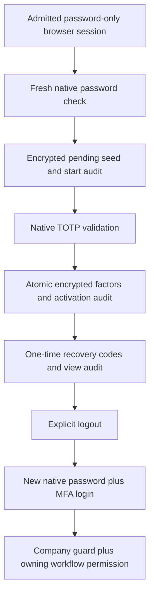

# Closed browser TOTP enrollment — P1b.2b.1

19 October 2026. Local implementation starts from branch HEAD `144ed843`.
Production release and applied migrations remain **unknown**. This slice adds
backend setup handlers only; browser access stays globally disabled, production
routes stay unmounted, and `staff_auth.E006` deliberately blocks activation.
No employee is provisioned or enrolled by applying this code. Telegram signed
launch, grants, shared sessions and Mini App assets are unchanged.

## 1. Scope, ownership and boundaries

`staff_auth/enrollment.py` owns closed setup for an existing, active Django user
with explicit current `StaffBrowserAdmission`, verified primary address and the
password-only company-browser channel established by `password_login`. A second
password check is required at begin. The ordinary Django/Admin cookie, Telegram
identity, password-only cookie without channel proof, completed browser login,
or caller-supplied token supplies no setup/replacement authority.

The pinned `django-allauth[mfa]==65.20.0` owns password verification, TOTP code
validation, authenticator creation, recovery-code generation and consumption.
`staff_auth/enrollment_state.py` projects nonprivileged progress from the current
session, native password reauthentication, admission revision, real ledger
receipts and exact authenticator IDs. It never issues browser MFA assurance.
`staff_auth/session_protection.py` continues to encrypt transient seeds with a
dedicated key and now clears enrollment context alongside browser context.

This is not staff provisioning, password recovery, factor replacement, a support
console, an operational frontend or a new business API. No model, migration,
dependency, environment name, production URL or frontend asset is added. React/
ADS installation remains held on D13 peer/licence/asset/build acceptance.

**Decisions/Findings:** reuse native credentials plus the existing audit ledger;
do not create another employee database or implement OTP algorithms.
**Open Questions:** provisioning/support owners, native shared cache, UI and M1.
**Next Steps:** accept these backend contracts before implementing their client.

## 2. Exact request and response contract

Paths below are relative declarations in `staff_auth/browser_urls.py`, not
production URLs. Only the synthetic URLconf mounts `/test-staff-auth/`.
All three endpoints accept POST JSON only, require the CSRF cookie/token and
trusted origin, reject any Authorization, X-Session-Token or Telegram-init-data
header (even empty), and send `Cache-Control: no-store, private`. Exact body
keys are enforced; the body limit is 8,192 bytes. Request keys are client UUIDs,
canonicalized server-side; never use employee/customer identifiers as keys.

| Handler / relative path | Exact body | Successful result | Important failures |
|---|---|---|---|
| `begin_enrollment`, `v1/enrollment/begin/` | `request_key`, `password` | 200 `enrollment_required`, `otpauth_uri`, `expires_at` | 400 invalid password/input; 409 in progress, unavailable or restart required |
| `confirm_enrollment`, `v1/enrollment/confirm/` | `request_key`, `code` | 200 `recovery_codes_required`, nonsecret `receipt_id`, `replayed: false` | 400 invalid code; 409 expired/missing setup, existing factor or conflicting retry |
| `enrollment_recovery_codes`, `v1/enrollment/recovery-codes/` | `request_key` | 200 `reauthentication_required`, `recovery_codes`, nonsecret `receipt_id` | 409 already viewed or invalid/expired activation context |

All responses have `is_authenticated: false`. An activation receipt retry may
report `reauthentication_required` after the recovery handoff; it never returns
the seed or recovery codes. Other shared results: 401 signed out/current
admission invalid; 403 CSRF/origin/mixed credentials; 404 global flag off; 405
wrong method; 429 durable throttle with Retry-After; 503 audit unavailable,
encryption configuration unavailable or unaccepted native notification mode.
Handlers do not return native exception text, account details or form errors.

Synthetic examples (no actual staff credentials):

```json
{"request_key":"da18826f-cba3-4b62-9338-36fd762e72b9","password":"<company password>"}
```

```json
{"request_key":"47f9432c-67c4-46d5-8de3-52ae499c7a38","code":"<authenticator code>"}
```

```json
{"request_key":"8e82f19d-873b-48f2-aacd-7940055987fe"}
```

The URI is itself a credential containing the enrollment seed and staff account
label. A future accepted client must keep it out of URLs, analytics, browser
storage, logs, screenshots and external QR services. Return it only through the
same-origin protected response. No QR renderer or UI is installed in this slice.

**Decisions/Findings:** setup is a distinct, protected JSON surface; no fallback
is added to CSRF-exempt Telegram endpoints. **Open Questions:** accepted client
handling and browser origin/cookie topology. **Next Steps:** scripted staging
journeys after the remaining release gates, not production mounting now.

## 3. Flow, idempotency and security invariants



1. `_execute` validates exact JSON and UUID, validates the channel and applies
   existing DB-backed IP/identity abuse controls **before** the owner transaction.
   Denied attempts remain counted even if a later write/audit rolls back. Each
   enrollment scope uses the existing initial 30/network and 10/identity requests
   per 600 seconds; these are security defaults, not measured service targets.
2. `_locked_channel` locks target Django User, then admission; rechecks current
   active identity/admission after locking; and installs the existing request-
   local encrypted session wrapper and native allauth request context. Lifecycle
   changes use compatible owner locking. Audit-chain locking comes last.
3. `_begin` requires no existing native authenticator of any type and the
   password-only channel. `ReauthenticateForm` performs the fresh native password
   check. Native `validate_can_add_authenticator` also rejects an unverified
   secondary email; primary verification alone does not waive that rule.
4. First begin uses native `ActivateTOTPForm` to generate the seed and records
   `staff_browser.enrollment_started`. Session context binds the exact session
   key, login attempt, admission UUID/revision, UUID request key, start time and
   receipt. The encrypted seed has the earlier user/admission/revision binding
   and 600-second expiry. Context holds no seed or password.
5. Valid same-key begin retries verify the password again and return the same
   pending seed/expiry without another audit. A new UUID while setup is valid
   gets `enrollment_in_progress`. Lost/expired context cannot reuse the old start
   key; a fresh begin with a new key is required. Receipts from earlier admission
   revisions cannot be reused to create a new credential.
6. Confirmation requires the actual start receipt, current session/auth hash,
   same admission revision and native password **reauthentication**. Both the
   600-second setup lifetime and native default 300-second reauthentication
   timeout apply, within the existing password-channel lifetime. A normal native
   password login record is not a reauthentication record. Same-key begin can
   refresh the native password check without extending the pending-seed expiry.
7. Before constructing a bound `ActivateTOTPForm`, `_confirm` requires and
   decrypts the existing seed: the vendor otherwise creates a new one if absent.
   Invalid OTP leaves the same seed available for a valid retry. Native
   `activate_totp` creates encrypted TOTP and recovery seeds in the same outer
   transaction as `staff_browser.enrollment_activated`, retaining exact factor
   IDs. Audit failure rolls back both factors and discards transient setup state.
8. Exact successful confirmation retries return a nonsecret receipt. Different
   keys, unexpected existing factors and stale contexts never replace/adopt a
   factor or regenerate recovery codes. This endpoint is not an MFA reset API.
9. Recovery retrieval locks native factors, independently refuses any prior view
   mark, then calls native `view_recovery_codes`. Marking viewed, generating the
   response's native unused codes and the `enrollment_recovery_viewed` audit are
   one transaction. Only count/activation reference enters audit. Audit failure
   rolls back the view mark, returns no codes and discards transient context.
10. Successful recovery-code disclosure is **not replayable**, even under a new
    request key or a relaxed native show-once setting. A lost response is uncertain
    delivery, not permission to re-show or regenerate. The authenticator still
    works for normal login; verified-support reset remains separate. If context
    expires after activation, use explicit logout plus native password/MFA; this
    slice has no later authenticated code-download/regeneration screen.
11. No enrollment action sends an allauth login-completion signal, creates MFA
    assurance, or supplies grants. Password-only cookies stay nonprivileged.
    Staff explicitly log out, then complete native password plus TOTP/recovery
    login before the company-browser guard can succeed. Each later workflow
    endpoint must still enforce its own role/capability and group/branch scope.

`session_state` may now report `recovery_codes_required` or
`reauthentication_required` only while these receipts/context remain current.
It returns no URI, seed, recovery code or setup audit. Ordinary Django login/
logout clears the new context through the existing signal boundary. Browser
logout clears only this client's setup/session, not the employee's credentials,
Telegram identity, other cookies, workflow grants or historical audit.

`_discard_failed_draft` explicitly saves the cleaned browser session after an
audit/configuration failure: Django SessionMiddleware does not normally save on
5xx. If session storage itself raises a database error, cleanup is best effort,
not guaranteed; the older encrypted/context-bound setup may remain until expiry.
No credential/view mutation commits without its audit and no business assurance
is issued. Resolve the storage outage and use current admission/expiry checks;
do not claim a browser-only revision reset or global session purge occurred.

**Decisions/Findings:** audit failure is fail-closed; retryable activation and
nonrepeatable code disclosure intentionally differ. **Open Questions:** actual
PostgreSQL race evidence, support for interrupted/lost setup and later native
factor maintenance. **Next Steps:** retain the explicit support boundary rather
than automatically replacing credentials.

## 4. Native callbacks, caching and remaining operational gates

Native activation schedules authenticator-added signals and local Django messages
on commit. No project authenticator-added receiver was found during inspection.
The native notification-mail function is a no-op under current
`ACCOUNT_EMAIL_NOTIFICATIONS=False`. These handlers hold with 503 if that setting
is enabled: this slice neither silently disables notifications nor authorizes
an external mail path. Review new receivers/callback behavior and accept a real
notification design before changing this guard. Audit and credential commits do
not prove callback/message delivery.

DB-backed HTTP throttles do **not** provide allauth's shared TOTP-used-code cache.
Default local-memory cache is not sufficient multi-worker replay protection.
Do not change the global cache backend incidentally or claim replay acceptance
from SQLite/local-cache tests. Controlled existing-user/address/password
provisioning, trusted recovery/helpdesk, mail, native shared replay/abuse cache,
deployed baseline, backup maintainer, cookie topology, real browser/Telegram
coexistence, PostgreSQL and M1 staging acceptance remain required. Complaints is
still the first business pilot; TAT/Origination/Portal remain later gated work.

No production auth paths are added to `config/urls.py` or `core/api/urls.py`.
Changing the browser feature flag alone still cannot make this operational.
Never remove E006 merely to start UI development. No percentage success or
latency threshold is inferred from a small pilot.

**Decisions/Findings:** source capability is not deployed readiness.
**Open Questions:** the operational gates above and D13 ADS acceptance.
**Next Steps:** bounded provisioning/recovery/cache work and frontend review,
then explicit M1 review before any staff admission.

## 5. Verification and limits

Stable inspected source anchors (exact-byte SHA-256 prefix; reread after changes):

- [[F:staff_auth/enrollment.py#1-237#263c5363]]: handlers, transaction, native flows,
  cleanup on 5xx and audit boundaries.
- [[F:staff_auth/enrollment_state.py#1-98#c0516c83]]: session/admission/native
  reauthentication and ledger/factor receipt checks.
- [[F:staff_auth/tests_enrollment.py#1-387#f76e387a]]: synthetic journeys and
  PostgreSQL-only races.
- [[F:staff_auth/browser_api.py#124-165#c12135a9]]: bootstrap state projection
  without new business authority.
- [[F:staff_auth/session_protection.py#21-35#e3f58162]]: context cleanup and
  existing encrypted pending-seed boundary.
- [[F:staff_auth/browser_urls.py#1-15#f36cfa73]]: relative declarations only.

The synthetic suite `staff_auth/tests_enrollment.py` exercises real native forms,
CSRF-enforcing Django clients, blocked external network and isolated test data.
It covers encrypted setup, same-key retry, activation, recovery-once, fresh
subsequent MFA login, current admission/hash/active checks, malformed/mixed
credentials, stale reauthentication, no silent seed creation/replacement, audit
rollback and native-mail hold. PostgreSQL-only concurrency tests cover competing
confirmation and recovery disclosure; SQLite must skip rather than simulate them.

Final focused run: **140 tests, 136 passed, four PostgreSQL-only concurrency
skips** (two existing lifecycle races and two new enrollment/handoff races).
All 23 new SQLite enrollment tests passed. The run also includes the existing
native headed/JSON password/MFA and Telegram/user-lifecycle regressions:

```text
python manage.py test staff_auth core.tests_telegram_authentication core.tests_user_identity core.tests_user_hard_delete --noinput --verbosity 0
```

It used isolated in-memory SQLite, synthetic configuration/keys, no provider
credentials and blocked network for enrollment journeys. An intermediate run
exposed the native SessionMiddleware 5xx save behavior; explicit post-rollback
cleanup fixed it. Fixture corrections used the real audit field names and an
elapsed clock rather than an impossible pre-login password timestamp. The full
rerun above passed after these corrections. The tool-suite's first invocation
omitted synthetic environment setup; rerunning with that setup passed.

Other executed passes: Django system check; no model changes detected;
migration graph (288 migrations, 19 leaves); architecture boundaries; Mini App
write inventory (202 routes); database governance; dependency parity (28 direct
Python packages); UI source ratchet; compileall; all **44 governance/tool tests**;
JavaScript syntax (147 first-party files); all `npm run test:node` groups; and
regenerated/verified database catalogue (213 application tables, usage-reference
changes only). Source/config/dependency/Telegram-asset diff checks confirm no
production URL, setting, migration, root manifest or Mini App UI change.

Wider checks remain **not all green**: environment-template parity reports the
same 119 missing names; tracked-artifact/privacy audit reports the same 17 prior
allowlist hash mismatches. No baseline/allowlist was relaxed. Local Ruff and
PostgreSQL tools are unavailable; the historical expired dependency-audit
exception and legacy duplicate-index finding remain in earlier phase documents,
not newly certified here. Full application CI, real browser/device runs, live
mail, cross-worker replay, PostgreSQL, staging, production and legal/licence
readiness are not established. No deployment or real enrollment occurs.

**Decisions/Findings:** validate at the auth boundary plus shared Telegram/user
identity regressions. **Open Questions:** unexecuted operational checks above.
**Next Steps:** use the following change-specific handoff, not an enable command.

## 6. Phase / merge / deployment / monitoring checklist

- [ ] Review new `enrollment.py`, `enrollment_state.py`, three relative route
  declarations, session-context cleanup, tests and ADR 0063. Browser remains
  false, production routes unmounted and E006 blocking.
- [ ] Confirm no new migration, dependency, environment name, root build change,
  Telegram template/JS/CSS edit, staff provisioning, grant or provider write.
  Catalogue regeneration is usage metadata only; preserve its existing schema.
- [ ] Re-run focused native auth, Telegram identity, user-deletion and governance
  checks. Review actual PostgreSQL race tests on a guarded local/staging database;
  skipped SQLite tests do not close that gate.
- [ ] Review same-key begin/activation behavior separately from one-time recovery
  disclosure. A lost response must not silently regenerate/re-show codes.
- [ ] Script password-only denial, ordinary cookie/mixed headers/CSRF, wrong or
  expired code, changed password, inactive user, admission revocation, concurrent
  submissions and audit outage. Setup must never grant business access.
- [ ] In a later approved staging mount, inspect safe 400/401/403/409/429/503
  outcomes, audit action/count/actor consistency, factor duplication, support
  interruptions and current channel/bootstrap state. Never capture credentials,
  cookies, otpauth URIs, enrollment screenshots, TOTP seeds or recovery codes.
- [ ] For any deploy of shared auth imports, check existing Telegram signed-launch
  journeys and ordinary Admin login/logout. No Telegram password/MFA prompt is
  introduced. Since production routes are absent, no new enrollment traffic or
  enrollment audit is expected there; treat unexpected exposure as an incident.
- [ ] If unexpected browser exposure, missing audit, duplicate factors, second
  disclosure, or Telegram regression occurs, close/keep closed the browser and
  investigate using nonsecret request/receipt evidence. Use human review and
  scripted journeys; no invented percentage/SLO trigger.
- [ ] Rollback: compatible prior application, browser still off/unmounted.
  Preserve factors, admission and immutable audit; no schema reversal, credential
  deletion or database restore is part of normal rollback. Real staff reset is a
  separately authorized, support-verified lifecycle operation.
- [ ] Record actual deployed commit/migrations before claiming production state.
  None inspected, merged, deployed or provisioned by this implementation phase.

### STATE BLOCK

- INDEX_VERSION: staff-browser-enrollment-1 / P1b.2b.1 / 19 October 2026.
- FILE_MAP_SUMMARY: staff_auth/enrollment.py; enrollment_state.py; browser_api.py;
  browser_urls.py; session_protection.py; assurance.py; lifecycle.py; tests_enrollment.py;
  tests_browser_api.py; config/settings.py; ADR 0063; phase plan/release checklist.
- OPEN_QUESTIONS: controlled provisioning, verified support/recovery, shared native
  cache, notification acceptance, deployed baseline, backup ownership, D13, M1.
- KNOWN_RISKS: interrupted enrollment, uncertain one-time delivery, stale session/
  admission, callback changes, shared-cache replay and unverified PostgreSQL races.
- GLOSSARY_DELTA: closed TOTP enrollment and recovery handoff are credential setup,
  not MFA login, permission, factor replacement or deployment admission.
- NEXT_READ_QUEUE: bounded provisioning/recovery/cache prerequisite; exact ADS
  compatibility/licence acceptance; accepted React client; M1; Complaints.
- VERIFICATION: 140 focused tests (136 passed, four PostgreSQL-only skips), 44
  governance/tool tests, Node checks and relevant fast checks passed. The 119
  environment-template and 17 artifact findings remain; no full-CI/production claim.

**Decisions/Findings:** this phase remains closed-backend only.
**Open Questions:** release and operational gates remain explicit.
**Next Steps:** continue one bounded prerequisite at a time; do not mount routes.
