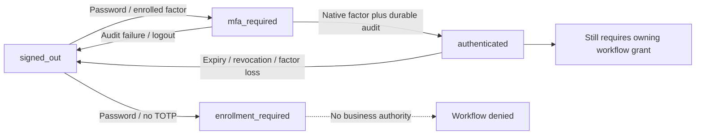

# P1b.2a: dormant browser JSON authentication boundary

Date: 19 October 2026. This is a bounded backend slice, **not usable browser
login/enrollment/recovery or an accepted M1 milestone**. Governing ADR:
`docs/adr/0062-browser-react-ads-and-headless-auth-boundary.md`.

Later P1b.2b.1 addendum: the closed backend now also has native TOTP enrollment
and audited one-time recovery-code handoff, documented in
`codebase-analysis-docs/assets/STAFF_BROWSER_ENROLLMENT.md` and ADR 0063.
Bootstrap may report `recovery_codes_required`/`reauthentication_required`, both
nonprivileged. Production routes remain unmounted and browser disabled. The
historical P1b.2a results/counts below describe that earlier slice only; controlled
provisioning, operational recovery/UI, shared cache and M1 remain unaccepted.

## 1. Scope and unchanged production channel

`staff_auth/browser_api.py` supplies JSON session, password, MFA and logout
handlers for the future React client. `staff_auth/browser_urls.py` declares their
relative paths but **neither config/urls.py nor any core route mounts them**.
Only `staff_auth/test_browser_urls.py` mounts a synthetic test prefix.
`STAFF_BROWSER_AUTH_ENABLED` stays false and the existing readiness check still
blocks activation. No complaint or other business API is added here.

`config/settings.py` adds `allauth.headless` from the already-pinned
`django-allauth[mfa]==65.20.0` distribution. This app has no model/migration;
browser clients only, specification serving disabled and headless-only mode
enabled. The latter avoids vendor stages requiring headed redirect URL names;
it does not mount the complete vendor API. The historical headed integration
fixture explicitly disables headless-only mode in tests only.

No new dependency, environment variable, database migration, grant or shared
frontend asset is added. Prior P1a vendor and P1b.1 admission migrations still
need their own environment-specific release approval; this slice does not prove
they are applied in production. No merge/deployment/real staff changes occurred.

**Findings:** bounded code is available for future React integration; production
browser access remains absent. **Open questions:** actual deployed state and
M1 acceptance. **Next steps:** retain all operational/installation gates.

## 2. Identity, audit and request boundary

The future browser boundary uses server-side Django sessions and CSRF protection,
not Telegram signed data or app tokens. Supplied `X-Telegram-Init-Data`,
`X-Session-Token` or `Authorization` headers are rejected, including empty
explicit values. Invalid credentials never fall back to a cookie or another
identity. Existing Telegram CSRF-exempt routes are untouched.

Login requires exact canonical username, active existing Django user, enabled
`StaffBrowserAdmission` and a verified primary allauth `EmailAddress`. Email is
not a login alias in this slice; it is not promoted to verified automatically.
Unknown, unadmitted and unverified identities receive generic credential denial.
No signup, password setup, email verification or account-recovery route is exposed.

`staff_browser_channel_v1` is a server-owned context containing user/admission
identity, admission revision, start time and random attempt ID. Pending login is
bounded by `MAX_LOGIN_SECONDS` (900 seconds). Completed login also requires the
current assurance marker and uses `STAFF_BROWSER_SESSION_AGE_SECONDS` (default
28,800 seconds; deployed configuration unknown). Admission/active status, verified primary address, current
password/factor and audit evidence are rechecked, not frozen authorization.

Native pinned allauth password/MFA stages validate credentials. Existing
`staff_auth/assurance.py` issues assurance only after full password plus TOTP or
recovery authentication. A password-only session can report `enrollment_required`
but is not business-authenticated. It cannot become an enrollment state from an
already-completed login whose factor disappears; fresh login is required.

`_complete()` records `staff_browser.login_completed` in the existing shared
compliance chain before returning success. Its deduplication key is
`staff-browser-login:<attempt UUID>`. The event holds actor/admission identity,
channel and admission revision, never password/code/token/secret. An audit write
failure clears browser proof and logs out that current browser session, returning
503 rather than a usable success. A repeated MFA request after completed login
returns current state, not a second login event or proof of fresh MFA.

**Future business endpoints must use
`staff_auth.browser_api.require_company_browser_user(request)` AND their owning
workflow's current authorization.** The older `require_browser_user` helper is
identity-assurance only; it does not require this boundary's channel/audit receipt
and is insufficient by itself for the future browser business surface. Neither
helper supplies AccessGrants, group scope or any financial/signing authority.

The guard is a current-request admission check, not a lock around future business
transactions. Preserve each workflow's own locks/revisions and define in-flight
revocation semantics when adding writes. Native allauth stage/session imports
are version-sensitive; retain the pinned version and rerun both JSON and headed
compatibility fixtures before upgrades. Django Admin's login policy is unchanged.

Ordinary Telegram/Admin cookies cannot qualify merely by being authenticated.
Browser login returns 409 when that cookie is already authenticated, rather than
silently switching its identity. Explicit browser logout flushes only the owned
current browser session, including an expired owned context. It does not log out
an unrelated ordinary cookie or other clients. A subsequent normal Django
login/logout clears browser context; request-local browser operations preserve
context just long enough for their audited completion.

**Findings:** identity, MFA, browser admission and durable audit are independent
requirements. **Open questions:** final cookie/origin topology and support UX for
shared-cookie conflicts. **Next steps:** combine this guard with owning policy
only in separately reviewed browser APIs.



These are boundary states, not a claim that the browser UI or enrollment is
implemented. `signed_out` can mean denied company-browser assurance while an
ordinary Django cookie still exists.

## 3. JSON contract for the future React client

Paths below are **relative declarations**, not deployed endpoints. Tests prefix
them with `/test-staff-auth/`; production prefix/routing is not approved here.

| Method / relative path | Exact JSON body | Normal outcome |
|---|---|---|
| GET `v1/session/` | None | 200 current state plus masked `csrf_token` |
| POST `v1/login/` | `{"username":"SYNTHETIC_STAFF","password":"SYNTHETIC_PASSWORD"}` | 401 `mfa_required`, or 202 `enrollment_required` |
| POST `v1/mfa/` | `{"code":"SYNTHETIC_CODE"}` | 200 `authenticated` after password stage and accepted TOTP/recovery |
| POST `v1/logout/` | No body fields are consumed | 200 `signed_out` |

All responses contain `state` and `is_authenticated`; only `authenticated`
sets the latter true. Initial success may include `user: {id: <Django ID>}`;
no contact record, full authentication methods or session/app token is forwarded.

POSTs require the current session cookie and valid `X-CSRFToken`/Django CSRF
mechanism. Get the bootstrap token, send JSON with same-origin credentials, and
refresh CSRF state after password/MFA authentication: Django rotates its CSRF
secret on login. Do not keep using a masked token captured before login. Use the
session endpoint to recover current state after a lost response, never store
passwords/codes in persistent browser storage or replay them automatically.

Credential bodies are exact dictionaries with no extra fields, content type
`application/json`, maximum 8,192 bytes; username 1–150 characters, password
1–1,024 and code 1–32. Logout does not perform an operational write or use a
client-supplied target identity. Authentication responses are `no-store, private`
with `Pragma: no-cache`; Django CSRF failures retain Django's normal 403 body,
so the client must tolerate a non-JSON security response.

Other states/statuses: 400 `invalid_request`/`invalid_credentials` or invalid MFA;
401 `signed_out` when the required pending stage is absent/expired; 403
`invalid_credentials` for mixed headers; 404 `unavailable` when disabled; 405
`method_not_allowed`; 409 current state for an already-authenticated login cookie;
429 `rate_limited` with `Retry-After`; 503 `audit_unavailable`.

`_throttle()` uses the existing durable request-throttling service: initial
per-phase limits of 30 attempts/IP and 10/identity over 600 seconds. These are
security defaults awaiting operational review, **not measured SLOs**. They do
not solve allauth's cross-worker TOTP replay/cache requirement. Do not expose
the routes while native replay protection still relies on a process-local cache.
Confirm trusted proxy/IP-header handling before relying on IP limits in staging;
this slice reuses the existing throttling service, not a new ingress policy.

**Findings:** only an allowlisted account boundary is exposed in the test harness.
**Open questions:** real React transport, error presentation and supported origin.
**Next steps:** build these only after D13 and operational auth gates are met.

## 4. Pending enrollment secret protection

`staff_auth/session_protection.py::protected_browser_session()` installs a
request-local `EnrollmentSession` mapping around the normal Django session.
Only allauth's `mfa.totp.secret` entry is transformed. The underlying session
engine, cookie lifetime and ordinary keys are unchanged; original session/request
flags are restored even on errors. No installed vendor code is patched.

The persisted entry is dedicated-key Fernet ciphertext (`staff-mfa:v1:`) around
an envelope containing purpose, secret, expiry and user/admission/revision
binding. It uses `STAFF_MFA_ENCRYPTION_KEYS`, not `SECRET_KEY`. Expiry is 600
seconds; malformed/plaintext/tampered/expired/wrong-binding material fails closed
and is discarded. Deliberate discard never decrypts expired or unreadable bytes.
Missing/invalid deployment keys fail closed rather than using plaintext.
These are initial security timeouts to review at M1, not measured operational
targets. Expiry prevents reuse; it is not a background session/backup purge.
Unread ciphertext follows the existing session/backup retention until removed.

The binding proves storage context, **not fresh password authorization**.
Enrollment endpoints are not implemented or mounted. Future enrollment must
check current browser context, recent password, admission, CSRF and proper native
re-authentication/factor/recovery policy before showing a QR or changing a factor;
it must wrap every secret-using native request in this adapter. Adding encryption
does not complete enrollment, recovery-code presentation or the support process.

**Findings:** a native form roundtrip can keep pending secret ciphertext in its
persisted session. **Open questions:** fully governed enrollment/recovery journeys
and key-rotation support. **Next steps:** implement those as P1b.2b, not a generic
vendor-route mount.

## 5. Verification and remaining acceptance gates

Tests live in `staff_auth/tests_browser_api.py`, alongside existing admission,
assurance and Telegram/user-deletion regression suites. They exercise actual
pinned allauth JSON password/MFA/recovery stages, CSRF-enforcing Django clients,
synthetic users, isolated SQLite and blocked network connections. They do not
constitute a real React end-to-end, PostgreSQL concurrency, staging or live-device
test. **Final focused run: 115 tests, 113 passed and two PostgreSQL-only
concurrency tests skipped on SQLite.** Command:

```text
python manage.py test staff_auth core.tests_telegram_authentication core.tests_user_identity core.tests_user_hard_delete --noinput --verbosity 0
```

The new file supplies 17 tests. Ten existing no-database crypto/configuration
tests were also rerun successfully; they overlap the combined run and are not
added to its distinct count. The final run includes both native headed-login
compatibility fixtures and the constrained JSON journeys. Intermediate runs
caught native redirect-name resolution and a cached headed-URL fixture issue;
headless-only runtime settings plus concrete test-only headed includes corrected
them. No production URL was mounted and no vendor source was patched to pass.

Fast checks passed: Django system check; no model changes detected; migration
graph (288 migrations, 19 leaves); dependency parity (28 direct Python packages);
architecture boundaries; Mini App write inventory (202 routes); database
governance; UI source ratchet; compileall; 28 governance-script tests; JavaScript
syntax (147 first-party files); all groups in `npm run test:node`. The database catalogue was regenerated only for
new auth/audit usage pointers; its 213 application-table entries and schemas are
unchanged. The stale-catalogue check preceding regeneration was expected evidence
of those new imports, not a new database model.

Wider checks are **not all green**: environment-template parity still reports
119 existing missing names, and tracked-artifact/privacy audit still reports 17
existing logo/synthetic-screenshot allowlist hash mismatches. No allowlist or
security baseline was changed to hide them. The prior dependency-audit exception
expiry, absent local Ruff and legacy catalogue duplicate-index test finding
remain documented in the earlier phase; those checks were not rerun here.
Full application CI, PostgreSQL, React/browser UI, real Telegram WebViews and
production readiness were not demonstrated.

Outstanding activation requirements: controlled provisioning/address/password
setup, enrollment/recovery UI and audit, shared allauth replay/abuse cache,
offboarding acceptance, mail/support ownership, full dependency/asset licence
review, React build/UI review, cookie topology, ordinary-role staging journeys,
both-channel cached-client checks, applicable PostgreSQL checks and explicit
release/production-admission approval. `staff_auth.E006` remains intentionally
blocking; do not remove it simply to start the frontend.

**Findings:** local tests can establish this dormant contract only.
**Open questions:** all operational gates above remain open.
**Next steps:** accept the next bounded slice and licence review, not browser use.

## 6. Phase / merge / deployment checklist

- [ ] Record actual deployed commit/migrations; currently unknown. No deployment
  or production inspection is implied by the local branch.
- [ ] Keep `STAFF_BROWSER_AUTH_ENABLED=False`; leave all production auth/business
  URLs unmounted and the unconditional activation readiness check intact.
- [ ] Review `allauth.headless`/headless-only/browser-only settings from the already
  pinned distribution. No new package, environment variable or migration here.
- [ ] Retain pending prior-phase migrations/release approval as separate items;
  no schema reversal command applies to this schema-free slice.
- [ ] Verify four-handler contract, CSRF/origin/mixed credentials, password-only
  denial, revoked admission/factor, lost responses, throttling and audit outage.
- [ ] Confirm ordinary Admin/Telegram login clears browser proof, browser logout
  does not terminate an unrelated cookie and Telegram still needs no company MFA.
- [ ] No existing Mini App CSS/JS/template or root Node lockfile changes; React/ADS
  packages/assets remain held pending exact licence/dependency approval.
- [ ] In staging after later approved mounting, inspect safe counts/outcomes of
  credential denials, 403/409/429/503, expiry/revocation and login audit receipts.
  Never log raw JSON credentials, cookies, recovery codes, QR or secret values.
- [ ] Review real supported browser and stale Telegram WebView journeys before
  operational admission; not run in this phase.
- [ ] Rollback keeps browser closed and uses a compatible known-good application
  if shared-code regression occurs. Preserve prior admission/audit evidence and
  unrelated sessions/grants; do not reverse business data or prior schema casually.

### STATE BLOCK

- INDEX_VERSION: staff-browser-json-auth-1 / P1b.2a / 19 October 2026.
- FILE_MAP_SUMMARY: config/settings.py; staff_auth/browser_api.py;
  staff_auth/browser_urls.py; staff_auth/session_protection.py;
  staff_auth/signals.py; staff_auth/test_browser_urls.py;
  staff_auth/tests_browser_api.py; staff_auth/tests.py; ADR 0062.
- OPEN_QUESTIONS: licence/build acceptance, provisioning/enrollment/recovery,
  shared cache, support owners, deployment baseline and M1 acceptance.
- KNOWN_RISKS: exposed password-only cookies, stale admission, unaudited success,
  plaintext pending secrets, mixed credentials, cross-worker replay and root-URL
  overexposure. Controls here address only the explicitly tested subset.
- GLOSSARY_DELTA: channel context and company-browser guard augment assurance;
  pending-secret storage is not enrollment authority or workflow access.
- VERIFICATION: 115 focused tests (113 passed, two PostgreSQL-only skips), 28
  governance-script tests and Node checks passed; wider failures/untested gates
  are listed above. No production inspection, activation, merge or deployment.

**Findings:** leave the new channel closed. **Open questions:** next slice and
operational evidence. **Next steps:** finish P1b.2b/P1c gates before Complaints.
