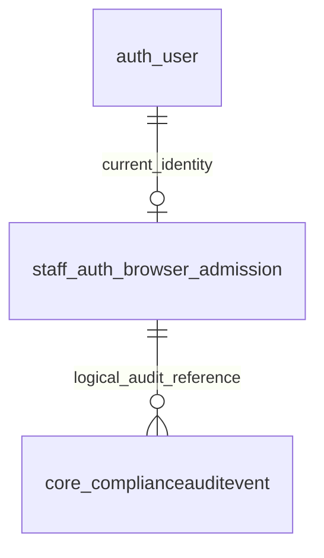

# Staff browser lifecycle: P1b.1 backend controls

Date: 19 October 2026. Branch: `Platform-Interdependence`; starting HEAD:
`9612b1ab4a76f0445574996c333171a07fdd99ce` with the prior P1a worktree preserved.
During this phase P1a was committed separately on the same branch as
`4b6c8aebfdbdf9c45715aae7d38f4f2f051a6436`; no overlapping change was reverted.
No commit was created by this P1b.1 implementation.
Decision: `docs/adr/0061-governed-browser-admission-and-revocation.md`.

## 1. Outcome and scope

This is **P1b.1**, the backend identity-lifecycle part of P1b. It adds deliberate
browser opt-in and audited suspension, browser-session revocation and factor
reset for existing Django staff users. It is **not** completed login, password
setup, enrollment, recovery UI, M1 acceptance or a production rollout.

`STAFF_BROWSER_AUTH_ENABLED` remains false. Its activation guards remain
blocking. No URL, login page, operational API, template, shared JavaScript/CSS,
Telegram launcher or public registration route is added. No dependency or
environment variable is added beyond P1a. Existing workflow grants, Django user
IDs, passwords, email verification and Telegram bindings are not converted.

Shared runtime compatibility includes **Complaints, TAT, Origination, Portal,
SPIN and Admin**. A browser credential never grants authority in any workflow.
Pilots remain Complaints → TAT → Origination → Portal, with an M3 review.

**Findings:** identity admission and revocation exist before exposing login.
**Open questions:** support owners, deployed release/migrations and P1b.2
operational controls. **Next steps:** complete those controls before M1.

## 2. Source map and behavior

| Source / symbol | Contract |
|---|---|
| `staff_auth/models.py::StaffBrowserAdmission` | Current browser-channel admission and revocation generation for one existing Django user |
| `staff_auth/governance.py` | Application mutation guard; unreviewed ORM/Admin edits are not the operational interface |
| `staff_auth/lifecycle.py::preview_change` | Read-only impact, current revision and factor-removal count; active Superuser only |
| `staff_auth/lifecycle.py::apply_change` | Transactional, audited, actor/request/payload-bound mutation; current Superuser and revision rechecked under locks |
| `staff_auth/management/commands/manage_staff_browser.py` | Infrastructure-only operator command; preview by default, explicit `--apply` and reviewed metadata for writes |
| `staff_auth/assurance.py::issue_assurance` | Requires explicit enabled admission and password authentication after its latest change; captures admission UUID/revision |
| `staff_auth/assurance.py::require_browser_user` | Rechecks current admission UUID/revision in addition to P1a's active-user/session/password/factor checks |
| `staff_auth/tests_lifecycle.py` | Lifecycle, rollback, retry, revocation, shared-session and user-deletion compatibility; PostgreSQL-only races |
| `staff_auth/catalogue.py` | Purpose, lifecycle, retention, authority and index rationale for the new bounded model |
| `core/services/user_hard_delete.py::DISPOSABLE_CASCADE_MODELS` | Classifies vendor email/factor rows as credential state so the existing governed user-deletion operation remains supported |

### Technical administration is not a workflow role

Only a **currently active Django Superuser** may use the lifecycle service.
Ordinary Django `is_staff`, a workflow IT grant, email ownership or a valid
Telegram identity is insufficient. This uses the existing technical authority;
no business role or capability policy is changed. A future delegated IT helpdesk
role requires its own explicit authorization design and approval.

The management command is an infrastructure/operator interface, not browser
authentication. Supplying an actor ID does not authorize an anonymous HTTP
caller. Future operator endpoints must authenticate the actor, enforce CSRF,
review/re-authentication and scope according to their accepted design.

### Lifecycle actions

| Action | State/effect | What it never does |
|---|---|---|
| `authorize` | Creates an enabled admission at revision 1, or deliberately reauthorizes an existing one and increments its revision; target must currently be active | Create a user, set a password, verify an email, enroll MFA or add workflow grants |
| `suspend` | Disables an existing browser admission and increments its revision | Disable the Django employee or remove Telegram access |
| `revoke_sessions` | Increments an existing admission revision while preserving enabled state | Delete shared Django sessions or change the password |
| `reset_mfa` | Removes the selected user's vendor factors and increments admission revision; reason and support verification reference required | Reveal seeds/codes, establish identity proof, approve a workflow action, generate new factors or restore access without new enrollment |

Every accepted action advances the revision, including deliberate repeated
revocation or reauthorization. The **same request key and exact payload** returns
the saved original receipt without another action. Reusing a key with changed
payload fails. Request keys are scoped to the authorizing actor; stale expected
revisions fail before mutation. Original receipts do not describe later current
state: read the current admission separately when reconciling a delayed response.

### Revocation and audit

```mermaid
sequenceDiagram
    participant O as Approved operator
    participant S as Lifecycle service
    participant D as Django database
    O->>S: action + target + revision + request key
    S->>D: Lock current Superusers, target, admission
    S->>D: Validate retry/revision; update admission
    S->>D: Append hash-chained compliance event
    D-->>S: Commit both or roll back both
    S-->>O: Stable receipt
```

Actions append `staff_browser.<action>` under existing compliance workflow
`access_control`, category `identity`. Events retain actor, target/admission IDs,
before/after revision and enabled status, reason, request fingerprint, and reset
verification reference. Structured action fields do not copy passwords, contact
fields, factor secret/ciphertext, recovery codes, cookies or launch data. The
existing ledger still retains its normal staff actor label, which can include
an employee's configured username/display name. Operators must not put credential
or unnecessary personal material in free-text reasons or ticket references.
An audit failure rolls back state changes **and factor removal**.

Root locks follow the existing governed hard-deletion order, then lock the target
staff row. That existing row serializes first admission even when no admission
row exists. These rare technical changes deliberately serialize rather than
relying only on an optimistic first-create check. Actual PostgreSQL race tests
remain required; SQLite is not row-lock evidence.

Issued browser assurance stores the admission UUID/revision. On the next
protected browser request, suspension or a changed revision denies the marker
and clears it. A login begun before the most recent lifecycle action cannot
issue new assurance from earlier password/MFA evidence. Readmission does not
resurrect old markers. Already-authorized in-flight work cannot be recalled;
future business services still need their normal current authorization and
transaction boundaries.

Existing shared sessions are retained deliberately. Browser-only suspension,
revocation and reset do not change `User.is_active`, the password hash, Telegram
profile, grants or shared session records. Django employee deactivation still
denies current identity through P1a's independent active-user check.
Global staff offboarding or a suspected cross-channel compromise must use the
existing governed staff-security process; browser-only revocation deliberately
does not revoke Telegram authority.

**Findings:** revocation is independent of Telegram and auditable on one
canonical identity. **Open questions:** final operator re-authentication/helpdesk
UX and acceptance. **Next steps:** add those through reviewed P1b.2 flows.

## 3. Schema and user deletion

New migration: `staff_auth/migrations/0001_initial.py`. It creates exactly one
table, `staff_auth_browser_admission`, with no data backfill or automatic opt-in:

| Column | Meaning |
|---|---|
| `id` | Immutable UUID admission identity |
| `user_id` | Unique nullable FK to existing `auth.User`; reverse name `browser_login_admission`; SET_NULL on governed user deletion |
| `subject_user_id` | Unique positive original staff ID retained after detachment; not a second employee identity |
| `enabled` | Explicit browser-channel opt-in, default false |
| `revision` | Positive browser-only revocation generation, default 1 |
| `created_at`, `updated_at` | Initial admission and latest lifecycle boundary |



The audit relationship is a logical subject/source reference, not a new foreign
key. Constraints require positive revision/original user ID and a live user link
equal to the retained original ID. PK/one-to-one/unique constraints supply the
needed lookups; no additional explicit index is justified. All columns and the
table carry PostgreSQL comments. `staff_auth/catalogue.py` is included in the
loaded catalogue and the model-governance checker.

Retention: preserve admission/original staff ID and compliance action evidence
for investigation; no automatic purge is introduced. A separately authorized
retention policy is still required. An orphaned row's historical enabled flag
is not live access: no current user link means no admission can qualify.

Compatibility correction: adding allauth introduced new reverse User relations.
The existing user-hard-delete registry rejects unclassified relations even when
empty. `account.EmailAddress` and `mfa.Authenticator` are now explicitly
disposable credential metadata; email confirmations cascade from their address.
The new admission uses the already supported SET_NULL policy. Original user IDs
and immutable compliance events survive. No financial/case/signature evidence
is deleted by this change. The existing deletion flow still requires its own
operator authority and impact confirmation.

The same registry review found two existing missing classifications:
`portal_recognition.PortalRecognitionLiveStanding` and
`tat_recognition.TatRecognitionLiveStanding`. They are explicitly expiring,
per-viewer cache checkpoints, so are classified as disposable. Settled group
period snapshots are **not** included or changed. Generic Admin auto-registration
also registers new models automatically; `staff_auth/admin.py` explicitly removes
the new admission editor, preserving the lifecycle-only mutation boundary.
`core/admin_utils.py` also excludes all three identity apps from generic
registration, so rerunning it cannot re-expose credential/admission editors.

The canonical `docs/database/` catalogue was regenerated for the added model.
This mechanically refreshes the eight stale HB Deposits/Portal usage/writer
entries diagnosed in P1a; it does not change those workflows. New catalogue
size: 213 application tables. Package-owned account/MFA tables remain vendor
schema rather than project catalogue models.

**Findings:** one additive bounded model; no existing staff data migration.
**Open questions:** actual production migration/retention approval.
**Next steps:** review and rehearse the exact release plan before deployment.

## 4. Operator contract and examples

Run only in an approved environment through the existing release/operator
process. The uppercase IDs below are **placeholders**, not real accounts.
Use the actual already-approved Superuser and existing target IDs; never use
customer data, passwords or MFA codes as command arguments.

Read-only preview:

```text
python manage.py manage_staff_browser authorize --actor SUPERUSER_ID --user EXISTING_STAFF_ID
```

The JSON result includes `dry_run`, target ID, current revision, enabled state,
action, whether reset verification is required and factor removal count. It
creates no admission, credential, audit event, message or grant.

After reviewing the current revision and obtaining environment-specific write
authority, the command accepts these additional write arguments:

```text
--apply --expected-revision REVIEWED_REVISION --request-key STABLE_REQUEST_KEY --reason "Approved administrative purpose"
```

First admission uses expected revision 0. Existing actions require the current
revision. Reset additionally requires `--verification-reference SUPPORT_TICKET`.
This reference is an operator attestation that the approved identity-verification
procedure was completed, not an automated verification or a way to bypass MFA.
Do not run reset against real staff while operational recovery/support is not
accepted. Retrying an uncertain action must reuse its exact request and payload;
the saved receipt includes `audit_event_id` and `replayed`.

**Findings:** preview is safe-by-default; actual writes remain explicit.
**Open questions:** named recovery/support owners and review process.
**Next steps:** define/rehearse those before staff enrollment.

## 5. Verification and remaining gates

**Final focused run: 97 tests, 95 passed and two PostgreSQL-only concurrency
tests skipped on SQLite.** Command:

```text
python manage.py test staff_auth core.tests_telegram_authentication core.tests_user_identity core.tests_user_hard_delete --noinput --verbosity 1
```

After the final generic-registration hardening, ten no-database crypto/config
tests also passed; nine overlap the focused run and one is the added
re-registration regression contract. No sum of these counts is claimed as
distinct tests or full-suite acceptance. Tests use synthetic staff,
ephemeral encryption keys and isolated in-memory SQLite. Socket connections are
blocked in lifecycle and native vendor-login journeys. No production inspection,
staff provisioning, real reset, deployment, provider write or merge is performed.

Confirmed fast checks:

- Django configuration, migration drift and graph: 288 migrations, 19 leaves.
- Model governance; generated catalogue refreshed and verified: 213 tables.
- Architecture boundary, 202-entry write-route inventory and UI source ratchet.
- Dependency parity remains 28 direct packages; 28 governance script tests pass.
- Python compilation and isolated admission-migration creation/reversal pass;
  reversal retained `auth_user` and applied no business-domain migrations.
- All 175 current reverse User relations have a defined deletion policy;
  credential/admission editors remain absent from Admin, including after generic
  registration is rerun. `git diff --check` and nine source-anchor checks pass.

P1a's existing global issues remain unless separately resolved: 119 missing
environment-template settings, expired dependency-audit exception, artifact
allowlist hash mismatches and unavailable local Ruff. The stale generated
catalogue issue is resolved mechanically by this phase's model catalogue update.
Full backend CI, actual PostgreSQL, live Telegram/browser devices, company-login
operations, privacy and support/restore drills are not established by focused
synthetic tests.

Additional diagnostic: `core.tests_database_catalog` passed four of five tests;
the remaining existing assertion reports a duplicate explicit
`core.RequisitionBatch.order_number` index (`core_requis_order_n_097497_idx`).
Neither that model nor its migrations/test were changed here. Removing a finance
index is not included in this authentication slice.

The initial expanded run used a programmatic `DiscoverRunner` without the
repository's `manage.py test` argv marker. That unintentionally kept production
AccessGrant fixture guards enabled. It also exposed the Admin auto-registration
and missing cache relation policies corrected in this phase. Its non-green
result is diagnostic, **not** final acceptance. Final regression is rerun with
the normal management command and without weakening runtime authorization.
The initial 96-test diagnostic reported three failures, 24 errors and two skips;
the corrected normal-run result above supersedes it rather than concealing it.

P1b.2 still needs secure password setup against existing identities, verified
email/mail policy, mandatory enrollment-only experience, transient TOTP secret
protection, shared replay/rate-limit controls, audited operator recovery UX,
source-bound UI review and named support ownership. Do not mount generic allauth
URLs, suppress activation checks or treat `authorize` as usable browser login.
Integrate browser admission retirement with governed offboarding/reactivation
before M1: current inactive-user checks deny while disabled, but are not by
themselves proof that a later reactivation cannot revive an unused old marker.

**Findings:** backend lifecycle is a prerequisite, not completed P1b/M1.
**Open questions:** listed operational and release acceptance items.
**Next steps:** P1b.2 before the Complaints read pilot; retain all later app gates.

## 6. Change-specific merge/deployment and monitoring checklist

- [x] Added one bounded admission model/migration, service, preview-first command,
  assurance generation checks, tests and governance/catalogue metadata.
- [x] No new dependency/configuration variable, URL, public signup, app UI,
  business grant or Telegram authentication change.
- [x] Added hard-deletion compatibility for vendor credentials; retained original
  identity/compliance evidence and existing operation authority.
- [x] No production command, real employee opt-in/reset, commit/merge/deployment
  or external write performed.
- [x] Focused verification: 95 passed, two PostgreSQL-only skipped; ten final
  crypto/configuration and 28 governance-script checks passed, with overlap
  disclosed and the separate four-pass/one-fail catalogue diagnostic retained.
- [ ] Confirm actual deployed commit/migrations and branch auto-deploy behavior;
  implementation approval is not merge/deployment authorization.
- [ ] Review/apply `staff_auth.0001_initial` only through the authorized release
  process, in addition to P1a's account/MFA package migrations if not deployed.
- [ ] Keep `STAFF_BROWSER_AUTH_ENABLED=False`; no login or recovery UI is expected.
- [ ] Review focused/full CI, PostgreSQL and remaining audit/environment gaps;
  record skips/failures and actual acceptance, not assumed success.
- [ ] After an approved deployment, verify current Telegram launches and selected
  reads/writes plus Admin login; watch missing-table/relationship-registry errors.
- [ ] Preview authorized and denied operator cases. Do not enroll/reset real
  employees just to smoke-test the infrastructure.
- [ ] Watch lifecycle actions for exact actor/revision/audit, retry replay versus
  payload mismatch, and no password/shared-session/grant/Telegram side effects.
- [ ] Preserve admission and compliance records in normal application rollback.
  For a shared-runtime fault, use a compatible known-good app or reviewed forward
  fix; the browser flag is already off and cannot undo that defect.
- [ ] Exact destructive schema reversal is `python manage.py migrate staff_auth zero`.
  Use only before operational use with approval/backup/plan review; it removes
  admissions but not compliance evidence, auth users, factors or workflow state.
  After use, favor a forward repair to preserve revocation history.
- [ ] Name recovery/provisioning/backup owners and complete P1b.2/M1 before
  browser activation. Continue to Complaints first, not TAT/Origination/Portal.

**Findings:** normal rollback preserves security/audit state; live acceptance is
separate. **Open questions:** release/support owners and actual environment.
**Next steps:** complete applicable checklist items for each proposed release.

## 7. Source anchors

Exact-byte SHA-256 prefixes for the P1b.1 source snapshot; re-read changed files.
Historical P1a anchors remain historical rather than silently rewritten.

- [[F:staff_auth/models.py#1-76#25883734]] — bounded current admission and constraints.
- [[F:staff_auth/governance.py#1-22#d2fb249d]] — lifecycle mutation guard.
- [[F:staff_auth/lifecycle.py#1-146#becd7dd8]] — current authority, locks, retry/revision and audit.
- [[F:staff_auth/assurance.py#1-134#cd68474a]] — admission-bound assurance.
- [[F:staff_auth/admin.py#1-14#268e38e8]] — remove vendor and generic admission editors.
- [[F:staff_auth/catalogue.py#1-13#64ca1cf7]] — model metadata and retention.
- [[F:staff_auth/management/commands/manage_staff_browser.py#1-38#0cb9cfb1]] — preview-first infrastructure command.
- [[F:staff_auth/migrations/0001_initial.py#1-35#eed33cbe]] — additive schema only.
- [[F:staff_auth/tests_lifecycle.py#1-315#7aba8ea6]] — lifecycle, replay, revocation/deletion and PostgreSQL-only contracts.

**Findings:** source anchors make the bounded slice independently reviewable.
**Open questions:** none for this source snapshot.
**Next steps:** refresh anchors if further code changes.

## STATE BLOCK — P1b.1

- INDEX_VERSION: staff-browser-lifecycle-p1b1-1, 19 October 2026.
- FILE_MAP_SUMMARY: `staff_auth/{models,governance,lifecycle,assurance,catalogue,tests,tests_lifecycle}.py`; `staff_auth/migrations/0001_initial.py`; operator command; database catalogue/governance; user hard-deletion policy; ADR 0061; phase and release documents.
- OPEN_QUESTIONS: production baseline, final pilot accounts, password/email/enrollment/recovery UX, transient-secret and shared-cache protection, retention/privacy review and named support operators.
- KNOWN_RISKS: premature activation, treating opt-in as a grant, raw factor editing, deleting shared sessions, missing audit, stale/replayed requests, untested PostgreSQL locks and incomplete operational recovery.
- GLOSSARY_DELTA: browser admission = explicit channel opt-in/revocation state; browser-only revocation generation = admission revision, not Django employee deactivation or workflow policy version.
- NEXT_READ_QUEUE: P1b.2 current vendor enrollment/forms/session/cache contracts and support/UI review, then Complaints allowlisted projection and owning authorization.
- PHASE_STATUS: P1b.1 backend controls; global browser admission closed, M0/M1 operational acceptance and later pilots remain open.

## Primary references

- [Django session behavior](https://docs.djangoproject.com/en/5.2/topics/http/sessions/): shared session semantics informed the decision not to delete all user sessions for browser-only revocation.
- [Allauth MFA adapter](https://docs.allauth.org/en/latest/mfa/adapter.html): maintained vendor factor hooks remain in use; no custom OTP algorithm or vendor-source edit.

Repository code, migration and executed tests define the local implementation;
external documentation does not establish production acceptance.
