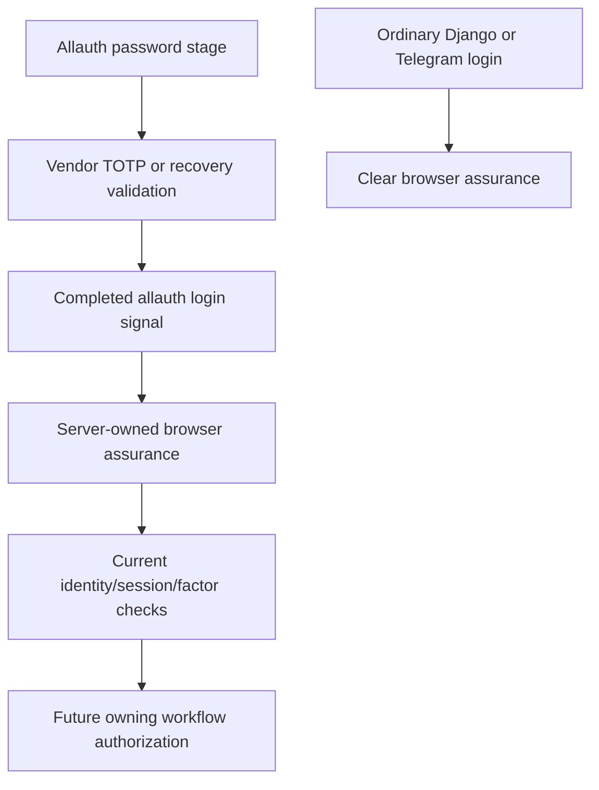
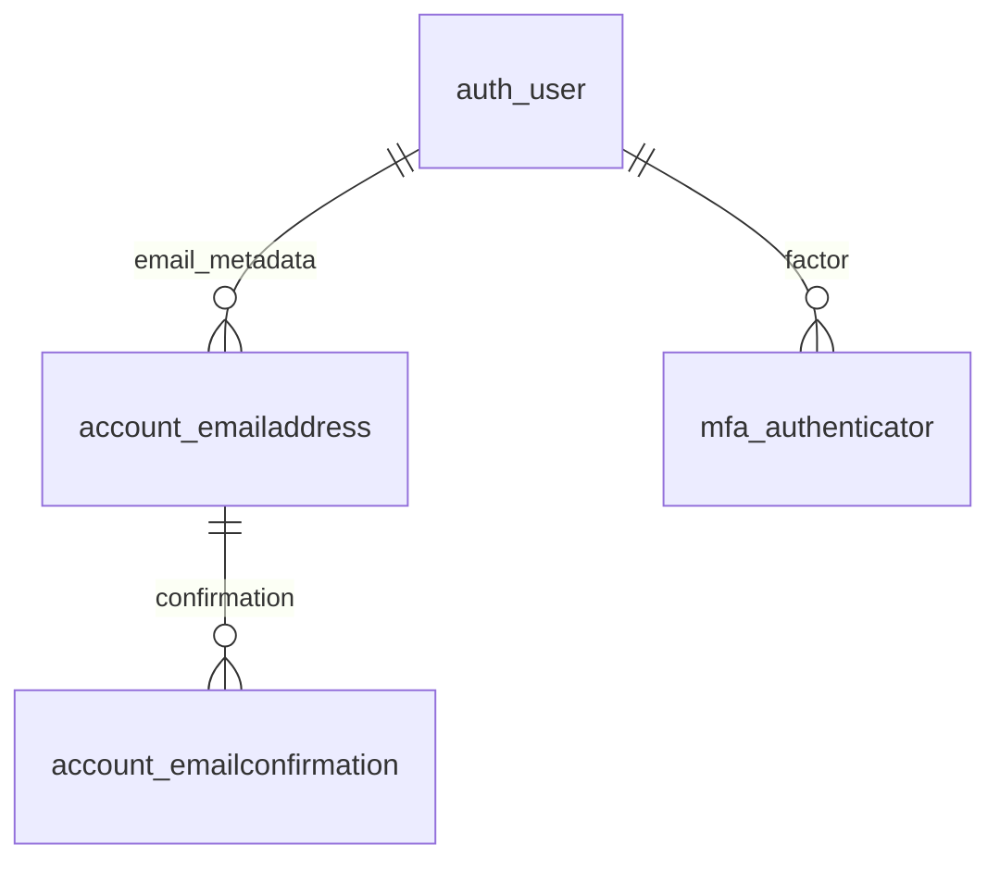

# Staff browser MFA: P1a dormant foundation

Date: 19 October 2026. Branch: `Platform-Interdependence`. Starting HEAD:
`9612b1ab4a76f0445574996c333171a07fdd99ce`.

## 1. Outcome and authority

P1a is a **local, disabled authentication foundation**, not a usable browser
portal or a completed P1/M1 milestone. No application login, enrollment,
recovery or browser business URL is mounted. `config/urls.py` is unchanged.
Setting `STAFF_BROWSER_AUTH_ENABLED=True` deliberately fails system checks
with `staff_auth.E006` and production preflight with
`staff-browser-foundation-only`. Removing that check is not an activation plan.

The user explicitly selected:

- Existing Django users plus maintained django-allauth TOTP/recovery codes.
- Browser convenience first, with a possible Telegram exit later.
- Existing Django Complaints roles and group scope, not new business grants.
- Browser password/MFA first; existing Telegram signed-launch access remains.
- Production release/migrations unknown; known limitations remain applicable.

ADR: `docs/adr/0060-staff-browser-mfa-foundation.md`. Overall plan:
`codebase-analysis-docs/assets/PLATFORM_INDEPENDENCE_IMPLEMENTATION_PLAN.md`.
Pilot order remains **Complaints → TAT → Origination → Portal**, with an M3
investment review before later applications. Production deployment, migration,
staff enrollment, account recovery, merge and channel activation are not
authorized or performed by this local implementation.

**Findings:** the integration can be reviewed without opening a partial login
product. **Open questions:** production baseline and support owners.
**Next steps:** finish P1b's operational controls before accepting M1.

## 2. Files and authentication contract

| File / symbol | Responsibility |
|---|---|
| `config/settings.py` | Installed account/MFA integration, closed adapters, three environment variables, AccountMiddleware, appended backend |
| `staff_auth/adapters.py::StaffAccountAdapter` | Public signup always denied; does not provision or grant access |
| `staff_auth/adapters.py::StaffMFAAdapter` | Routes vendor secret encryption/decryption through dedicated keys |
| `staff_auth/crypto.py::keyring` | Validates a dedicated ordered Fernet key list, rejects missing/malformed/duplicate keys and Django-secret reuse |
| `staff_auth/crypto.py::encrypt_secret` / `decrypt_secret` | Versioned authenticated encryption; no plaintext fallback |
| `staff_auth/assurance.py::issue_assurance` | Records server-owned completed password/MFA assurance only after the completed allauth login signal |
| `staff_auth/assurance.py::require_browser_user` | Rechecks enabled state, session/actor binding, active user, password hash, age and current TOTP identity/fingerprint; returns identity, not workflow authority |
| `staff_auth/signals.py` | Ordinary Django login/logout clears browser assurance; completed allauth login may issue it |
| `staff_auth/admin.py` | Removes vendor credential/email editors; raw JSON editing or bulk verified-email actions are not recovery |
| `staff_auth/checks.py::staff_browser_checks` | Validates configured encryption, adapters, factor policy, session controls; always prevents P1a activation |
| `core/production.py::production_security_readiness_issues` | Rejects accidental activation in pre-migration release checks |
| `staff_auth/tests.py` / `staff_auth/test_urls.py` | Synthetic unit/library integration contracts; isolated test URLs are never included by production routing |
| `.github/workflows/ci.yml` | Includes this app in correctness lint, compilation, coverage and PostgreSQL-job tests |

`requirements.txt` and `pyproject.toml` both pin
`django-allauth[mfa]==65.20.0`; `scripts/check_dependency_parity.py` maps the
`allauth` import to that distribution. This version was verified compatible
with installed Django 5.2.17. The older 64.2.1 example is not used. The MFA
extra installs QR-code and FIDO dependencies; **WebAuthn/passkeys are not enabled**.
Django's existing password validators/hashers remain unchanged; Argon2 is not
introduced by this phase.

The current library configuration uses existing **usernames**, not email-only
login or email-based identity merging. Mandatory email verification is configured
but no existing address is silently verified. Supporting work-email login or
email-less staff provisioning needs the corresponding P1b policy and tests.

### Assurance boundary

The vendor password and MFA algorithms are not reimplemented. The small local
assurance marker distinguishes company browser authentication from the Django
sessions already used by Telegram and Admin:



The marker is stored server-side under `staff_browser_assurance_v1`. It binds
the user ID, MFA time, session authentication hash and current TOTP record/data
fingerprint. Issuance requires the vendor's server-owned password and TOTP or
recovery authentication records, matching completed-login session identity,
and an existing TOTP factor. Password/MFA steps must be ordered and within
the implementation's 900-second login window. This is an initial security
policy, not a measured operational performance target.

`require_browser_user` denies absent/expired/malformed markers, future times,
inactive users, changed passwords, removed/replaced factors and mixed
`X-Telegram-Init-Data` credentials. It fetches current user/factor state rather
than trusting an earlier `request.user` snapshot. Password changes, account
deactivation and TOTP removal/replacement invalidate this admission boundary
on its next request. An ordinary Django login never upgrades itself to MFA.

Crucially, **no production route calls this helper yet**. Future browser writes
must use separate CSRF-protected endpoints and owning workflow access checks
on every request. Never call a CSRF-exempt Telegram view with a session fallback.
No `AccessGrant`, policy version, role, employee identifier, customer record or
business workflow changes in P1a. A successfully authenticated account with no
Complaints grants still has no Complaints authority.

Configuration/middleware are shared runtime surfaces affecting **Complaints,
TAT, Origination, Portal, SPIN and Admin** even though their workflow rules are
unchanged. Browser assurance expiration is not a global Django logout and does
not change Telegram's signed-launch age. An ordinary login clears assurance;
P1b must test cookie/session coexistence on its actual deployment origin.

**Findings:** authentication is separated from workflow authorization without
replacing existing staff identities. **Open questions:** reviewed provisioning,
complete revocation/reset/audit UX and actual browser deployment topology.
**Next steps:** implement those controls in P1b, then separate Complaints reads.

## 3. Configuration, encryption and schema

| Variable | Default | P1a behavior |
|---|---|---|
| `STAFF_BROWSER_AUTH_ENABLED` | `False` | Keep false; true is rejected because the operational product is incomplete |
| `STAFF_MFA_ENCRYPTION_KEYS` | Empty | Comma-separated, newest-first Fernet keys in the deployment secret store; not needed while dormant and no MFA data is being read/written |
| `STAFF_BROWSER_SESSION_AGE_SECONDS` | `28800` | Proposed eight-hour maximum assurance age; activation check accepts integer 1–86400, subject to M1 policy acceptance |

Never put actual keys, QR codes, recovery codes, passwords or staff addresses in
Git, release notes or logs. Never reuse `DJANGO_SECRET_KEY` for MFA encryption.
Ciphertexts start with `staff-mfa:v1:`. The adapter encrypts the stored TOTP
secret and recovery seed; the recovery-code consumption mask remains vendor
state. Ciphertexts are randomized. Missing keys, invalid tokens, unsupported
formats and legacy plaintext fail closed with sanitized errors.

New writes use the first key; all retained keys can decrypt. Adding a new first
key does **not** automatically re-encrypt historical rows. Keep old keys until
controlled re-encryption and restoration tests prove they are no longer needed.
Re-encrypting TOTP data changes its fingerprint and invalidates current browser
assurance. Losing keys can make factors unrecoverable; backup/rotation and IT
reset procedures must be accepted before enrollment.

### Package-owned additive schema

No project-owned model or migration is added. Installing these Django apps
loads **12 vendor migrations** (account 0001–0009 and MFA 0001–0003) from the
pinned package. Review them in the actual environment's migration plan before
authorizing deployment:

| Table | Purpose / authority | Lifecycle and relationships |
|---|---|---|
| `account_emailaddress` | Vendor verified/primary-email metadata, not a new employee identity | FK to existing Django user; vendor uniqueness constraints; provisioning, retention and deletion policy must be accepted before use |
| `account_emailconfirmation` | Vendor confirmation metadata/schema | FK to email address; confirmation-token handling follows vendor settings; never publish token columns |
| `mfa_authenticator` | Vendor factor type, encrypted secret/seed JSON, creation and last-use times | FK to existing Django user; conditional uniqueness for TOTP/recovery factors; recovery consumption is transactional |



These package-owned tables retain vendor names, migrations and constraints.
Do not duplicate them in `core`, edit installed package migrations, or silently
rename tables. They are outside `CATALOGUE_APP_LABELS` in
`core/services/database_catalog.py`, just as other framework-owned tables are.
There are no new project catalogue models or PostgreSQL comment migrations.
Credential retention and user hard-deletion behavior need an explicit review
before real factors exist: vendor user FKs cascade and are not immutable
business audit evidence.

Normal Django `post_migrate` also creates the vendor model content types and
standard Django model permissions. Those metadata rows do not create workflow
AccessGrants, approved users or new operational capabilities; do not assign
unused vendor-edit permissions as an enrollment/recovery shortcut.

Normal approved deployment uses the existing `release.sh` migration sequence,
with browser admission still **off**. Dependencies must be installed first.
The package migration leaves are `account.0009_emailaddress_unique_primary_email`
and `mfa.0003_authenticator_type_uniq`. All installed-app migration health checks
can report pending vendor migrations even while browser admission is off.

Normal rollback retains the additive tables and keeps admission off. Only
before enrollment, after authorization, backup/plan review and proving no
dependent evidence exists, destructive schema reversal is:

```text
python manage.py migrate mfa zero
python manage.py migrate account zero
```

Those commands remove factor/email metadata, not Django users. They are **not
routine rollback instructions after staff enrollment**. Leaving the apps in a
release can cause the next normal migration run to recreate their tables.

**Findings:** dormant installation still has dependency/schema deployment work.
**Open questions:** real PostgreSQL release/rollback evidence, retention and key
operations. **Next steps:** review the actual plan before any production action.

## 4. Verification and limitations

**Final focused run: 53 tests passed**, comprising `staff_auth`,
`core.tests_telegram_authentication` and `core.tests_user_identity`. Command:

```text
python manage.py test staff_auth core.tests_telegram_authentication core.tests_user_identity --noinput --verbosity 1
```

The local log is `test-results/staff-browser-mfa-final.txt` (ignored, synthetic
diagnostics; not a portable committed evidence artifact). The runner's final
summary is `Ran 53 tests ... OK`. Expected denial logs, SQLite's unsupported
table/column-comment warnings and a missing local collected-static directory
do not establish PostgreSQL or deployment readiness. All tests
use synthetic users, ephemeral encryption keys and a fresh SQLite in-memory
database. Real vendor HTTP login/MFA journeys run only through
`staff_auth.test_urls`; socket connections are forbidden in those journeys.
No production credentials, provider messages, employee enrollment or operational
records are required.

The library journey proves password success remains pre-authentication while a
TOTP challenge is pending; correct TOTP completes assurance; wrong codes and
missing CSRF are denied. A vendor password login without an enrolled factor can
create an ordinary Django session, but **cannot pass the browser assurance
boundary**. P1b still needs a governed enrollment-only experience, not access
to business APIs during setup.

The existing Telegram deployment-check test used positional IDs after
Origination's later addition. Its expectation now names the already existing
stable diagnostics (Origination E030/E031, others unchanged). No production
diagnostic was renumbered. An initial new-test corrupt-session fixture was
also corrected before the final run.

Confirmed checks:

- Django system checks, dependency parity (28 direct packages), `pip check`,
  migration drift and graph (287 migrations, 18 leaves).
- Architecture boundaries, database model governance, 202-entry Mini App
  write-route inventory and UI source ratchet.
- Isolated vendor-only SQLite migration/reversal: both package schemas
  created and reversed; `auth_user` retained; no business migrations executed.
- Governance script unit suite: 28 passed.
- Python compilation and `git diff --check` passed (Git notes normal line-ending
  conversion for existing Markdown files).
- Nine no-database crypto/configuration tests were rerun successfully after the
  final readability/message refinement to activation checks; these overlap,
  rather than add to, the 53-test focused suite.

Non-green or unavailable wider checks, not hidden by the focused suite:

- Environment-template parity: **119 settings missing both at HEAD and now**;
  no newly missing settings; all three new variables are documented. Do not
  treat the global parity check as passing.
- Dependency audit wrapper: refuses to run because existing
  `PYSEC-2026-3412` exception expired on 2026-09-30. No exception was extended
  and no clean vulnerability-audit result is claimed.
- Generated database catalogue: stale usage/writer references for eight existing
  models from earlier HB Deposits/Portal work; 212 table entries unchanged.
  No `staff_auth` reference caused those differences. No unrelated catalogue
  regeneration is bundled into this phase.
- Ruff is not installed locally; no unrelated tool dependency was added.
- Tracked-artifact/privacy audit reports 17 hash mismatches in existing logo
  and synthetic Portal screenshot allowlist entries. Those files were not
  modified by P1a; no hash baseline was updated to pass the check. Review the
  existing artifacts/allowlist through their normal approval process.
- Full backend/CI suite, PostgreSQL execution/concurrency, staging, live
  Telegram devices, company-browser operation, production readiness and privacy
  or restore/support drills are **not established** by this local work.

**Findings:** focused evidence is not full release acceptance. **Open questions:**
wider check failures and environment acceptance. **Next steps:** resolve those
with their owners before merge/deployment authorization.

## 5. P1b work and change-specific release checklist

P1b must implement IT-controlled account provisioning/password setup against
existing user IDs, verified-email policy and actual mail delivery; mandatory
enrollment and recovery-code presentation; audited identity-checked helpdesk
reset and session revocation; login/MFA/reset abuse protection; supported logout
and browser-only session expiry. No public self-registration or automated grants.
Read `docs/ui-standard/README.md` and its component index before UI work.

Before enrollment, also address two vendor integration subtleties:

- Pending TOTP enrollment secrets are normally kept in the Django session.
  Authenticator encryption does **not** encrypt the whole session database.
  Protect transient secret storage and cleanup, backups and logging explicitly.
- Vendor TOTP replay/rate-limit controls use Django's cache. A per-process
  local cache is not adequate multi-worker replay/abuse protection. Select and
  test a shared atomic cache strategy; recovery concurrency needs PostgreSQL
  evidence. Never enable a production TOTP bypass code or trusted-MFA skip.

Every proposed merge/deploy must complete the general template in
`codebase-analysis-docs/assets/PLATFORM_INDEPENDENCE_RELEASE_CHECKLIST.md` and
these specific items:

- [x] Added dormant library/configuration/adapters/assurance/checks/tests only;
  existing Telegram routes, templates, shared JS/CSS, workflow grants and
  business services are unchanged.
- [x] Shared-runtime impact explicitly includes Complaints, TAT, Origination,
  Portal, SPIN and Admin; workflow authority is unchanged, live compatibility
  remains a deployment acceptance item.
- [x] No merge, commit, production migration/deployment or provider write.
- [ ] Confirm the target branch's auto-deploy behavior and actual deployed
  release/migrations; approval to implement is not approval to deploy.
- [ ] Review/install the pinned dependency and its MFA extra; approve the
  actual 12-vendor-migration plan through the normal release process.
- [ ] Keep `STAFF_BROWSER_AUTH_ENABLED=False`; no staff login is expected.
  Do not provision real factors or supply keys merely to bypass E006.
- [ ] Resolve/accept explicitly the wider dependency/artifact audits, environment-template and stale
  catalogue failures; record full CI and PostgreSQL results, not guessed success.
- [ ] After any approved deployment, check Admin login and current authorized
  Telegram launch/list/detail and a selected safe workflow journey. Watch for
  login loops, auth/backend exceptions and missing vendor-table health errors.
- [ ] Confirm no new password/MFA requirement in Telegram, no new access
  grants, duplicate users, bot messages, paid API calls or unrequested email.
- [ ] Confirm account/MFA editors remain absent from Admin and no
  `/accounts/`, `/staff/` or test-only authentication route was mounted.
- [ ] Human operator reviews safe logs and reports at an agreed business review
  point. No invented percentage or latency gates for low-volume pilots.
- [ ] Shared-backend fault: use a compatible known-good release or reviewed
  forward repair. The browser flag is already off and cannot undo a shared
  middleware/dependency defect. Preserve schema/evidence by default.
- [ ] Name primary/backup provisioning and recovery owners before P1b activation;
  retain privacy/support and M1 acceptance gates before Complaints admission.

**Findings:** P1a has a reviewable deployment surface but no operational browser
feature. **Open questions:** support/release owners and P1b security acceptance.
**Next steps:** P1b before Complaints read pilot; do not start TAT/Origination/Portal.

## 6. Source anchors

The following are exact-byte SHA-256 prefixes for this P1a worktree snapshot,
not a promise that older whole-codebase inventories have been regenerated.
Re-read a file when its hash changes.

- [[F:staff_auth/adapters.py#1-18#5c3072de]] — closed signup and encrypted vendor hooks.
- [[F:staff_auth/admin.py#1-12#4ae04483]] — remove raw vendor credential editors.
- [[F:staff_auth/apps.py#1-9#2b712b5d]] — checks/signals registration.
- [[F:staff_auth/crypto.py#1-38#3b3aedb5]] — dedicated-key encryption and rotation reads.
- [[F:staff_auth/assurance.py#1-120#0fb6a889]] — completed-login issuance and current admission.
- [[F:staff_auth/signals.py#1-17#2c42d949]] — clear/issue on separate login signals.
- [[F:staff_auth/checks.py#1-50#84904b7d]] — disabled-product and configuration gates.
- [[F:staff_auth/tests.py#1-329#8f9e664f]] — synthetic crypto/configuration/assurance/vendor journeys.
- [[F:staff_auth/test_urls.py#1-18#2205fc7a]] — isolated library/CSRF harness, never mounted by project URLs.

**Findings:** source anchors identify the reviewed new module without rewriting
historical evidence. **Open questions:** none for this snapshot.
**Next steps:** update anchors if subsequent implementation changes these files.

## STATE BLOCK — P1a

- INDEX_VERSION: staff-browser-mfa-p1a-1, 19 October 2026.
- FILE_MAP_SUMMARY: `staff_auth/{adapters,crypto,assurance,signals,checks,admin,tests,test_urls}.py`; `config/settings.py`; `core/production.py`; dependency manifests; `.env.example`; CI; ADR 0060; implementation plan and release checklist.
- OPEN_QUESTIONS: deployed release/migrations, real pilot accounts, same-origin deployment, provisioning/mail/recovery/backup ownership, transient-secret protection, shared cache, retention and actual privacy/support acceptance.
- KNOWN_RISKS: premature activation, CSRF-exempt session fallback, password-only access, unreviewed vendor Admin recovery, missing/rotated keys, pending-session secrets, per-worker replay cache and unfinished support lifecycle; pre-existing global check failures.
- GLOSSARY_DELTA: browser MFA assurance = server-owned proof of completed company password/MFA, never a workflow grant; P1a = dormant integration, not usable login.
- NEXT_READ_QUEUE: P1b provisioning/recovery/current-session interfaces and UI standard; then allowlisted Complaints projection and owning workflow authorization. No production activation before acceptance.
- PHASE_STATUS: dormant local foundation; M0/M1 operational acceptance and all later pilots remain open.

## Primary references

- [Allauth release notes](https://docs.allauth.org/en/latest/release-notes/recent.html): current release and MFA/rate-limit security fixes; pin reviewed on 19 October 2026.
- [Allauth MFA adapter](https://docs.allauth.org/en/latest/mfa/adapter.html): encryption extension hooks, not a guarantee of encrypted default storage.
- [Allauth MFA settings](https://docs.allauth.org/en/latest/mfa/configuration.html): supported factors, trusted-browser policy and recovery-code display.
- [Allauth installation](https://docs.allauth.org/en/latest/installation/quickstart.html): installed applications, middleware and backend integration.

The installed pinned package's `account/internal/flows/login.py`,
`mfa/totp/internal/auth.py`, `mfa/recovery_codes/internal/auth.py` and migrations
were also inspected directly. Test contracts must be rechecked on upgrades;
no installed vendor source was edited or copied into project business code.
