# Portal UI/UX: current, refinement and redesign

Review prepared 29–30 October 2026. Baseline source: `53b4e8fa`. **Design options for review; no operational UI migration.**

[Open the comparison gallery](index.html). Every recommendation below has actual Before images and browser-rendered A/B proposals. The gallery supports enlarged images, view switching and interactive previews.

## What is included

- 13 improvement areas; 28 captured task scenarios.
- 28 actual baselines, 56 primary option images and 28 comparison boards, plus narrow/desktop/dark and interaction captures.
- A refines the familiar layout. B reorganizes the task using the supplied Stitch surfaces, blue/green semantics, card hierarchy and spacing.
- Both use local Arial/system fallbacks rather than fetching remote fonts, logos, scripts or map tiles.
- Realistic states include rejection, expired appraisal, held import rows, returned payment, missing replacement, revoked access, queued publication and completed records.

## Recommendations at a glance

| Area | Priority | Preferred option | Why |
|---|---|---|---|
| [01 · Shared appearance and navigation](#area-01) | P1 | A | A provides the readability gain with the smallest navigation change. |
| [02 · Queues and filters](#area-02) | P1 | B | Task rows make repeated queue work easier while keeping the same case facts. |
| [03 · Visit and decision forms](#area-03) | P1 | A | The existing form can become much clearer without introducing extra required steps. |
| [04 · Revisit and recovery handoffs](#area-04) | P1 | A | The short handoff is faster for a repeated operational task. |
| [05 · FarmUp and SysUp review](#area-05) | P1 | B | The larger restructuring pays off for hundreds of rows; source contracts stay distinct. |
| [06 · Invoice identity detail](#area-06) | P1 | B | A direct comparison makes the financial hold easier to understand. |
| [07 · Correction letters and replacement](#area-07) | P1 | B | A stage-based layout explains both the current task and retained evidence. |
| [08 · Payment preparation at scale](#area-08) | P1 | B | The focused layout reduces repeated scrolling without adding bulk approval. |
| [09 · Payment handoff and completion](#area-09) | P1 | A | A concise summary is sufficient once the batch has been reviewed. |
| [10 · Orders, archives and previews](#area-10) | P2 | B | The split view is useful on desktop; mobile retains a dedicated detail. |
| [11 · Reports and Performance](#area-11) | P2 | A | Reports need a clearer hierarchy more than new navigation. |
| [12 · Alerts, dialogs and uploads](#area-12) | P1 | A | The familiar dialog works well once feedback and file selection are organized. |
| [13 · Settings and IT recovery](#area-13) | P2 | A | Most preferences are occasional tasks and fit a simple grouped page. |

P1 means frequent-task friction; P2 means secondary workflow clarity. These are design priorities, not new production release blockers. No option is automatically approved.

## Read the comparisons fairly

- Before images are actual synthetic Portal captures, not recreated wireframes. Ten were recaptured after loading/animations settled; the others preserve the original walkthrough state. The old blank Performance/loading archive frames were not used as defects.
- Core records, case counts, IDs, amounts and review states come from those synthetic snapshots. Draft payment modes were restored from the original preparation driver, rather than using the later reviewed values.
- The refreshed Performance baseline shows the recorded officer with 20 points, nine cases and nine visits. An empty-period interaction is explicitly a local preview state; it is not claimed historical ranking evidence.
- The import previews include all 505 FarmUp source rows and all 995 held SysUp rows. Only the visible viewport is in each primary image. Remaining rows and filters can be inspected in the preview.
- After images are proposed presentation. They do not certify backend operations, authentication, integrations or a completed workflow.

<a id="area-01"></a>
## 01. Shared appearance and navigation

**Observed opportunity:** Reduce competing headings and tiny supporting text; keep the existing four Portal hubs.

**A — Refinement:** Normalize the present shell, typography and spacing.

**B — Redesign:** Use Stitch surfaces and a calmer workspace header with a clear active destination.

**Recommendation: A.** A provides the readability gain with the smallest navigation change.

### Mobile workspace shell

Role: **JBL Officer**. State: **Six funded cases awaiting visit**. Viewport: 390 × 844.

[Comparison board](assets/boards/shell.png) · [Interactive A](preview.html?case=shell&variant=a) · [Interactive B](preview.html?case=shell&variant=b)

| Before: actual Portal | A: refinement | B: redesign |
|---|---|---|
| [](assets/before/shell.png) | [](assets/after/shell-a.png) | [](assets/after/shell-b.png) |

<a id="area-02"></a>
## 02. Queues and filters

**Observed opportunity:** Make case identity, current status and next action easier to scan.

**A — Refinement:** Improve existing cards and show applied filters together.

**B — Redesign:** Use compact task rows with explicit action and status grouping.

**Recommendation: B.** Task rows make repeated queue work easier while keeping the same case facts.

### Case queue and applied filters

Role: **JBL Officer**. State: **Six funded cases awaiting visit**. Viewport: 390 × 844.

[Comparison board](assets/boards/queue.png) · [Interactive A](preview.html?case=queue&variant=a) · [Interactive B](preview.html?case=queue&variant=b)

| Before: actual Portal | A: refinement | B: redesign |
|---|---|---|
| [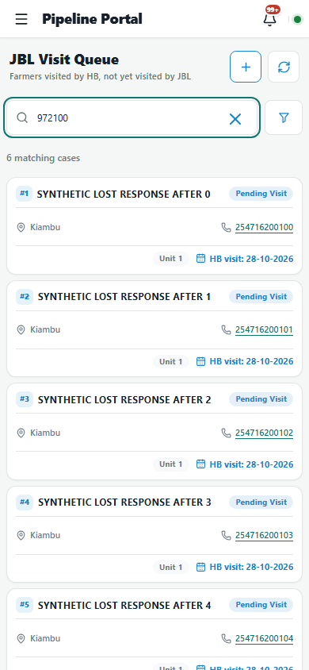](assets/before/queue.png) | [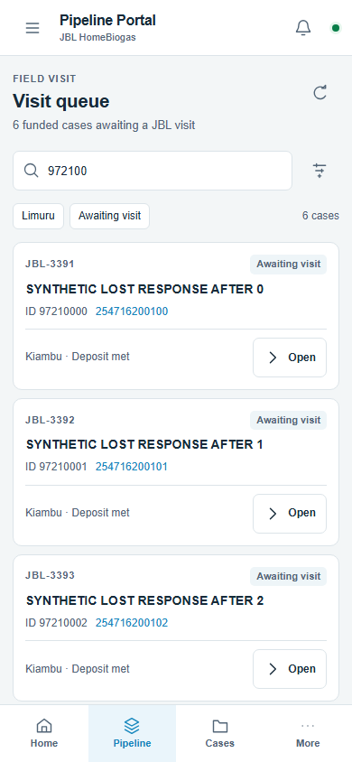](assets/after/queue-a.png) | [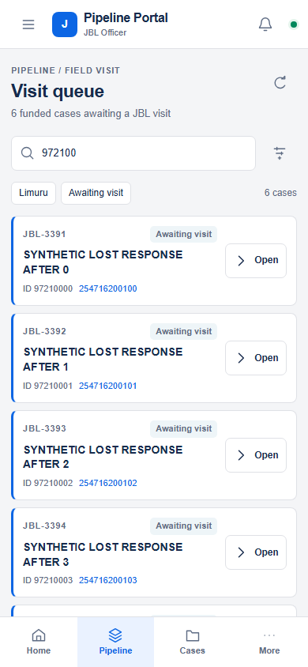](assets/after/queue-b.png) |

<a id="area-03"></a>
## 03. Visit and decision forms

**Observed opportunity:** Separate reference facts, evidence and the decision; keep negative outcomes understandable.

**A — Refinement:** Keep one form with clearer sections and conditional inputs.

**B — Redesign:** Use optional task sections with a persistent summary and submission footer.

**Recommendation: A.** The existing form can become much clearer without introducing extra required steps.

### JBL visit and evidence

Role: **JBL Officer**. State: **Unsaved visit; evidence required**. Viewport: 390 × 844.

[Comparison board](assets/boards/visit.png) · [Interactive A](preview.html?case=visit&variant=a) · [Interactive B](preview.html?case=visit&variant=b)

| Before: actual Portal | A: refinement | B: redesign |
|---|---|---|
| [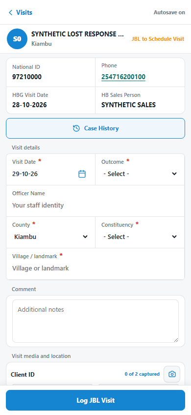](assets/before/visit.png) | [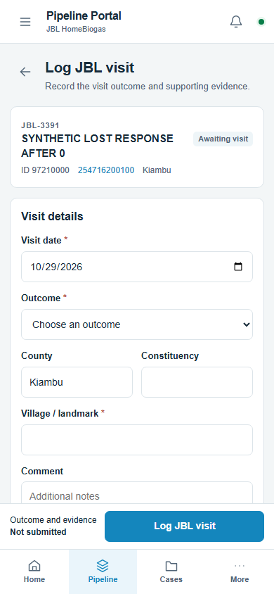](assets/after/visit-a.png) | [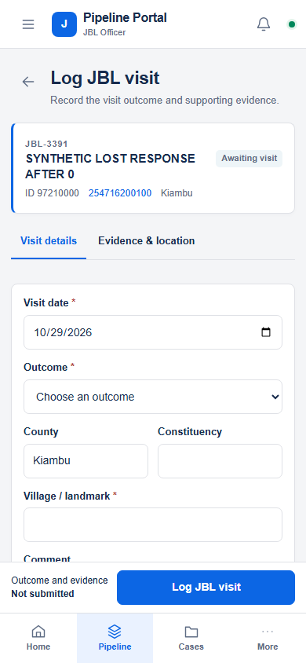](assets/after/visit-b.png) |

### Rejected credit decision

Role: **Credit Analyst**. State: **Rejected selected; not submitted**. Viewport: 390 × 844.

[Comparison board](assets/boards/credit.png) · [Interactive A](preview.html?case=credit&variant=a) · [Interactive B](preview.html?case=credit&variant=b)

| Before: actual Portal | A: refinement | B: redesign |
|---|---|---|
| [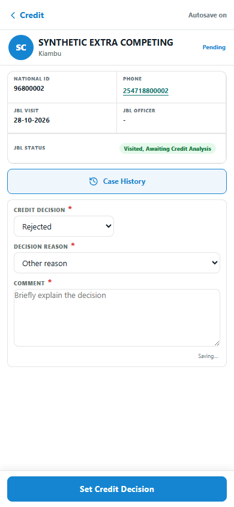](assets/before/credit.png) | [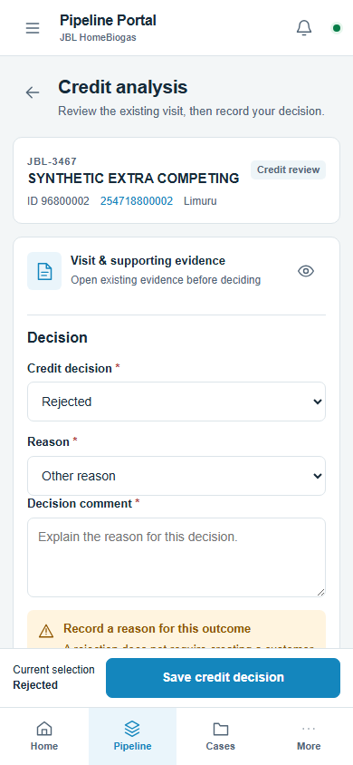](assets/after/credit-a.png) | [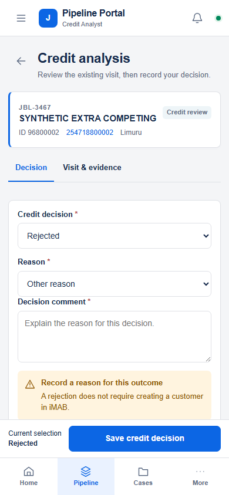](assets/after/credit-b.png) |

### Final decision, repayment and evidence

Role: **Head of Rural**. State: **Approved selected; repayment day 10; tenor six months**. Viewport: 390 × 844.

[Comparison board](assets/boards/final-review.png) · [Interactive A](preview.html?case=final-review&variant=a) · [Interactive B](preview.html?case=final-review&variant=b)

| Before: actual Portal | A: refinement | B: redesign |
|---|---|---|
| [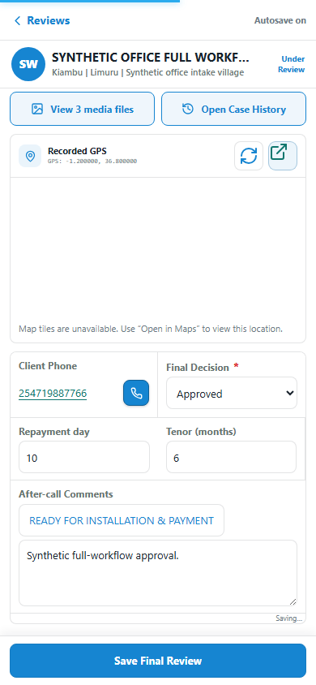](assets/before/final-review.png) | [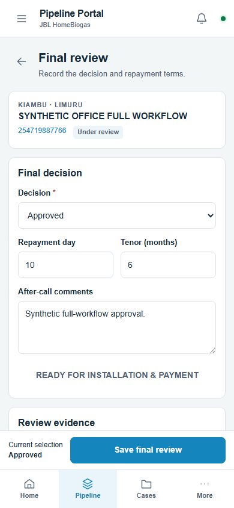](assets/after/final-review-a.png) | [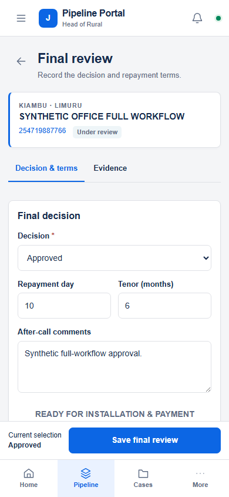](assets/after/final-review-b.png) |

<a id="area-04"></a>
## 04. Revisit and recovery handoffs

**Observed opportunity:** Show why the case is blocked, who acts and the next permitted step.

**A — Refinement:** Condense the existing warning into a structured handoff.

**B — Redesign:** Show a recovery journey with the current hold and subsequent steps.

**Recommendation: A.** The short handoff is faster for a repeated operational task.

### Expired appraisal handoff

Role: **Operations Administrator**. State: **Reappraisal required**. Viewport: 390 × 844.

[Comparison board](assets/boards/revisit.png) · [Interactive A](preview.html?case=revisit&variant=a) · [Interactive B](preview.html?case=revisit&variant=b)

| Before: actual Portal | A: refinement | B: redesign |
|---|---|---|
| [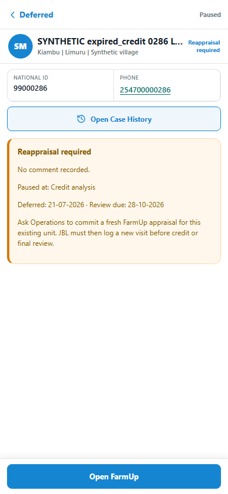](assets/before/revisit.png) | [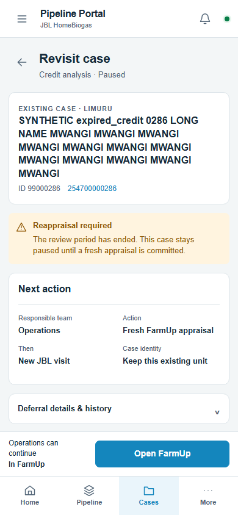](assets/after/revisit-a.png) | [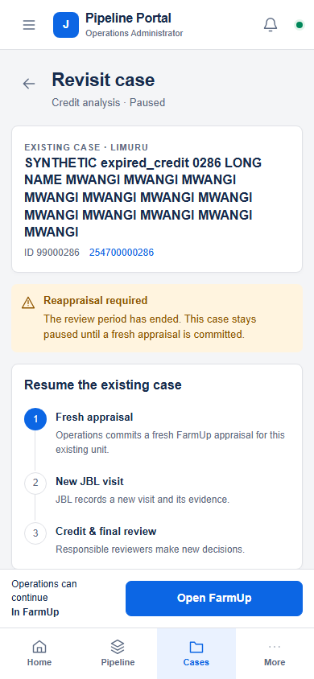](assets/after/revisit-b.png) |

<a id="area-05"></a>
## 05. FarmUp and SysUp review

**Observed opportunity:** Put rows ahead of completed upload setup, and distinguish saved work from remaining selection.

**A — Refinement:** Collapse source setup and improve the existing review toolbar.

**B — Redesign:** Use a dedicated review workspace with phone cards and a desktop grid.

**Recommendation: B.** The larger restructuring pays off for hundreds of rows; source contracts stay distinct.

### 500 selected FarmUp rows

Role: **Operations Administrator**. State: **500 selected; five unresolved**. Viewport: 390 × 844.

[Comparison board](assets/boards/farmup.png) · [Interactive A](preview.html?case=farmup&variant=a) · [Interactive B](preview.html?case=farmup&variant=b)

| Before: actual Portal | A: refinement | B: redesign |
|---|---|---|
| [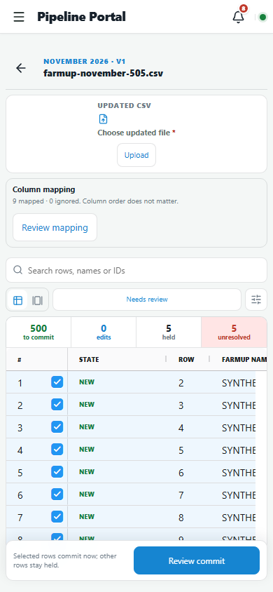](assets/before/farmup.png) | [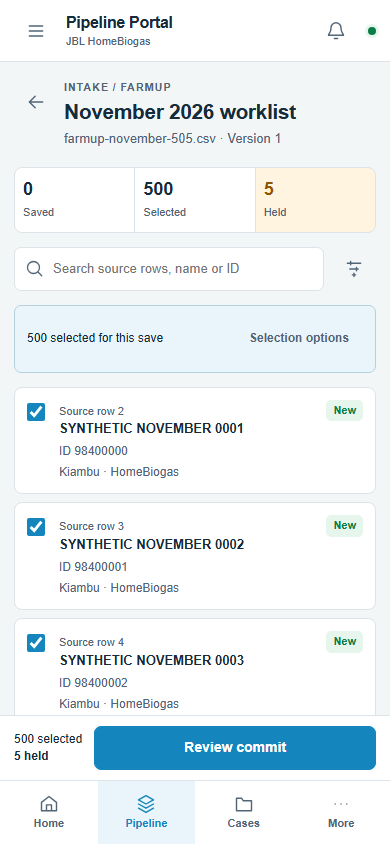](assets/after/farmup-a.png) | [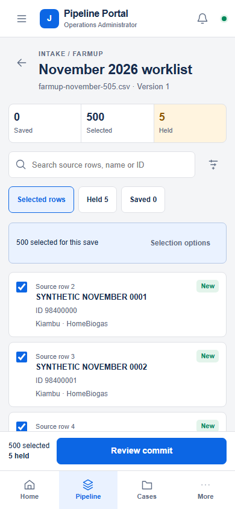](assets/after/farmup-b.png) |

### Saved rows and remaining selection

Role: **Operations Administrator**. State: **50 saved; 11 selected; one held**. Viewport: 390 × 844.

[Comparison board](assets/boards/farmup-recovery.png) · [Interactive A](preview.html?case=farmup-recovery&variant=a) · [Interactive B](preview.html?case=farmup-recovery&variant=b)

| Before: actual Portal | A: refinement | B: redesign |
|---|---|---|
| [](assets/before/farmup-recovery.png) | [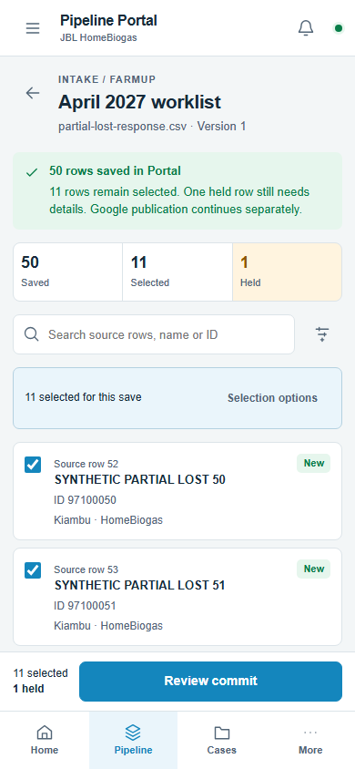](assets/after/farmup-recovery-a.png) | [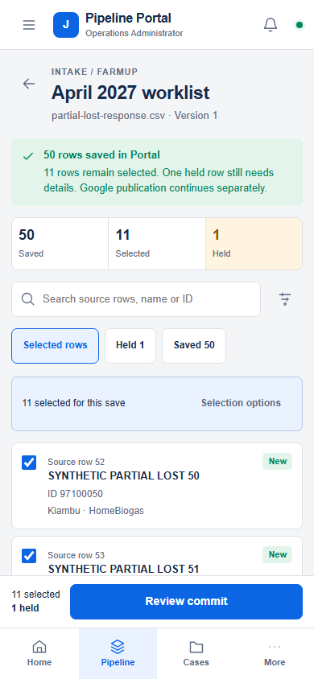](assets/after/farmup-recovery-b.png) |

### Customer-update import review

Role: **IT**. State: **50 committed; 995 held**. Viewport: 390 × 844.

[Comparison board](assets/boards/sysup.png) · [Interactive A](preview.html?case=sysup&variant=a) · [Interactive B](preview.html?case=sysup&variant=b)

| Before: actual Portal | A: refinement | B: redesign |
|---|---|---|
| [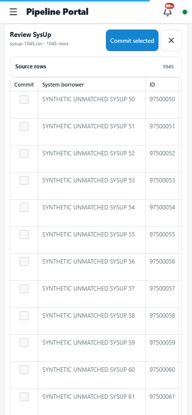](assets/before/sysup.png) | [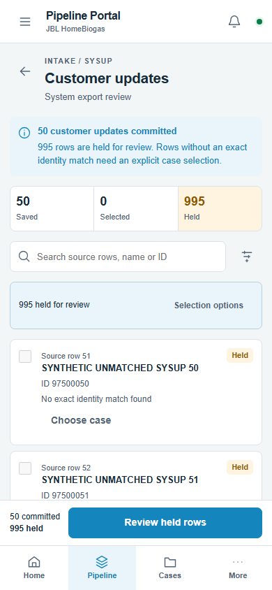](assets/after/sysup-a.png) | [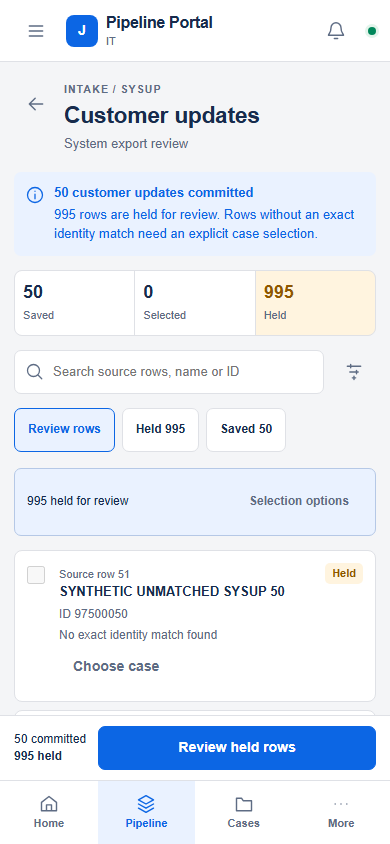](assets/after/sysup-b.png) |

<a id="area-06"></a>
## 06. Invoice identity detail

**Observed opportunity:** Surface the identity difference without repeating identical lead and applicant cards.

**A — Refinement:** Combine identical display facts and emphasize the mismatch.

**B — Redesign:** Use an explicit applicant-versus-invoice comparison.

**Recommendation: B.** A direct comparison makes the financial hold easier to understand.

### Invoice identity mismatch

Role: **Operations Administrator**. State: **Fresh household verification required**. Viewport: 390 × 844.

[Comparison board](assets/boards/invoice.png) · [Interactive A](preview.html?case=invoice&variant=a) · [Interactive B](preview.html?case=invoice&variant=b)

| Before: actual Portal | A: refinement | B: redesign |
|---|---|---|
| [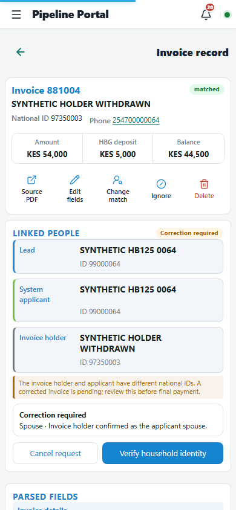](assets/before/invoice.png) | [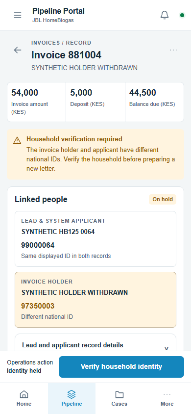](assets/after/invoice-a.png) | [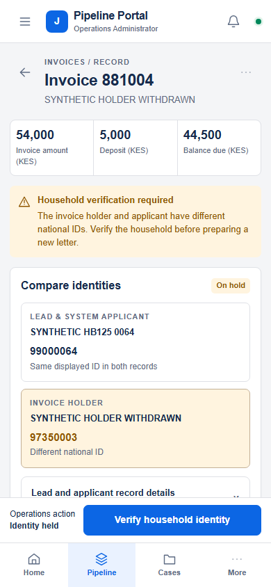](assets/after/invoice-b.png) |

<a id="area-07"></a>
## 07. Correction letters and replacement

**Observed opportunity:** Make the next action clear among letters, agreements, replacement and closure.

**A — Refinement:** Prioritize the current action; group secondary controls.

**B — Redesign:** Organize the same actions around the correction journey.

**Recommendation: B.** A stage-based layout explains both the current task and retained evidence.

### Current correction letter and next action

Role: **Operations Administrator**. State: **Version 2 agreement accepted; replacement outstanding**. Viewport: 390 × 844.

[Comparison board](assets/boards/correction.png) · [Interactive A](preview.html?case=correction&variant=a) · [Interactive B](preview.html?case=correction&variant=b)

| Before: actual Portal | A: refinement | B: redesign |
|---|---|---|
| [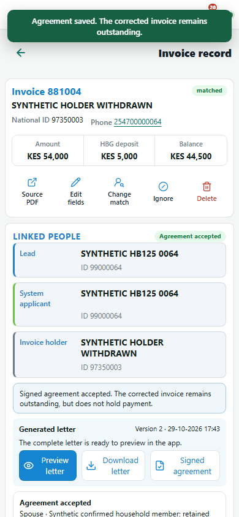](assets/before/correction.png) | [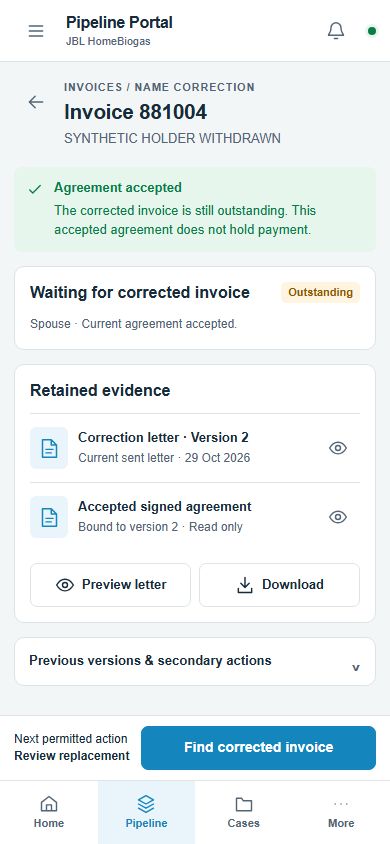](assets/after/correction-a.png) | [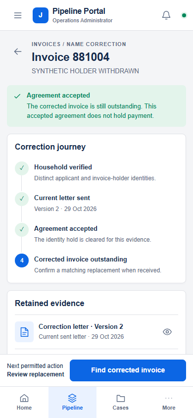](assets/after/correction-b.png) |

### Replacement-invoice selection

Role: **Operations Administrator**. State: **Awaiting corrected invoice; candidate inspection**. Viewport: 390 × 844.

[Comparison board](assets/boards/replacement.png) · [Interactive A](preview.html?case=replacement&variant=a) · [Interactive B](preview.html?case=replacement&variant=b)

| Before: actual Portal | A: refinement | B: redesign |
|---|---|---|
| [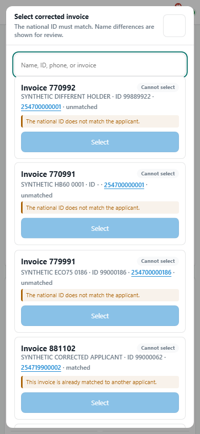](assets/before/replacement.png) | [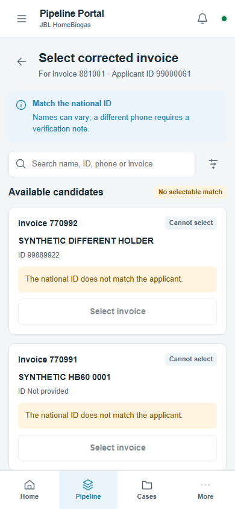](assets/after/replacement-a.png) | [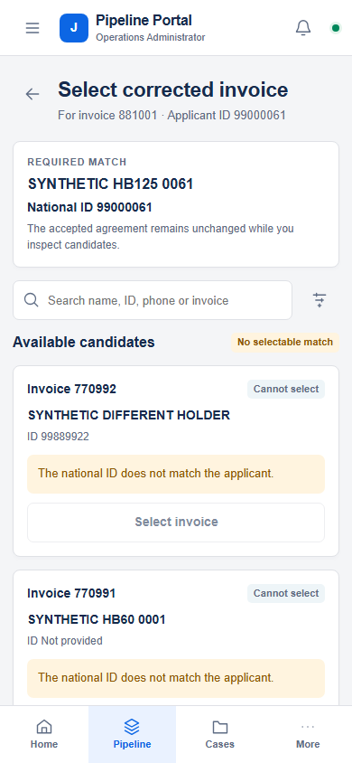](assets/after/replacement-b.png) |

<a id="area-08"></a>
## 08. Payment preparation at scale

**Observed opportunity:** Make Cash/Loan controls explicit and returned cases easy to find in a large batch.

**A — Refinement:** Keep expandable cards with labelled modes and status filters.

**B — Redesign:** Use status groups, a review list and a focused case panel.

**Recommendation: B.** The focused layout reduces repeated scrolling without adding bulk approval.

### Mixed payment: 60 cases

Role: **Operations Administrator**. State: **Draft; 60 awaiting review**. Viewport: 390 × 844.

[Comparison board](assets/boards/payment-list.png) · [Interactive A](preview.html?case=payment-list&variant=a) · [Interactive B](preview.html?case=payment-list&variant=b)

| Before: actual Portal | A: refinement | B: redesign |
|---|---|---|
| [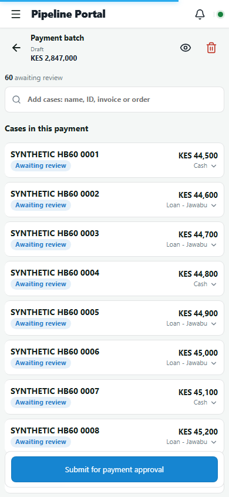](assets/before/payment-list.png) | [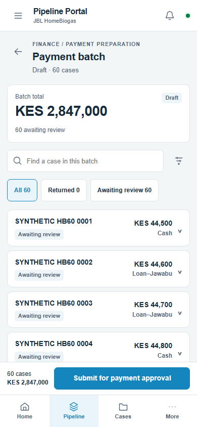](assets/after/payment-list-a.png) | [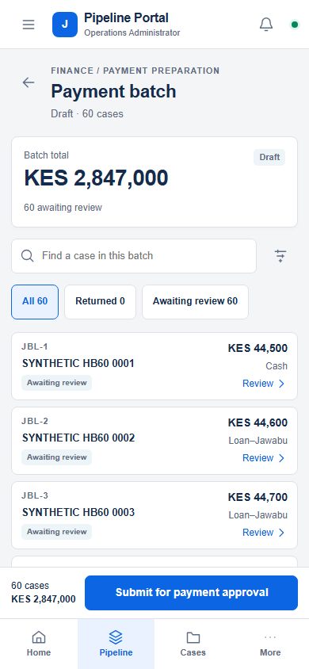](assets/after/payment-list-b.png) |

### Returned case needs correction

Role: **Operations Administrator**. State: **Four awaiting review; one returned**. Viewport: 390 × 844.

[Comparison board](assets/boards/payment-return.png) · [Interactive A](preview.html?case=payment-return&variant=a) · [Interactive B](preview.html?case=payment-return&variant=b)

| Before: actual Portal | A: refinement | B: redesign |
|---|---|---|
| [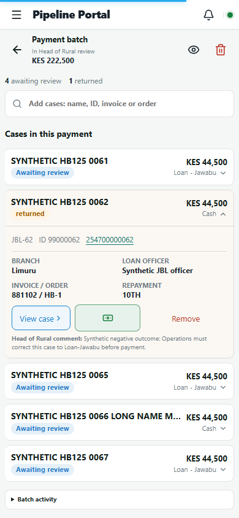](assets/before/payment-return.png) | [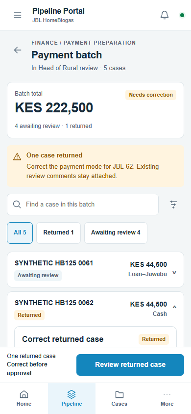](assets/after/payment-return-a.png) | [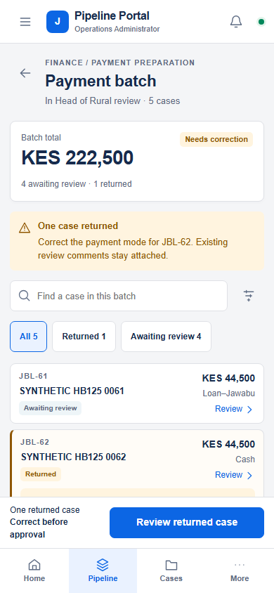](assets/after/payment-return-b.png) |

<a id="area-09"></a>
## 09. Payment handoff and completion

**Observed opportunity:** Explain the remaining task, responsible role and retained documents at each state.

**A — Refinement:** Add a clear status summary and correctly placed document actions.

**B — Redesign:** Keep a persistent financial summary with a task/evidence panel.

**Recommendation: A.** A concise summary is sufficient once the batch has been reviewed.

### Review complete; generate workbook

Role: **Head of Rural**. State: **Five reviewed; no official number allocated yet**. Viewport: 390 × 844.

[Comparison board](assets/boards/payment-review.png) · [Interactive A](preview.html?case=payment-review&variant=a) · [Interactive B](preview.html?case=payment-review&variant=b)

| Before: actual Portal | A: refinement | B: redesign |
|---|---|---|
| [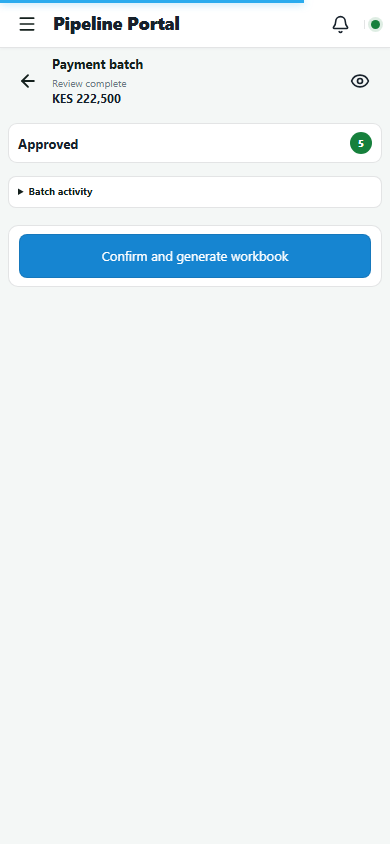](assets/before/payment-review.png) | [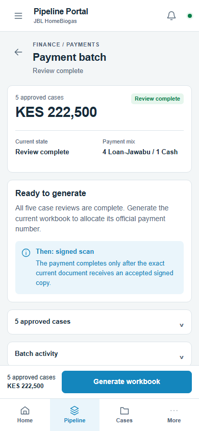](assets/after/payment-review-a.png) | [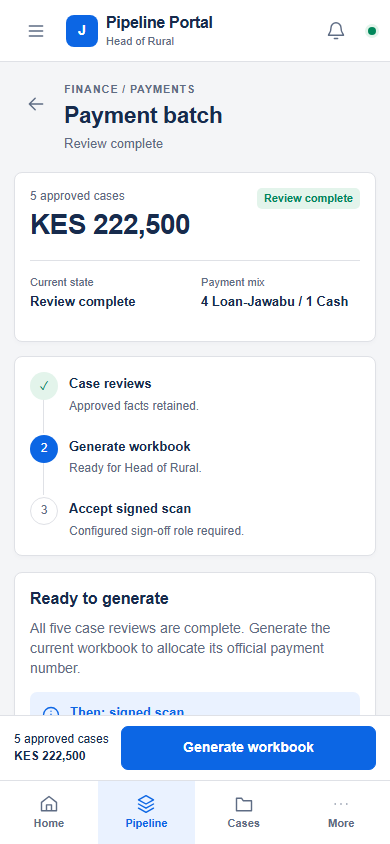](assets/after/payment-review-b.png) |

### 61-case payment ready for its current workbook

Role: **Head of Rural**. State: **Payment #1; 61 reviewed; current workbook required**. Viewport: 390 × 844.

[Comparison board](assets/boards/payment-61.png) · [Interactive A](preview.html?case=payment-61&variant=a) · [Interactive B](preview.html?case=payment-61&variant=b)

| Before: actual Portal | A: refinement | B: redesign |
|---|---|---|
| [](assets/before/payment-61.png) | [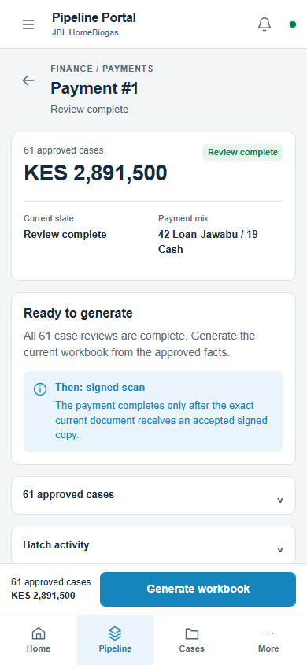](assets/after/payment-61-a.png) | [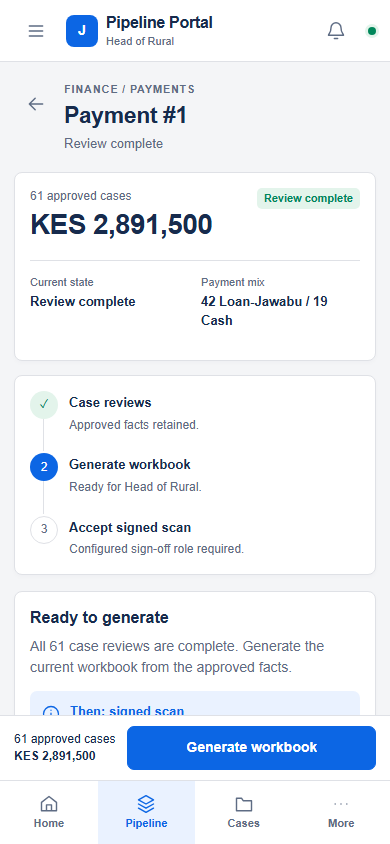](assets/after/payment-61-b.png) |

### Waiting for the configured sign-off role

Role: **Operations Administrator**. State: **Payment #3; awaiting signed scan**. Viewport: 390 × 844.

[Comparison board](assets/boards/payment-scan.png) · [Interactive A](preview.html?case=payment-scan&variant=a) · [Interactive B](preview.html?case=payment-scan&variant=b)

| Before: actual Portal | A: refinement | B: redesign |
|---|---|---|
| [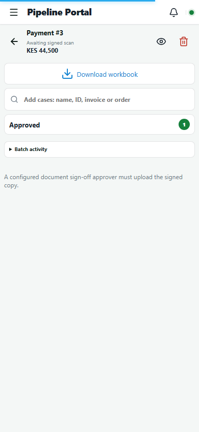](assets/before/payment-scan.png) | [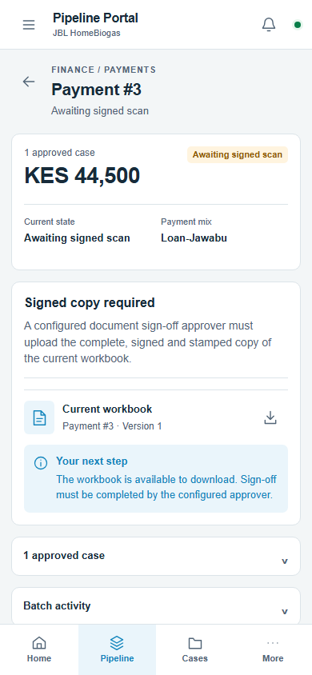](assets/after/payment-scan-a.png) | [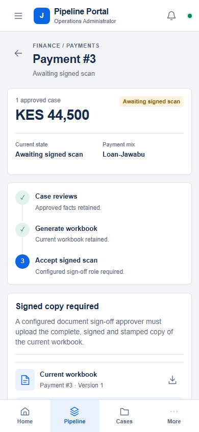](assets/after/payment-scan-b.png) |

### Completed payment and retained evidence

Role: **Operations Administrator**. State: **Payment #2; completed**. Viewport: 390 × 844.

[Comparison board](assets/boards/payment-done.png) · [Interactive A](preview.html?case=payment-done&variant=a) · [Interactive B](preview.html?case=payment-done&variant=b)

| Before: actual Portal | A: refinement | B: redesign |
|---|---|---|
| [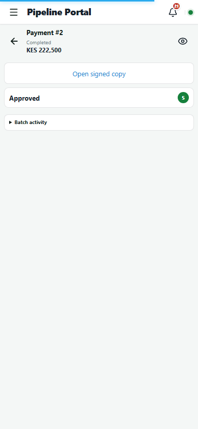](assets/before/payment-done.png) | [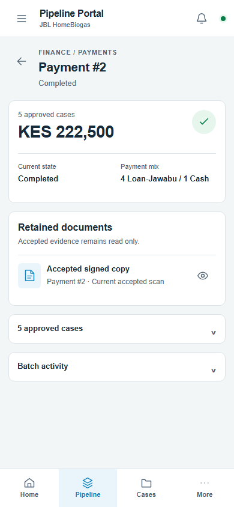](assets/after/payment-done-a.png) | [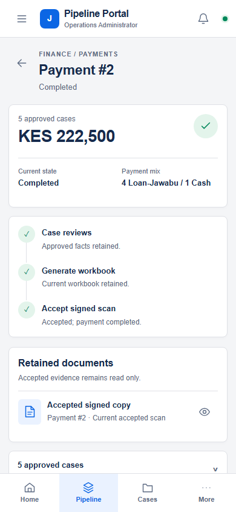](assets/after/payment-done-b.png) |

<a id="area-10"></a>
## 10. Orders, archives and previews

**Observed opportunity:** Distinguish current version, signed evidence, retained history and repeated display numbers.

**A — Refinement:** Use consistent metadata and labelled document actions.

**B — Redesign:** Use a document list and contextual detail/preview panel.

**Recommendation: B.** The split view is useful on desktop; mobile retains a dedicated detail.

### Large order archive

Role: **Operations Administrator**. State: **Retained order workspaces**. Viewport: 390 × 844.

[Comparison board](assets/boards/orders.png) · [Interactive A](preview.html?case=orders&variant=a) · [Interactive B](preview.html?case=orders&variant=b)

| Before: actual Portal | A: refinement | B: redesign |
|---|---|---|
| [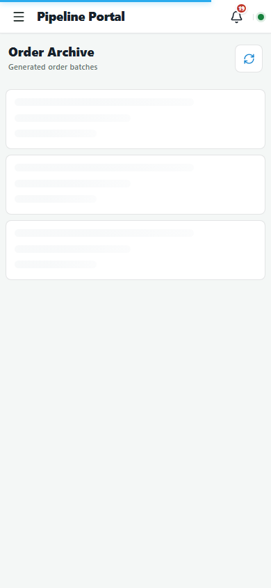](assets/before/orders.png) | [](assets/after/orders-a.png) | [](assets/after/orders-b.png) |

### Desktop document history

Role: **IT**. State: **Retained orders; independent workspaces**. Viewport: 1280 × 844.

[Comparison board](assets/boards/history-desktop.png) · [Interactive A](preview.html?case=history-desktop&variant=a) · [Interactive B](preview.html?case=history-desktop&variant=b)

| Before: actual Portal | A: refinement | B: redesign |
|---|---|---|
| [](assets/before/history-desktop.png) | [](assets/after/history-desktop-a.png) | [](assets/after/history-desktop-b.png) |

### Retained 61-case payment preview

Role: **Operations Administrator**. State: **Read-only retained workbook**. Viewport: 390 × 844.

[Comparison board](assets/boards/document.png) · [Interactive A](preview.html?case=document&variant=a) · [Interactive B](preview.html?case=document&variant=b)

| Before: actual Portal | A: refinement | B: redesign |
|---|---|---|
| [](assets/before/document.png) | [](assets/after/document-a.png) | [](assets/after/document-b.png) |

<a id="area-11"></a>
## 11. Reports and Performance

**Observed opportunity:** Clarify scope, filters, metrics and empty states without inventing scores.

**A — Refinement:** Reorder existing controls and reduce competing visual weight.

**B — Redesign:** Use an overview-to-detail layout with coordinated charts and cases.

**Recommendation: A.** Reports need a clearer hierarchy more than new navigation.

### Mobile pipeline report

Role: **IT**. State: **All branches; 3,277 cases in scope**. Viewport: 390 × 844.

[Comparison board](assets/boards/reports.png) · [Interactive A](preview.html?case=reports&variant=a) · [Interactive B](preview.html?case=reports&variant=b)

| Before: actual Portal | A: refinement | B: redesign |
|---|---|---|
| [](assets/before/reports.png) | [](assets/after/reports-a.png) | [](assets/after/reports-b.png) |

### Desktop rejected-outcome report

Role: **IT**. State: **Rejected outcome; three matching cases**. Viewport: 1280 × 844.

[Comparison board](assets/boards/reports-desktop.png) · [Interactive A](preview.html?case=reports-desktop&variant=a) · [Interactive B](preview.html?case=reports-desktop&variant=b)

| Before: actual Portal | A: refinement | B: redesign |
|---|---|---|
| [](assets/before/reports-desktop.png) | [](assets/after/reports-desktop-a.png) | [](assets/after/reports-desktop-b.png) |

### Performance period and standings

Role: **IT**. State: **Current authorized period**. Viewport: 390 × 844.

[Comparison board](assets/boards/performance.png) · [Interactive A](preview.html?case=performance&variant=a) · [Interactive B](preview.html?case=performance&variant=b)

| Before: actual Portal | A: refinement | B: redesign |
|---|---|---|
| [](assets/before/performance.png) | [](assets/after/performance-a.png) | [](assets/after/performance-b.png) |

<a id="area-12"></a>
## 12. Alerts, dialogs and uploads

**Observed opportunity:** Avoid repeated messages and keep file, error and recovery controls together.

**A — Refinement:** One persistent task error and a clear selected-file card.

**B — Redesign:** A focused task sheet with document context and a recovery section.

**Recommendation: A.** The familiar dialog works well once feedback and file selection are organized.

### Agreement upload after access was revoked

Role: **Operations Administrator**. State: **403; agreed-letter.pdf and confirmation retained**. Viewport: 390 × 844.

[Comparison board](assets/boards/upload-error.png) · [Interactive A](preview.html?case=upload-error&variant=a) · [Interactive B](preview.html?case=upload-error&variant=b)

| Before: actual Portal | A: refinement | B: redesign |
|---|---|---|
| [](assets/before/upload-error.png) | [](assets/after/upload-error-a.png) | [](assets/after/upload-error-b.png) |

### Saved data versus Google publication

Role: **Operations Administrator**. State: **50 saved; zero of 50 Sheet updates complete**. Viewport: 390 × 844.

[Comparison board](assets/boards/publication.png) · [Interactive A](preview.html?case=publication&variant=a) · [Interactive B](preview.html?case=publication&variant=b)

| Before: actual Portal | A: refinement | B: redesign |
|---|---|---|
| [](assets/before/publication.png) | [](assets/after/publication-a.png) | [](assets/after/publication-b.png) |

<a id="area-13"></a>
## 13. Settings and IT recovery

**Observed opportunity:** Separate account information, personal preferences and operational recovery.

**A — Refinement:** Group the existing settings and fix help-text wrapping.

**B — Redesign:** Use settings categories and an actionable IT status panel.

**Recommendation: A.** Most preferences are occasional tasks and fit a simple grouped page.

### Personal workspace preferences

Role: **IT**. State: **Existing account and work defaults**. Viewport: 390 × 844.

[Comparison board](assets/boards/settings.png) · [Interactive A](preview.html?case=settings&variant=a) · [Interactive B](preview.html?case=settings&variant=b)

| Before: actual Portal | A: refinement | B: redesign |
|---|---|---|
| [](assets/before/settings.png) | [](assets/after/settings-a.png) | [](assets/after/settings-b.png) |

### IT publication recovery

Role: **IT**. State: **Reviewed retry required for exhausted operation**. Viewport: 390 × 844.

[Comparison board](assets/boards/it-status.png) · [Interactive A](preview.html?case=it-status&variant=a) · [Interactive B](preview.html?case=it-status&variant=b)

| Before: actual Portal | A: refinement | B: redesign |
|---|---|---|
| [](assets/before/it-status.png) | [](assets/after/it-status-a.png) | [](assets/after/it-status-b.png) |

## Interactions observed in Playwright

[Raw interaction observations](interaction-observations.json) · [Capture observations](capture-observations.json)

- Queue search shows an explicit empty state; clearing it restores rows. Opening the second case keeps that case’s ID and phone, rather than displaying the first record.
- Credit outcome changes reveal the relevant fields. Cancelling confirmation keeps the typed note. Optional visit/evidence sections keep entered values and local file selection.
- Final rejection reveals its reason and hides the approval phrase shortcut. Clicking the approval shortcut twice adds its exact phrase once.
- Deselecting one of 500 FarmUp rows leaves 499 selected in both the summary and confirmation. The held filter shows five held rows.
- Returned-payment filtering shows the single returned case. A local mode change remains visible after closing the case panel; it does not approve the case.
- Both upload variants retain the chosen filename and confirmation after denied retry. The external review control can simulate restored access without changing any grant.
- Document navigation reaches the exact retained page-three image. Zoom scrolls inside the document viewport and does not widen the app.
- Empty Performance period and restoring the recorded period are distinct. Settings categories retain the selected preference.
- Gallery search, Before/A/B switching, image enlargement and Escape-to-close were exercised.

Selected interaction frames:

| Interaction | Image |
|---|---|
| Visit evidence section | [B](assets/interactions/visit-evidence-section-b.png) |
| Approved credit fields | [B](assets/interactions/credit-approval-fields-b.png) |
| Rejected final-review fields | [B](assets/interactions/final-rejected-fields-b.png) |
| Bulk confirmation after deselection | [B](assets/interactions/farmup-confirmation-b.png) |
| Returned payment detail | [B](assets/interactions/payment-returned-case-b.png) |
| Denied upload keeps file | [A](assets/interactions/upload-denied-retained-a.png) · [B](assets/interactions/upload-denied-retained-b.png) |
| Retained page three | [B](assets/interactions/retained-document-page-three-b.png) |
| Explicit empty Performance period | [B](assets/interactions/performance-empty-period-b.png) |

## Workflow boundaries

- Role-filtered Portal navigation remains server-owned. Preview navigation offers only local comparisons for the shown role. It grants no operational access.
- Lead/applicant display deduplication never merges customer identities. Verification, ID discrepancies, notes and current-letter binding remain required.
- No bulk approval, automatic warning acknowledgement, customer-verification badge, new messaging, new scoring policy, financial recalculation or invented backend field was added.
- Reused order numbers do not combine independent workspaces. Document preview displays the actual retained synthetic exported page images unchanged.
- The preview makes no operational API calls, sends no file, requests no camera/GPS and prevents prototype phone links from launching a call. Controls show local interactions or a clearly labelled simulated response.
- Existing deposit eligibility, case revisions, approval ordering, source checksums and signed-document finality are not replaced by a visual stepper.

## Open or reproduce

Open `index.html` directly; all gallery, preview, fixture and image assets are local. For an HTTP preview from the repository root:

```powershell
.venv/Scripts/python.exe -m http.server 8778 --bind 127.0.0.1 --directory docs/ui-standard/reviews/portal-ux-options-2026-10-29
```

Then open `http://127.0.0.1:8778/`. The static server never initializes Django or deployment settings. To recapture the after options while that server is running:

```powershell
node docs/ui-standard/reviews/portal-ux-options-2026-10-29/capture.cjs
node docs/ui-standard/reviews/portal-ux-options-2026-10-29/interactions.cjs
node docs/ui-standard/reviews/portal-ux-options-2026-10-29/export.cjs
```

These are direct Playwright capture/review drivers, with recorded observations and errors, no assertions and no test runner. They do not produce a passing-test certificate. The generator `prepare.cjs` and actual-baseline driver require the original ignored synthetic review inputs/server; the completed pack and after captures do not.

## Provenance and limits

- [Manifest](manifest.json) records source and image hashes, source screenshot paths, roles, states, viewports and dates. Synthetic PNGs are individually hash-pinned under an exact-folder artifact classification; approved visual baseline hashes are unchanged.
- The code/CSS and screenshot under `Stitch/Main Page` informed B. No remote reference asset was copied into an operational app. This review does not constitute Phase 6 adoption.
- This pack covers the approved thirteen improvement areas. It is not a newly designed page for every Portal destination: unaffected HB commissioned records, for example, retain their existing summary/evidence pattern.
- No production UI, API, schema, grants, financial state or release flags were changed. The only non-document edits register the synthetic assets and candidate sources.
- Physical Telegram, camera/GPS, screen readers, real providers and deployment were not checked. No test suites, lint, type checks or visual-baseline updates were run.

